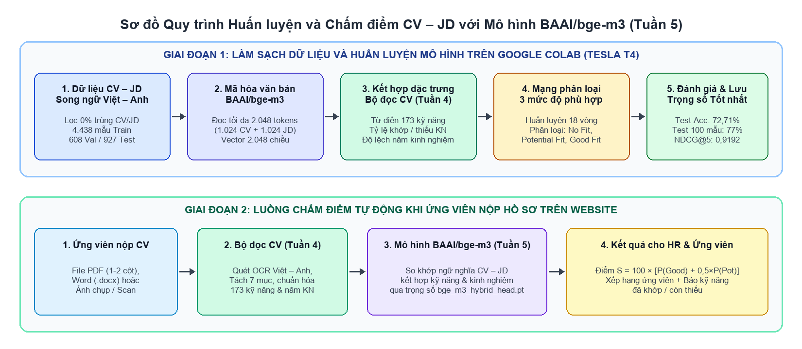
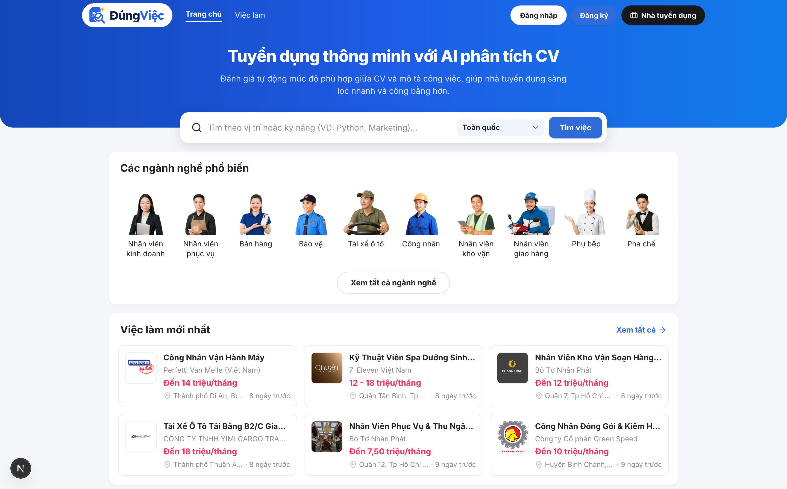
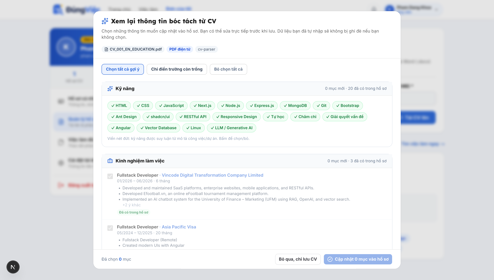
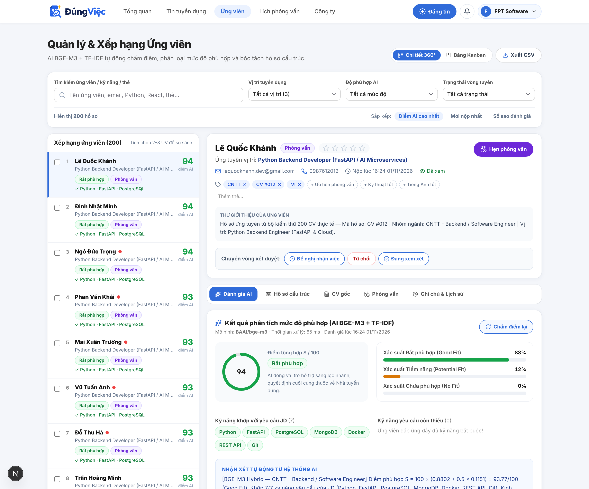

# BÁO CÁO RÀ SOÁT TIẾN ĐỘ THỰC HIỆN ĐỀ TÀI

### Đề tài: Xây dựng website hỗ trợ tuyển dụng ứng dụng AI trong phân tích CV và đánh giá mức độ phù hợp với vị trí tuyển dụng

| Thông tin chung | Nội dung chi tiết |
| --- | --- |
| **Sinh viên thực hiện** | Phạm Đăng Khoa — MSSV: 24810114 |
| **Giảng viên hướng dẫn** | ThS. Đoàn Văn Thanh Phong |
| **Tên hệ thống xây dựng** | Đúng Việc — Website hỗ trợ tuyển dụng ứng dụng AI |
| **Ngày cập nhật tiến độ** | 14/11/2026 |
| **Tiến độ sản phẩm Demo** | Đạt khoảng **85%** (Đã ghép nối và chạy thông luồng giữa Website Next.js và Dịch vụ AI Python) |

---

## 1. Tổng quan tiến độ hiện tại theo từng hạng mục

Đến thời điểm hiện tại, em đã hoàn thành phần cốt lõi của cả **Dịch vụ AI xử lý CV – chấm điểm song ngữ** lẫn **Giao diện & nghiệp vụ Website cho 2 vai trò (Ứng viên, Nhà tuyển dụng)**, đảm bảo hệ thống chạy xuyên suốt từ bước đăng tin tuyển dụng, nộp CV ứng tuyển đến bước AI tự động phân tích và xếp hạng hồ sơ cho HR.

| STT | Hạng mục công việc | Mức độ hoàn thành | Trạng thái hiện tại |
| --- | --- | --- | --- |
| 1 | Khảo sát bài toán, phân tích yêu cầu, thiết kế kiến trúc & CSDL | 100% | Đã hoàn thành |
| 2 | Bộ đọc file CV đa định dạng (PDF 1–2 cột, Word, ảnh Scan OCR) & trích xuất thực thể | 95% | Đã hoàn thành |
| 3 | Làm sạch dữ liệu & huấn luyện mô hình chấm điểm song ngữ BAAI/bge-m3 | 95% | Đã hoàn thành |
| 4 | Xây dựng Website (Phân hệ Ứng viên & Phân hệ Nhà tuyển dụng) tích hợp AI | 85% | Đã chạy thông luồng Demo |
| 5 | Kiểm thử tích hợp toàn hệ thống (End-to-End) & viết cuốn Báo cáo tổng kết | 35% | Đang thực hiện |

---

## 2. Các tính năng ĐÃ LÀM (Done)

### 2.1. Phân tích thiết kế hệ thống & Cơ sở dữ liệu
- Xác định phạm vi nghiệp vụ gồm 4 Use Case trọng tâm (Đăng & quản lý tin tuyển dụng; Tìm việc & ứng tuyển bằng CV; AI bóc tách & chấm điểm mức độ phù hợp CV – JD; Sàng lọc & xếp hạng ứng viên theo điểm AI) và bộ quy tắc nghiệp vụ chặt chẽ.
- Thiết kế kiến trúc tách biệt giữa **Web Application** (`Next.js 16`, `React 19`, `TypeScript`, `Tailwind CSS`, `shadcn/ui`) và **AI Service** (`Python`, `FastAPI`, `PyTorch`).
- Thiết kế cấu trúc 6 bảng/collection dữ liệu cốt lõi (`users`, `companies`, `jobs`, `cv_profiles`, `applications`, `ai_evaluations`) và hoàn thiện bộ 6 sơ đồ thiết kế (Use Case, Quy trình nghiệp vụ, ERD, Pipeline AI, Kiến trúc hệ thống, Sơ đồ trạng thái hồ sơ).

### 2.2. Mô-đun AI đọc file CV & chấm điểm độ phù hợp (ai-service)
- **Đọc file CV đa định dạng:** Xử lý tự động file `.pdf` văn bản (nhận diện bố cục trình bày 1 cột và 2 cột thiết kế trên Canva/TopCV để đọc đúng thứ tự không bị trộn dòng), file `.docx` và file PDF dạng ảnh chụp/bản scan thông qua OCR song ngữ Việt – Anh (`RapidOCR` kết hợp `Tesseract 5`). Kiểm thử thực nghiệm đạt `100%` trên bộ 10 mẫu CV đa bố cục (thời gian đọc PDF thường trung bình `0,23 giây/CV`) và bóc tách thành công `15/15` file CV Scan thực tế.
- **Trích xuất thông tin & chuẩn hóa kỹ năng:** Phân tách CV thành 7 mục nội dung, xây dựng bộ từ điển **173 kỹ năng** chuẩn hóa thuộc 10 nhóm ngành (kèm 645 cách viết đồng nghĩa Việt – Anh), trích xuất thông tin liên hệ, học vấn và tính chính xác tổng số năm kinh nghiệm làm việc (tách riêng năm học đại học và tự động gộp các khoảng thời gian làm việc trùng nhau).
- **Huấn luyện & tích hợp mô hình chấm điểm `BAAI/bge-m3`:**
  - Khắc phục triệt để hiện tượng rò rỉ dữ liệu ở mô hình thử nghiệm ban đầu (`0%` trùng CV và `0%` trùng JD giữa các tập Train – Validation – Test), đồng thời bổ sung dữ liệu CV – JD song ngữ Việt – Anh (`VI-VI`, `EN-EN`, `EN-VI`, `VI-EN`).
  - Kết hợp biểu diễn ngữ nghĩa văn bản dài (`2.048 tokens`) của `BAAI/bge-m3` với 18 chỉ số so khớp kỹ năng và độ lệch số năm kinh nghiệm từ bộ đọc CV.
  - Kết quả trên tập Test độc lập (`927` mẫu) đạt độ chính xác **Accuracy `72,71%`**, **Macro F1 đạt `0,7220`** (tăng `+27,85%` so với mô hình cơ sở `DistilBERT`), đạt **`77/100`** trên bộ kiểm thử xuất Excel và chất lượng xếp hạng ứng viên cho HR đạt **`Mean NDCG@5 = 0,9192`** (`Recall@5 = 89,05%`).
- **Quy đổi điểm số & giải thích kết quả:** Chuyển xác suất dự đoán thành thang điểm liên tục `0 – 100` theo công thức `S = 100 × [ P(Good Fit) + 0,5 × P(Potential Fit) ]`, gắn nhãn 3 mức độ (`Good Fit`, `Potential Fit`, `No Fit`) kèm danh sách kỹ năng đã đáp ứng và kỹ năng còn thiếu so với JD.

### 2.3. Phân hệ dành cho Ứng viên trên Website (web)
- **Trang chủ (`/`) & Tìm kiếm việc làm (`/viec-lam`):** Tìm kiếm theo từ khóa công việc/kỹ năng, lọc kết hợp theo danh mục ngành nghề, hình thức làm việc, cấp bậc thâm niên và danh sách 34 tỉnh/thành phố Việt Nam; xem chi tiết tin tuyển dụng (`/viec-lam/[slug]`) và trang giới thiệu doanh nghiệp (`/cong-ty/[slug]`).
- **Đăng ký & Đăng nhập (`/dang-ky`, `/dang-nhap`):** Hỗ trợ chuyển đổi vai trò *Ứng viên / Nhà tuyển dụng* trực quan và kiểm tra định dạng dữ liệu đầu vào.
- **Quản lý tài khoản, hồ sơ & tự động điền thông tin từ CV (`/ung-vien/tai-khoan`):** Cho phép tải lên và quản lý nhiều phiên bản CV (`.pdf`, `.docx`), gọi trực tiếp API bóc tách CV của AI và hiển thị hộp thoại đối chiếu thông tin (`CvReviewDialog`) đánh dấu các trường *Mới / Khác hồ sơ* để ứng viên xác nhận cập nhật nhanh vào hồ sơ cá nhân.
- **Nộp đơn ứng tuyển & Theo dõi trạng thái (`/ung-vien/don-ung-tuyen`):** Ứng tuyển bằng CV đã lưu hoặc tải CV mới kèm thư giới thiệu (`ApplyDialog`), kiểm tra chống nộp trùng vào cùng một công việc, theo dõi tiến trình xử lý hồ sơ (*Đã nộp → Đang xem xét → Mời phỏng vấn → Trúng tuyển / Chưa phù hợp*). Điểm số AI và ghi chú đánh giá nội bộ của HR được ẩn hoàn toàn khỏi giao diện và API phía ứng viên theo đúng quy tắc phân quyền.

### 2.4. Phân hệ dành cho Nhà tuyển dụng — HR trên Website (web)
- **Xác thực doanh nghiệp tự động bằng Mã số thuế:** Tích hợp tra cứu Mã số thuế doanh nghiệp tự động phía máy chủ (qua dịch vụ VietQR) để lấy chính xác tên pháp lý và địa chỉ đăng ký kinh doanh, kiểm tra chống trùng mã số thuế và quản lý trang Hồ sơ công ty (`/nha-tuyen-dung/cong-ty`).
- **Quản lý tin tuyển dụng (`/nha-tuyen-dung/tin-tuyen-dung`):** Tạo mới, chỉnh sửa, tạm dừng, đóng hoặc mở lại tin tuyển dụng (`JobFormDialog`) với trường kỹ năng yêu cầu và số năm kinh nghiệm tối thiểu phục vụ chấm điểm AI.
- **Sàng lọc & Xếp hạng ứng viên theo điểm AI (`/nha-tuyen-dung/ung-vien`):**
  - Hiển thị danh sách hồ sơ nộp vào từng vị trí được sắp xếp tự động theo điểm AI từ cao xuống thấp (`0 – 100`) kèm nhãn phân loại 3 mức độ (`Good Fit`, `Potential Fit`, `No Fit`).
  - Xem chi tiết xác suất từng lớp, các thẻ **Kỹ năng khớp (màu xanh)** và **Kỹ năng còn thiếu (màu đỏ)**, đọc trực tiếp file CV PDF gốc ngay trên trình duyệt, đặt các ứng viên cạnh nhau để đối chiếu (`CompareDialog`), chuyển trạng thái duyệt hồ sơ và lưu ghi chú nội bộ.
- **Quản lý lịch phỏng vấn, Thông báo & Trang Tổng quan thống kê:**
  - Đặt lịch phỏng vấn Online/Offline cho ứng viên đạt yêu cầu và hỗ trợ xuất file lịch chuẩn `.ics` (`/nha-tuyen-dung/lich-phong-van`).
  - Tích hợp chuông thông báo (`NotificationBell`) cập nhật trạng thái đơn ứng tuyển và lịch hẹn.
  - Xây dựng trang Tổng quan tuyển dụng (`/nha-tuyen-dung/tong-quan`) thống kê các chỉ số KPI, biểu đồ phân bố mức độ phù hợp AI và danh sách ứng viên nổi bật.

---

## 3. Các tính năng & công việc ĐANG LÀM (In Progress)

| STT | Đầu việc đang triển khai | Nội dung chi tiết | Tiến độ ước tính |
| --- | --- | --- | --- |
| 1 | Kiểm thử tích hợp toàn luồng trên 200 CV thực tế | Chạy thử nghiệm xuyên suốt từ giao diện nộp đơn đến bảng xếp hạng HR với bộ 200 file CV nhiều ngành nghề và định dạng (1 cột, 2 cột, DOCX, ảnh scan) để xử lý các trường hợp ngoại lệ. | ~60% |
| 2 | Rà soát tự động hóa nghiệp vụ & trải nghiệm giao diện | Kiểm tra kỹ cơ chế tự động tính lại điểm AI (`Re-score`) khi HR chỉnh sửa yêu cầu kỹ năng/kinh nghiệm trên JD, tự động đóng tin quá hạn nộp (`deadline`), và cải thiện hiển thị trạng thái chờ khi quét OCR các file CV ảnh dung lượng lớn. | ~70% |
| 3 | Chuẩn hóa dữ liệu mẫu & lớp lưu trữ CSDL | Đồng bộ dữ liệu chạy thử với cấu trúc schema CSDL (`MongoDB` / `PostgreSQL` đã thiết kế sẵn trong thư mục `database/`) và chuẩn bị bộ kịch bản dữ liệu thực tế cho buổi Demo. | ~50% |
| 4 | Hệ thống hóa nội dung vào khung Báo cáo tổng kết | Biên tập và ghép nối nội dung từ các báo cáo thành phần đã thực hiện (Tuần 1 đến Tuần 6) vào bố cục các chương của cuốn Báo cáo Tiểu luận tốt nghiệp. | ~40% |

---

## 4. Các công việc DỰ KIẾN LÀM (Planned)

Trong giai đoạn tiếp theo cho đến khi hoàn tất học phần, em dự kiến thực hiện tuần tự 3 nhóm công việc sau:

1. **Đo đạc hiệu năng thực tế & hoàn thành Biên bản kiểm thử (Test Cases):**
   - Lập bảng kịch bản kiểm thử chức năng (Functional Test Cases) cho toàn bộ các luồng của Ứng viên, Nhà tuyển dụng và Dịch vụ AI.
   - Thống kê thời gian phản hồi thực tế của hệ thống ở từng khâu (tải file CV, bóc tách văn bản/OCR, chấm điểm `BAAI/bge-m3`, truy vấn bảng xếp hạng ứng viên) để đưa số liệu định lượng vào chương Thực nghiệm & Đánh giá.
2. **Hoàn thiện cuốn Báo cáo Tiểu luận tốt nghiệp hoàn chỉnh:**
   - Viết hoàn chỉnh các chương về Triển khai hệ thống, Kết quả thực nghiệm tích hợp, Kết luận – Hạn chế và Hướng phát triển mở rộng.
   - Rà soát thống nhất định dạng văn bản, đánh số hình ảnh, bảng biểu và danh mục tài liệu tham khảo theo đúng quy định của Khoa.
3. **Thiết kế Slide thuyết trình & chuẩn bị kịch bản Demo bảo vệ:**
   - Chuẩn bị slide báo cáo ngắn gọn, tập trung vào bài toán thực tế, kiến trúc pipeline AI song ngữ `BAAI/bge-m3` và kết quả thực nghiệm.
   - Chuẩn bị sẵn kịch bản Demo trực tiếp trên hệ thống (tạo tin tuyển dụng mới → nộp thử các mẫu CV phù hợp / thiếu kinh nghiệm / trái ngành → đối chiếu bảng xếp hạng AI bên phía HR).

---

## 5. Hình ảnh minh họa kết quả hệ thống hiện tại

*Hình 1. Sơ đồ quy trình kết hợp mô hình ngôn ngữ BAAI/bge-m3 và bộ trích xuất thông tin CV trong hệ thống.*

*Hình 2. Giao diện màn hình Trang chủ và tìm kiếm việc làm của hệ thống Đúng Việc.*

*Hình 3. Chức năng AI đọc file CV và đối chiếu tự động điền thông tin hồ sơ cho Ứng viên.*

*Hình 4. Giao diện Nhà tuyển dụng sàng lọc, xếp hạng ứng viên theo điểm AI và xem chi tiết kỹ năng khớp/thiếu.*
