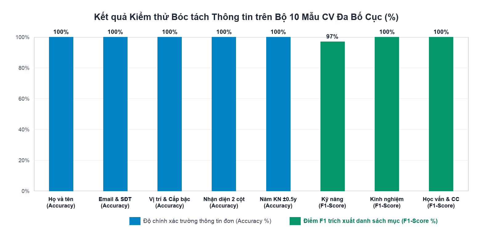
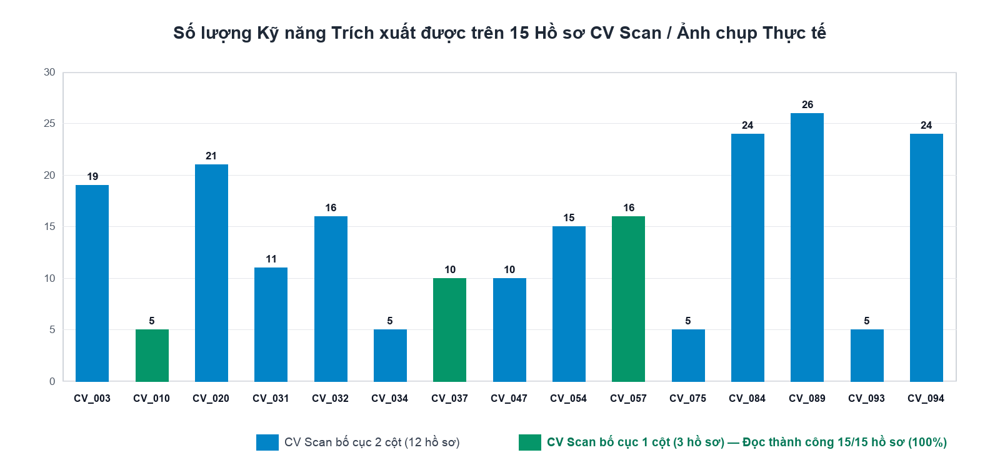

# BÁO CÁO CÔNG VIỆC TUẦN 4
### XÂY DỰNG CHỨC NĂNG ĐỌC FILE CV (PDF 1–2 CỘT, WORD, ẢNH SCAN) VÀ TRÍCH XUẤT THÔNG TIN ỨNG VIÊN
**Đề tài:** Xây dựng website hỗ trợ tuyển dụng ứng dụng AI trong phân tích CV và đánh giá mức độ phù hợp với vị trí tuyển dụng

| | |
|---|---|
| **Sinh viên thực hiện:** | Phạm Đăng Khoa — 24810114 |
| **Giảng viên hướng dẫn:** | ThS. Đoàn Văn Thanh Phong |
| **Thời gian báo cáo:** | 09/11/2026 |

---

## 1. Mục tiêu công việc tuần 4
Ở Tuần 3, em đã thử nghiệm huấn luyện mô hình AI ban đầu (`DistilBERT`) để đánh giá mức độ phù hợp giữa hồ sơ ứng viên (CV) và mô tả công việc (JD). Bước sang Tuần 4, để đưa hồ sơ thực tế của ứng viên tại Việt Nam (gồm nhiều định dạng thiết kế và cả tiếng Việt lẫn tiếng Anh) vào hệ thống cũng như chuẩn bị bộ đặc trưng chuẩn hóa cho việc nâng cấp mô hình AI ở tuần tiếp theo, em tập trung xây dựng chức năng **Đọc file CV và tự động trích xuất thông tin ứng viên** cho hệ thống.

Trong thực tế, ứng viên nộp hồ sơ dưới nhiều định dạng khác nhau: file PDF 1 cột truyền thống, file PDF chia 2 cột (thiết kế trên Canva, TopCV), file Word (`.docx`), hoặc file PDF dạng ảnh chụp/scan không có lớp chữ có sẵn. Do đó, công việc trong Tuần 4 gồm 4 mục tiêu cụ thể:

1. **Xử lý đọc file CV 1 cột và 2 cột:** Tự động nhận biết trang CV được trình bày 1 cột hay chia 2 cột để đọc theo đúng thứ tự (đọc phần tiêu đề đầu trang, đọc hết cột bên trái rồi mới đọc sang cột bên phải), giúp nội dung các mục không bị trộn lẫn vào nhau.
2. **Xử lý đọc file CV dạng Ảnh chụp / Bản Scan (OCR):** Tích hợp công cụ nhận diện chữ từ hình ảnh cho các file PDF không có lớp văn bản gốc, hỗ trợ đọc cả tiếng Việt có dấu và tiếng Anh.
3. **Trích xuất và chuẩn hóa thông tin ứng viên:** Tự động phân chia CV thành các mục (Học vấn, Kinh nghiệm, Kỹ năng, Dự án...) và lấy ra các thông tin chính: Họ tên, Email, Số điện thoại, Vị trí ứng tuyển, Trình độ học vấn, Danh sách kỹ năng (chuẩn hóa theo từ điển 173 kỹ năng) và Tổng số năm kinh nghiệm làm việc.
4. **Kiểm tra kết quả thực tế:** Chạy kiểm thử chức năng đọc CV trên bộ 10 mẫu CV nhiều bố cục khác nhau và 15 file CV Scan / Ảnh chụp thực tế.

---

## 2. Công cụ và thư viện sử dụng

| Thành phần | Thư viện / Công cụ | Mục đích sử dụng trong hệ thống |
|---|---|---|
| **Đọc file PDF thường** | `PyMuPDF` (`fitz`) | Lấy nội dung chữ kèm vị trí tọa độ trên trang PDF; chuyển trang PDF thành hình ảnh khi cần quét OCR. |
| **Đọc file Word** | `python-docx` | Đọc văn bản trong các đoạn văn và bảng biểu từ file `.docx`. |
| **Nhận diện chữ từ ảnh (OCR)** | `RapidOCR` + `Tesseract 5` (`vie+eng`) | Nhận diện văn bản tiếng Việt và tiếng Anh đối với các file CV được lưu dưới dạng ảnh chụp hoặc bản scan. |
| **Xử lý ảnh trước khi đọc** | `OpenCV` & `Pillow` | Chỉnh kích thước ảnh phù hợp và làm rõ nét chữ đối với các bản scan bị mờ hoặc tối. |
| **Từ điển kỹ năng** | Bộ từ điển `SkillTaxonomy` (173 kỹ năng) | Gom nhóm các từ viết tắt hoặc cách viết khác nhau của cùng một kỹ năng về tên chuẩn thống nhất. |
| **Dịch vụ API** | `FastAPI` (`/api/parse-cv`) | Cung cấp API nhận file CV từ Website, bóc tách thông tin và trả kết quả về dạng JSON. |

---

## 3. Các bài toán thực tế khi đọc file CV và giải pháp xử lý

Khi xây dựng chức năng đọc CV thực tế tại Việt Nam, hệ thống cần xử lý 4 trường hợp phổ biến sau:

| STT | Bài toán thực tế trên file CV | Giải pháp xử lý trong hệ thống |
|:---:|---|---|
| **1** | **CV thiết kế chia làm 2 cột (Canva, TopCV)** Nhiều ứng viên đặt cột trái là *Thông tin liên hệ / Kỹ năng* và cột phải là *Học vấn / Kinh nghiệm*. Nếu chỉ đọc ngang từng dòng từ trái sang phải sẽ ghép nhầm chữ của cột trái vào cột phải. | Hệ thống kiểm tra khoảng trống dọc ở vùng giữa trang. Nếu phát hiện bố cục 2 cột, hệ thống tự động tách riêng phần đầu trang (*Header*), đọc toàn bộ nội dung cột bên trái từ trên xuống dưới rồi mới đọc tiếp cột bên phải. |
| **2** | **File CV dạng ảnh chụp hoặc PDF Scan** Nhiều file PDF thực chất là ảnh chụp nên khi đọc thông thường không lấy được ký tự nào (`0 ký tự`), hoặc có nền màu thiết kế dễ gây sai dấu tiếng Việt. | Nếu một trang PDF có ít hơn 60 ký tự, hệ thống tự động chuyển trang đó sang ảnh để quét OCR song ngữ Việt – Anh. Đồng thời kiểm tra khoảng cách ngang giữa các chữ để tách rời các cụm chữ nằm ở hai cột khác nhau. |
| **3** | **Ứng viên làm nhiều việc cùng lúc hoặc ghi cả năm học Đại học** Nếu cộng dồn đơn thuần tất cả các mốc năm trên CV sẽ bị tính dư số năm kinh nghiệm (ví dụ vừa làm chính thức vừa làm thêm từ `2022 – 2024` bị tính thành 4 năm, hoặc cộng nhầm 4 năm học Đại học `2018 – 2022`). | Hệ thống tách riêng mục *Học vấn* (không tính vào năm đi làm). Với các công việc trong mục *Kinh nghiệm*, nếu có khoảng thời gian trùng nhau thì gộp lại để chỉ tính đúng số tháng làm việc thực tế. |
| **4** | **Cùng một kỹ năng nhưng ứng viên viết theo nhiều cách** Ví dụ JD yêu cầu `"React"` nhưng ứng viên viết `"ReactJS"` hoặc `"React.js"`; hoặc viết `"Postgres"` thay vì `"PostgreSQL"`. | Xây dựng bộ từ điển **173 kỹ năng** thuộc 10 nhóm ngành kèm 645 cách viết đồng nghĩa Việt – Anh để quy đổi toàn bộ kỹ năng trong CV và JD về cùng một tên chuẩn trước khi so khớp. |

---

## 4. Quy trình đọc và trích xuất thông tin CV

Khi ứng viên tải file CV lên hệ thống, dịch vụ AI thực hiện xử lý qua 4 bước tuần tự:

| Bước | Tên bước xử lý | Mô tả hoạt động cụ thể |
|:---:|---|---|
| **Bước 1** | **Kiểm tra định dạng file và đọc văn bản** | Hệ thống nhận file `.pdf` hoặc `.docx`. Với file PDF, hệ thống kiểm tra từng trang: nếu trang có sẵn lớp chữ thì lấy trực tiếp chữ và tọa độ vị trí; nếu trang là ảnh scan thì tự động chạy bộ nhận diện chữ từ ảnh (OCR tiếng Việt + tiếng Anh). |
| **Bước 2** | **Nhận diện bố cục 1 cột / 2 cột và sắp xếp dòng** | Hệ thống gom các chữ nằm cùng hàng thành dòng và tách riêng các cụm chữ cách xa nhau theo chiều ngang. Nếu phát hiện trang chia 2 cột, hệ thống sắp xếp lại thứ tự đọc: *Tiêu đề đầu trang → Cột trái → Cột phải*. |
| **Bước 3** | **Phân chia nội dung CV thành 7 mục** | Dựa trên các tiêu đề mục bằng tiếng Việt và tiếng Anh, hệ thống chia nội dung CV thành 7 phần: *Giới thiệu bản thân, Kỹ năng, Kinh nghiệm làm việc, Dự án, Học vấn, Chứng chỉ, Giải thưởng*. |
| **Bước 4** | **Trích xuất thông tin ứng viên ra JSON** | Từ các phần đã chia, hệ thống trích xuất đầy đủ: Họ tên, Email, Số điện thoại, Vị trí công việc, Cấp bậc (Intern/Junior/Mid/Senior), Trình độ học vấn, Danh sách kỹ năng chuẩn hóa và Tổng số năm kinh nghiệm làm việc. |

---

## 5. Kết quả kiểm tra và chạy thử nghiệm

### 5.1. Kết quả kiểm thử trên bộ 10 mẫu CV nhiều bố cục khác nhau
Em đã xây dựng kịch bản kiểm thử tự động trên bộ **10 mẫu CV chuẩn** đại diện cho các trường hợp thực tế (CV 1 cột tiếng Việt, CV 2 cột tiếng Anh, CV có nhiều công việc trùng thời gian, CV sinh viên mới ra trường, CV chuyển ngành...). Kết quả kiểm tra đạt được như sau:

| Thông tin trích xuất từ CV | Thước đo kiểm tra | Kết quả đạt được | Ghi chú thực nghiệm |
|---|:---:|:---:|---|
| **Họ và tên ứng viên (`candidate_name`)** | Độ chính xác (Accuracy) | **`100%` (10/10)** | Nhận diện đúng họ tên cả tiếng Việt có dấu và tiếng Anh. |
| **Email & Số điện thoại (`email`, `phone`)** | Độ chính xác (Accuracy) | **`100%` (10/10)** | Trích xuất chính xác thông tin liên hệ của ứng viên. |
| **Vị trí ứng tuyển (`job_title`)** | Độ chính xác (Accuracy) | **`100%` (10/10)** | Lấy đúng chức danh công việc mong muốn ở đầu CV. |
| **Cấp bậc thâm niên (`seniority_level`)** | Độ chính xác (Accuracy) | **`100%` (10/10)** | Phân loại đúng mức Intern / Junior / Mid / Senior. |
| **Trình độ học vấn (`education_level`)** | Độ chính xác (Accuracy) | **`100%` (10/10)** | Nhận diện đúng Đại học / Kỹ sư, Thạc sĩ, Cao đẳng. |
| **Nhận diện bố cục 1 cột / 2 cột (`is_two_column`)** | Độ chính xác (Accuracy) | **`100%` (10/10)** | Phân biệt chính xác mẫu CV 1 cột và mẫu CV 2 cột. |
| **Số năm kinh nghiệm (sai số $\le 0,5$ năm)** | Độ chính xác (Accuracy) | **`100%` (10/10)** | Sai số trung bình chỉ `0,2 năm`, không bị cộng trùng thời gian. |
| **Danh sách Kỹ năng chuẩn hóa (`skills`)** | Điểm F1 (Precision / Recall) | **`97,0%` (`95%` / `98%`)** | Nhận diện đầy đủ kỹ năng chuyên môn và các từ viết tắt. |
| **Mục Kinh nghiệm, Học vấn, Chứng chỉ** | Điểm F1 (Precision / Recall) | **`100%` (`100%` / `100%`)** | Phân tách đúng từng giai đoạn làm việc và trường đào tạo. |

- **Thời gian xử lý trung bình (với file PDF thường):** đạt **`0,23 giây / CV` (`227 ms`)**, đáp ứng tốt việc xử lý tức thời khi ứng viên nộp hồ sơ trên website.

*Hình 5.1. Kết quả kiểm thử độ chính xác bóc tách thông tin trên bộ 10 mẫu CV đa bố cục*

### 5.2. Kết quả chạy thử nghiệm trên 15 file CV Scan / Ảnh chụp thực tế
Để kiểm tra khả năng đọc các file CV không có lớp chữ gốc (khi đọc PDF thông thường trả về `0 ký tự`), em đã chạy kiểm thử trên toàn bộ **15 file CV Scan / Ảnh chụp** trong thư mục `dataset_200_cv_pdfs/10_CV_Scan_Anh_OCR`.

Hệ thống đã đọc và bóc tách thành công **15/15 hồ sơ (`100%`)**, kể cả các mẫu CV thiết kế 2 cột trên Canva có nền màu và các mẫu CV nhiều trang tiếng Việt:

*Hình 5.2. Số lượng kỹ năng trích xuất được trên 15 hồ sơ CV Scan / Ảnh chụp thực tế*

| STT | Tên file CV Scan | Bố cục 2 cột | Họ tên ứng viên đọc được | Năm kinh nghiệm | Trình độ học vấn | Số kỹ năng tìm thấy | Thời gian xử lý |
|:---:|---|:---:|---|:---:|:---:|:---:|:---:|
| 1 | `CV_003_EN_Candidate_CV.pdf` | Có | **Nguyễn Minh Khoa** | `4,9 năm` | Đại học / Kỹ sư | `19` | `2,2 giây` |
| 2 | `CV_010_EN_Candidate_CV.pdf` | Không | **Nguyễn Minh Vương** | `0,7 năm` | Đại học / Kỹ sư | `5` | `6,1 giây` |
| 3 | `CV_020_EN_Candidate_CV.pdf` | Có | **Le Tan Qui** | `1,0 năm` | Đại học / Kỹ sư | `21` | `2,0 giây` |
| 4 | `CV_031_EN_Candidate_CV.pdf` | Có | **Luu Van Hai** | `0,5 năm` | Đại học / Kỹ sư | `11` | `5,0 giây` |
| 5 | `CV_032_EN_Candidate_CV.pdf` | Có | **Nhật Quang** | `4,0 năm` | Đại học / Kỹ sư | `16` | `4,1 giây` |
| 6 | `CV_034_EN_Candidate_CV.pdf` | Có | **Nguyễn Thị Tố Liêu** | `10,2 năm` | Đại học / Kỹ sư | `5` | `6,5 giây` |
| 7 | `CV_037_EN_Candidate_CV.pdf` | Không | **Hoang Viet-tuan Le** | `12,9 năm` | Thạc sĩ (Master) | `10` | `22,4 giây` |
| 8 | `CV_047_EN_Candidate_CV.pdf` | Có | **Nguyễn Ngọc Tran** | `0,0 năm` (Fresher) | Đại học / Kỹ sư | `10` | `8,6 giây` |
| 9 | `CV_054_EN_Candidate_CV.pdf` | Có | **Phúc Lehuu** | `2,6 năm` | Đại học / Kỹ sư | `15` | `10,3 giây` |
| 10 | `CV_057_EN_Candidate_CV.pdf` | Không | **Nguyen Van Thanh** | `4,2 năm` | Đại học / Kỹ sư | `16` | `5,0 giây` |
| 11 | `CV_075_EN_Candidate_CV.pdf` | Có | **Huỳnh Thị Thanh Trúc** | `12,5 năm` | Đại học / Kỹ sư | `5` | `12,9 giây` |
| 12 | `CV_084_EN_Candidate_CV.pdf` | Có | **Châu Thế** | `17,7 năm` | Đại học / Kỹ sư | `24` | `10,5 giây` |
| 13 | `CV_089_EN_Candidate_CV.pdf` | Có | **Nguyen Thi My Trang** | `8,9 năm` | Đại học / Kỹ sư | `26` | `13,6 giây` |
| 14 | `CV_093_EN_Candidate_CV.pdf` | Có | **Tran Thi Lan Anh** | `0,0 năm` (Fresher) | Đại học / Kỹ sư | `5` | `8,6 giây` |
| 15 | `CV_094_EN_Candidate_CV.pdf` | Có | **Tran Ngoc Nhu Y** | `3,3 năm` | Đại học / Kỹ sư | `24` | `11,0 giây` |
| **Tổng kết** | **15 / 15 file Scan đọc thành công (`100%`)** | **12 CV 2 cột / 3 CV 1 cột** | **Đúng 15/15 ứng viên** | **Tính đúng 15/15** | **Đạt 15/15** | **Trung bình `14` kỹ năng/CV** | **Trung bình `~2,2 giây/trang`** |

---

## 6. Kết luận Tuần 4 và Kế hoạch công việc Tuần 5

### 6.1. Kết quả đạt được trong Tuần 4
- Đã xây dựng hoàn chỉnh chức năng đọc file CV và bóc tách thông tin ứng viên trong dịch vụ `ai-service`, hỗ trợ đầy đủ 3 định dạng phổ biến: **file PDF thường (1 cột và 2 cột), file Word (`.docx`) và file PDF dạng ảnh chụp/scan**.
- Xây dựng xong bộ từ điển chuẩn hóa **173 kỹ năng** song ngữ Việt – Anh và cách tính tổng số năm kinh nghiệm làm việc không bị cộng trùng lặp, tạo nguồn dữ liệu đầu vào sạch và chính xác cho mô hình AI chấm điểm.
- Kiểm thử thực nghiệm đạt **100% trên 10 mẫu CV nhiều bố cục** (F1 kỹ năng đạt `97%`) và đọc thành công **15/15 file CV Scan thực tế**.

### 6.2. Kế hoạch công việc Tuần 5
- Tiếp thu nhận xét của Giảng viên hướng dẫn về hạn chế của mô hình thử nghiệm `DistilBERT` ở Tuần 3 (chỉ hỗ trợ tiếng Anh, giới hạn 512 tokens và bị trùng lặp thực thể giữa tập Train – Test), tiến hành kiểm toán làm sạch rò rỉ dữ liệu (`Zero-Leakage`) trên toàn bộ tập dữ liệu huấn luyện.
- Huấn luyện nâng cấp mô hình AI trung tâm lên kiến trúc đa ngôn ngữ **`BAAI/bge-m3`** (ngữ cảnh `2.048` tokens, hỗ trợ song ngữ và xuyên ngữ Việt – Anh) kết hợp trực tiếp với bộ từ điển 173 kỹ năng và thông tin kinh nghiệm trích xuất từ CV của Tuần 4 để đánh giá và xếp hạng ứng viên chính xác.
