<div align="center">


# Đúng Việc — Website Tuyển Dụng Ứng Dụng AI Phân Tích CV & Đánh Giá Mức Độ Phù Hợp

**Đồ án / Tiểu luận Tốt nghiệp — Xây dựng hệ thống hỗ trợ tuyển dụng thông minh song ngữ Việt – Anh**

[](https://nextjs.org)
[](https://react.dev)
[](https://www.typescriptlang.org)
[](https://tailwindcss.com)
[](https://ui.shadcn.com)
[](https://www.python.org)
[](https://pytorch.org)

*Nhà tuyển dụng xác thực MST & đăng tin → Ứng viên tải CV thật (`.pdf` / `.docx`) → AI trích xuất toàn văn theo đúng bố cục 1–2 cột / OCR & chấm điểm CV–JD bằng `BAAI/bge-m3 Hybrid` → HR sàng lọc, so sánh, đặt lịch phỏng vấn xuất `.ics` và quản trị phễu tuyển dụng.*

</div>

---

## 📑 Mục lục

1. [Thông tin đề tài & Mục tiêu](#-thông-tin-đề-tài--mục-tiêu)
2. [Đóng góp chính & Giải pháp kỹ thuật](#-đóng-góp-chính--giải-pháp-kỹ-thuật)
3. [Phân hệ chức năng & Giao diện](#-phân-hệ-chức-năng--giao-diện)
4. [Kiến trúc hệ thống & Luồng xử lý](#-kiến-trúc-hệ-thống--luồng-xử-lý)
5. [Mô-đun AI: Parser V2 & BAAI/bge-m3 Hybrid](#-mô-đun-ai-parser-v2--baaibge-m3-hybrid)
6. [Quy trình, Trạng thái & Quy tắc nghiệp vụ (QT-01 → QT-07)](#-quy-trình-trạng-thái--quy-tắc-nghiệp-vụ)
7. [Quản lý tệp tin, Bảo mật & Tối ưu ảnh 2 tầng](#-quản-lý-tệp-tin-bảo-mật--tối-ưu-ảnh-2-tầng)
8. [Ngăn xếp công nghệ](#-ngăn-xếp-công-nghệ)
9. [Cấu trúc thư mục dự án](#-cấu-trúc-thư-mục-dự-án)
10. [Hướng dẫn cài đặt & Chạy thử nghiệm](#-hướng-dẫn-cài-đặt--chạy-thử-nghiệm)
11. [Tài khoản mẫu & Kho 200 CV Demo](#-tài-khoản-mẫu--kho-200-cv-demo)
12. [Hệ thống API nội bộ & Dịch vụ ngoài](#-hệ-thống-api-nội-bộ--dịch-vụ-ngoài)
13. [Cơ sở dữ liệu & Sơ đồ thiết kế](#-cơ-sở-dữ-liệu--sơ-đồ-thiết-kế)
14. [Hạn chế hiện tại & Hướng phát triển](#-hạn-chế-hiện-tại--hướng-phát-triển)

---

## 🎓 Thông tin đề tài & Mục tiêu

| Hạng mục | Nội dung |
|---|---|
| **Tên đề tài** | Xây dựng website hỗ trợ tuyển dụng ứng dụng AI trong phân tích CV và đánh giá mức độ phù hợp với vị trí tuyển dụng |
| **Sinh viên thực hiện** | **Phạm Đăng Khoa** — MSSV: `24810114` |
| **Giảng viên hướng dẫn** | **ThS. Đoàn Thanh Phong** |
| **Phạm vi hệ thống** | 2 vai trò (`candidate`, `hr`) · 4 Use Case trọng tâm · 15 trang Next.js App Router · 34 API Route Handlers · 11 collections MongoDB thật |
| **Kho mã nguồn & Học liệu** | Tích hợp notebook huấn luyện Colab [`TRAIN_BGE_M3_BILINGUAL_COLAB.ipynb`](TRAIN_BGE_M3_BILINGUAL_COLAB.ipynb), bộ kiểm thử `dataset_200_cv_pdfs/`, tài liệu thiết kế tuần 1–6 & sơ đồ `.drawio` |

### Danh mục Use Case cốt lõi

| Mã | Tên Use Case | Tác nhân chính | Giá trị mang lại |
|---|---|---|---|
| **UC-01** | Đăng ký xác thực MST & quản lý tin tuyển dụng | Nhà tuyển dụng (`hr`) | Chống doanh nghiệp giả mạo qua tra cứu VietQR; quản lý vòng đời tin (tạo, sửa, nhân bản, đóng/mở, tự hết hạn, chấm lại hàng loạt). |
| **UC-02** | Tìm kiếm việc làm, quản lý CV & nộp đơn ứng tuyển | Ứng viên (`candidate`) | Lọc tin theo từ khóa, 34 tỉnh/thành, ngành nghề, hình thức, mức lương; quản lý nhiều CV PDF/DOCX và theo dõi tiến trình trực quan. |
| **UC-03** | Trích xuất văn bản CV (Parser V2) & chấm điểm phù hợp CV–JD | Hệ thống AI (`ai-service`) | Đọc đúng thứ tự cột PDF 1–2 cột, OCR lai scan Việt–Anh, đánh giá toàn văn không cắt xén bằng `BAAI/bge-m3 Hybrid`, giải thích kỹ năng khớp/thiếu. |
| **UC-04** | Sàng lọc, so sánh hồ sơ theo điểm AI & quản lý phỏng vấn | Nhà tuyển dụng (`hr`) | Xếp hạng ứng viên giảm dần theo điểm `S`, xem chế độ List/Kanban, so sánh song song 2–3 ứng viên, lên lịch phỏng vấn & xuất lịch `.ics`. |

---

## 🌟 Đóng góp chính & Giải pháp kỹ thuật

1. **Giải quyết bài toán đọc sai thứ tự CV 2 cột & CV ảnh scan (Parser V2)**:
   - Thay vì gọi `get_text("text")` dễ bị trộn cột trái–phải, [`layout_engine.py`](ai-service/services/layout_engine.py) phân tích toạ độ từng dòng từ PyMuPDF `get_text("dict")`, phát hiện **khe trắng thật (gutter)** và chia **băng ngang (horizontal bands)** để đọc trọn vẹn từng cột, đồng thời loại trừ cột giả (các mốc thời gian căn lề phải trong CV 1 cột).
   - Tự động kích hoạt nhánh OCR lai (**Tesseract 5 `vie+eng` xuất TSV có toạ độ** / **RapidOCR PP-OCRv4** tiền xử lý bằng OpenCV ở 250 DPI) khi trang PDF là ảnh quét, rồi chạy lại đúng thuật toán dựng cột.

2. **Chấm điểm bằng toàn văn `raw_text` không làm mất ngữ cảnh + Mô hình song ngữ `BAAI/bge-m3 Hybrid`**:
   - Khắc phục nhược điểm của mô hình 512 token hoặc parser dựa vào template cố định: hệ thống giữ nguyên 100% văn bản trích xuất `raw_text` (bỏ qua hoàn toàn các rule đoán mò dễ lỗi), hỗ trợ cặp đầu vào **CV 1.024 tokens + JD 1.024 tokens = 2.048 tokens** (kiến trúc BGE-M3 hỗ trợ tối đa 8.192 tokens).
   - Huấn luyện tầng phân loại lai **`BGEM3HybridFitClassifier`** (`bge_m3_hybrid_head.pt`) trên tập tách **Zero-Leakage Bipartite Disjoint Split** (0% trùng lặp CV và JD giữa Train/Val/Test) kết hợp ngữ liệu song ngữ 4 chế độ `VI-VI`, `EN-EN`, `EN-VI`, `VI-EN`.

3. **Nghiệp vụ tuyển dụng khép kín, nhất quán dữ liệu & sẵn sàng mở rộng**:
   - Đóng băng bản chụp hồ sơ lúc nộp (`cv_snapshot`), gắn mã băm mô tả công việc (`jd_hash`) để cảnh báo điểm AI lỗi thời khi HR sửa JD, lưu lịch sử điểm (`history`) khi chấm lại.
   - Đầy đủ xác thực thực tế: xác thực doanh nghiệp bằng **Mã số thuế**, khôi phục mật khẩu qua **OTP 6 số gửi email SMTP**, thông báo thời gian thực, so sánh ứng viên, xuất CSV bảng điểm, tạo file lịch `.ics`.

4. **Tối ưu trải nghiệm người dùng & Xử lý ảnh 2 tầng (10 MB → WebP siêu nhẹ)**:
   - Giao diện hợp nhất hệ thiết kế **100% `shadcn/ui`**, font chữ **`Inter`** đồng nhất toàn hệ thống với độ dày chữ tối đa `700` (`font-bold`), tối ưu responsive trên mobile và desktop.
   - Tải lên Avatar, Logo doanh nghiệp và Ảnh bìa chấp nhận tệp đến **10 MB**, tự động tối ưu 2 tầng bằng **Canvas đa bước 0.5x** trên trình duyệt và **Sharp (`libvips`)** trên server (tự xoay EXIF, crop 1:1 cho avatar, giữ kênh trong suốt RGBA cho logo, nén WebP giảm 90–99% dung lượng).

---

## ✨ Phân hệ chức năng & Giao diện

### 👤 Phân hệ Ứng viên (`/`, `/viec-lam`, `/cong-ty/[slug]`, `/ung-vien/*`)
- **Tìm kiếm & Khám phá việc làm (`/viec-lam`, `/viec-lam/[slug]`)**: Lọc đa tiêu chí theo từ khóa, 34 tỉnh/thành Việt Nam, nhóm ngành nghề, hình thức làm việc (Toàn thời gian, Bán thời gian, Thực tập, Remote/Hybrid) và khoảng lương; tự động đếm lượt xem và danh sách việc làm cùng công ty.
- **Hồ sơ năng lực & Trung tâm tài khoản (`/ung-vien/tai-khoan`)**:
  - Cập nhật thông tin cá nhân, **tải lên Ảnh đại diện** (dropzone hỗ trợ tới 10 MB, tự crop 1:1 WebP), đổi mật khẩu.
  - Quản lý danh sách CV (`.pdf`/`.docx`, ≤ 5 MB), đặt CV mặc định, xem trực tiếp **bản PDF gốc** (stream an toàn qua `/api/files/cv/[id]`) song song với tab **Nội dung văn bản đã đọc (`raw_text`)** và kỹ năng AI nhận diện được; hỗ trợ lưu trữ/xóa CV an toàn.
- **Theo dõi đơn ứng tuyển (`/ung-vien/don-ung-tuyen`)**:
  - Ứng tuyển bằng CV mới hoặc CV đã lưu kèm thư giới thiệu ngắn.
  - Theo dõi thanh tiến trình 5 bước (*Đã nộp → Đang xem → Mời phỏng vấn → Đề nghị nhận việc → Trúng tuyển*), lý do từ chối hoặc trạng thái tự rút đơn.
  - Xác nhận tham dự hoặc gửi yêu cầu đổi lịch phỏng vấn trực tiếp từ giao diện; nhận thông báo tự động.
  - **Bảo mật dữ liệu nội bộ (`QT-04`)**: Tuyệt đối không trả điểm AI (`match_score`), xác suất lớp hay ghi chú nội bộ của HR về phía API/UI ứng viên.

### 🏢 Phân hệ Nhà tuyển dụng (`/nha-tuyen-dung/*`)
- **Xác thực doanh nghiệp khi đăng ký (`/dang-ky`)**: Bắt buộc nhập Mã số thuế (10 hoặc 13 số). Server tự gọi VietQR Business API điền `company_name` và `address` chỉ đọc, ngăn chặn đăng ký công ty ảo hoặc trùng MST (`409 DUPLICATE_TAX_CODE`).
- **5 khu vực quản trị chuyên biệt**:

| Trang | Đường dẫn | Chức năng chính |
|---|---|---|
| **Tổng quan** | `/nha-tuyen-dung/tong-quan` | KPI tuyển dụng, phễu chuyển đổi 5 bước, biểu đồ phân bố 3 mức phù hợp AI, danh sách top ứng viên tiềm năng và lịch phỏng vấn sắp tới. |
| **Tin tuyển dụng** | `/nha-tuyen-dung/tin-tuyen-dung` | Tạo, chỉnh sửa, nhân bản tin, lọc theo trạng thái (`active`, `draft`, `closed`), đóng/mở lại tin, kích hoạt **chấm lại điểm AI hàng loạt** (`/rescore-all`) khi sửa JD, và **Nạp nhanh từ kho 200 CV mẫu** (`/autofill-pool`) phục vụ demo/đánh giá xếp hạng. |
| **Ứng viên** | `/nha-tuyen-dung/ung-vien` | Xếp hạng ứng viên mặc định giảm dần theo điểm AI `S`; hỗ trợ cả chế độ **Bảng danh sách (List)** và **Bảng kéo thả Kanban**; dialog chi tiết 5 tab (*Đánh giá AI*, *Nội dung hồ sơ*, *CV gốc PDF*, *Lịch phỏng vấn*, *Ghi chú & Lịch sử*); **So sánh song song 2–3 ứng viên**; chuyển trạng thái hàng loạt và **Xuất CSV** bảng xếp hạng. |
| **Lịch phỏng vấn** | `/nha-tuyen-dung/lich-phong-van` | Lên lịch phỏng vấn trực tuyến/trực tiếp (kèm link họp hoặc địa điểm), tải file lịch chuẩn **`.ics`** tương thích Google Calendar/Outlook, ghi nhận kết quả đánh giá sau phỏng vấn (*Đạt / Cân nhắc / Chưa đạt*). |
| **Hồ sơ công ty** | `/nha-tuyen-dung/cong-ty` | Hiển thị thông tin pháp lý xác thực MST (chỉ đọc), chỉnh sửa giới thiệu, ngành nghề, quy mô, phúc lợi, mạng xã hội và **tải lên Ảnh đại diện HR, Logo công ty (giữ nền trong suốt), Ảnh bìa trang công ty**. |

### 🔐 Xác thực & Khôi phục mật khẩu (`/dang-nhap`, `/dang-ky`, `/quen-mat-khau`)
- Phiên đăng nhập lưu qua `HttpOnly` cookie ký bằng **HMAC-SHA256** (`session_secret`), mật khẩu băm muối ngẫu nhiên với Node **`crypto.scrypt`**.
- **Quên mật khẩu qua OTP email**: Nhập email → sinh mã OTP 6 số ngẫu nhiên (`crypto.randomInt`) lưu dạng băm HMAC (`otp_hash`) với thời hạn **10 phút**, cooldown gửi lại **60 giây**, giới hạn tối đa **5 lần nhập sai**, gửi email HTML qua SMTP (`nodemailer`), cấp `reset_token` một lần để đặt mật khẩu mới.

---

## 🏗 Kiến trúc hệ thống & Luồng xử lý

Hệ thống áp dụng kiến trúc tách biệt hai dịch vụ (**Decoupled Web App + AI Microservice**):

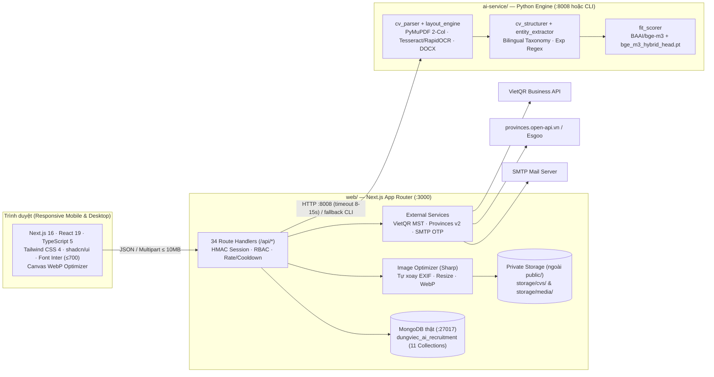

### Giao tiếp Web ↔ AI Engine (`web/src/lib/db/ai-client.ts`)
- **Cơ chế ưu tiên HTTP + Dự phòng CLI tự động**: Backend Next.js gửi request HTTP tới `AI_SERVICE_URL` (mặc định `http://127.0.0.1:8008`). Nếu tiến trình HTTP chưa được bật hoặc kết nối từ chối, Next.js tự động kích hoạt `ai-service/cli.py` qua `spawnSync` (truyền JSON stdin/stdout với `maxBuffer: 20 MB`, tự dò Python virtualenv `.venv/bin/python`), đảm bảo pipeline AI Python luôn chạy thật trên mọi môi trường dev/demo.

### Luồng ứng tuyển & chấm điểm End-to-End

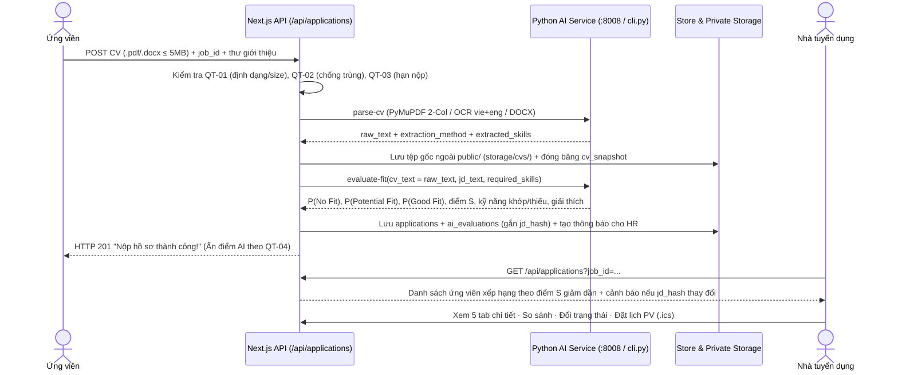

---

## 🧠 Mô-đun AI: Parser V2 & BAAI/bge-m3 Hybrid

### 1. Pipeline đọc & bóc tách CV (`ai-service/services/layout_engine.py`, `cv_parser.py`)

| Định dạng đầu vào | Kỹ thuật áp dụng | Xử lý đặc thù |
|---|---|---|
| **PDF điện tử 1–2 cột** | `PyMuPDF` (`page.get_text("dict")`) | Đo độ phủ toạ độ X của từng dòng để phát hiện khe trắng cột (tránh cắt nhầm vào lề thời gian căn phải); chia băng ngang (`full` / `left` / `right`) giữ đúng thứ tự đọc tự nhiên. |
| **PDF ảnh quét (Scan)** | `Tesseract 5 LSTM (vie+eng)` + `OpenCV` (`250 DPI`), dự phòng `RapidOCR (PP-OCRv4)` | Xuất TSV kèm bounding box `(x0, y0, x1, y1)` để tái sử dụng chính thuật toán phân cột của PDF điện tử; tự phát hiện trang cần OCR khi độ dài văn bản < 30 ký tự. |
| **Word (`.docx`)** | `python-docx` | Duyệt tuần tự toàn bộ `body` (đoạn văn xen kẽ bảng biểu) giữ thuộc tính Heading, in đậm, cỡ chữ, tránh bỏ sót thông tin nằm trong bảng CV. |

### 2. Kiến trúc mô hình so khớp CV–JD (`BAAI/bge-m3` + `BGEM3HybridFitClassifier`)

- **Mã nguồn**: [`ai-service/services/fit_scorer.py`](ai-service/services/fit_scorer.py), [`ai-service/config.py`](ai-service/config.py)
- **Notebook huấn luyện**: [`TRAIN_BGE_M3_BILINGUAL_COLAB.ipynb`](TRAIN_BGE_M3_BILINGUAL_COLAB.ipynb) trên GPU Tesla T4.
- **Trọng số đã huấn luyện**: [`bge_m3_hybrid_head.pt`](ai-service/models/best_cvjd_model/bge_m3_hybrid_head.pt) (`8.0 MB`).
- **Tài liệu nền tảng**: Chen et al. (2024), *BGE M3-Embedding: Multi-Lingual, Multi-Functionality, Multi-Granularity Text Embeddings Through Self-Knowledge Distillation* (`arXiv:2402.03216`).

#### Thiết kế kiến trúc Gated Hybrid Network:
1. **Biểu diễn ngữ cảnh dài song ngữ (`2 × 1024 = 2.048 tokens`)**:
   - Đưa toàn bộ văn bản gốc `raw_text` của CV (tối đa `1.024` tokens) và toàn văn JD (tối đa `1.024` tokens) qua backbone `BAAI/bge-m3`.
   - Ghép nối vector `[CLS] (1024-d) || [Mean Pooling] (1024-d)` tạo vector **`2.048-d`** cho CV (`cv_emb`) và **`2.048-d`** cho JD (`jd_emb`).
2. **Chiếu đối xứng & Tương tác hai chiều**:
   - Tầng `shared_proj` (`2048 → 256`, `LayerNorm`, `GELU`) đưa hai văn bản về cùng không gian `u` và `v`, sau đó tính bộ đặc trưng tương tác Siêu đối xứng **`[u, v, |u - v|, u * v]`** (`1.024-d`).
3. **Nhánh 18 đặc trưng cấu trúc–ngữ nghĩa (`struct_encoder`: `18 → 96`)**:
   - Chuẩn hóa Z-score (`struct_mean`, `struct_std` lưu trong checkpoint) gồm: độ tương đồng lexical `TF 1-2 gram` (`lex_cos`), tỷ lệ phủ kỹ năng JD (`cov_jd`), tỷ lệ thiếu (`miss_jd`), Jaccard kỹ năng (`jacc_sk`), số kỹ năng khớp chuẩn hóa (`inter_sk`), chênh lệch/tỷ lệ/đạt ngưỡng số năm kinh nghiệm song ngữ (`exp_diff`, `exp_ratio`, `exp_suff`), Jaccard/độ phủ từ vựng (`w_jacc`, `w_cov`), độ dài từ CV/JD, và 6 tín hiệu tương quan ngữ nghĩa (`sim_cls`, `sim_mean`, `sim_c1`, `sim_c2`, `z_cls`, `z_mean`).
4. **Cơ chế Cổng hợp nhất & Phân loại 3 lớp (`Gated Fusion`: `1.120-d`)**:
   - Vector hợp nhất `raw_fusion` đi qua cổng `Sigmoid(Linear(1120, 1120))` tự cân bằng trọng số giữa ngữ nghĩa sâu và cấu trúc kỹ năng, qua MLP (`1120 → 256 → 96 → 3`) sinh xác suất 3 lớp **No Fit (0)**, **Potential Fit (1)**, **Good Fit (2)**.

#### Công thức tính điểm liên tục & Ngưỡng phân loại (`QT-04`)

$$S = 100 \times \left[ P(\text{Good Fit}) + 0.5 \times P(\text{Potential Fit}) \right]$$

| Khoảng điểm `S` | Nhãn mô hình | Hiển thị cho HR | Ý nghĩa khuyến nghị |
|---|---|---|---|
| **≥ 70** | `Good Fit` | **Rất phù hợp** | Đáp ứng tốt kỹ năng cốt lõi, kinh nghiệm và ngữ cảnh JD — ưu tiên mời phỏng vấn. |
| **50 – 69** | `Potential Fit` | **Tiềm năng** | Có nền tảng tương đồng hoặc thiếu một phần kỹ năng phụ — cân nhắc xem kỹ CV gốc. |
| **< 50** | `No Fit` | **Chưa phù hợp** | Chênh lệch lớn về kỹ năng trọng tâm hoặc số năm kinh nghiệm yêu cầu. |

Ngưỡng được đồng bộ tại nguồn duy nhất ở cả backend/frontend ([`web/src/lib/ai-thresholds.ts`](web/src/lib/ai-thresholds.ts)) và Python AI ([`ai-service/services/fit_scorer.py`](ai-service/services/fit_scorer.py)).

> [!NOTE]
> **Minh bạch cơ chế chạy thực tế (Runtime Inference Modes)**:
> - Khi môi trường Python có đủ `torch` + `transformers` và weights `BAAI/bge-m3`, `fit_scorer.py` mã hóa trực tiếp từng cặp CV–JD qua backbone `BAAI/bge-m3` và tầng `bge_m3_hybrid_head.pt`.
> - Nếu chạy trên máy cục bộ cấu hình nhẹ chưa tải ~2.3 GB `BAAI/bge-m3` hoặc chưa cài `transformers`, `fit_scorer.py` vẫn nạp checkpoint `bge_m3_hybrid_head.pt`, dựng vector không gian con (**Subspace Basis**) từ chính ma trận trọng số của head kết hợp bộ trích xuất kỹ năng song ngữ (`BILINGUAL_SKILL_MAP`, `REQUIRED_SKILL_SYNONYMS`, từ khóa ghép `HTML / CSS`, kinh nghiệm song ngữ `extract_experience_years_bilingual`) để suy luận qua mạng `hybrid_head`, đồng thời hòa trộn tín hiệu thực nghiệm (`0.22 × nn_score + 0.78 × struct_s`). Khi không có PyTorch, hệ thống fallback về `_predict_from_real_text` (TF 1–2 gram + tỷ lệ kỹ năng + thưởng/phạt kinh nghiệm).

### 3. Kết quả thực nghiệm & Kiểm toán chống rò rỉ dữ liệu

Dữ liệu huấn luyện từ [`cnamuangtoun/resume-job-description-fit`](https://huggingface.co/datasets/cnamuangtoun/resume-job-description-fit) được tách theo thuật toán **Zero-Leakage Bipartite Disjoint Split** (`4.438` mẫu Train / `608` mẫu Validation / `927` mẫu Test — **0% trùng lặp CV và JD** giữa các tập) kết hợp bổ sung ngữ liệu song ngữ Việt–Anh:

#### So sánh mô hình trên tập Test độc lập (`config.json` & `benchmark_comparison.csv`)

| Mô hình | Accuracy (%) | Balanced Acc (%) | Macro-F1 | Weighted-F1 | F1 (No Fit) | F1 (Potential) | F1 (Good Fit) |
|---|---|---|---|---|---|---|---|
| Baseline 1: TF-IDF + Logistic Regression | 65,05% | 63,66% | 0,6419 | 0,6488 | 0,6982 | 0,5982 | 0,6293 |
| Reference (Báo cáo 3): DistilBERT (EN-only, 512 tokens) | 44,86% | 38,12% | 0,3779 | 0,4385 | 0,6015 | 0,2099 | 0,3224 |
| Baseline 2: `BAAI/bge-m3` Zero-Shot Cosine | 48,22% | 45,25% | 0,4464 | 0,4683 | 0,6294 | 0,2379 | 0,4720 |
| **Đề xuất: Fine-Tuned `BAAI/bge-m3` Hybrid (2.048 tokens)** | **72,71%** | **72,20%** | **0,7220** | **0,7271** | **0,7619** | **0,7075** | **0,6968** |

#### Thống kê chi tiết theo ngôn ngữ, độ đo xếp hạng & kiểm thử phân tầng

| Hạng mục đánh giá | Kết quả thực nghiệm (`ai-service/models/best_cvjd_model/config.json`) |
|---|---|
| **Validation cao nhất (Epoch 14)** | Accuracy **79,11%** · Macro-F1 **0,7804** |
| **Tập Test 100 mẫu phân tầng** | Accuracy **77,00%** (chi tiết từng mẫu trong [`test_100_samples_evaluation.xlsx`](ketqua/extracted/test_100_samples_evaluation.xlsx)) |
| **Chỉ số xếp hạng (90 nhóm JD thực tế)** | **NDCG@5 = 0,9192** · **NDCG@10 = 0,9302** · **Recall@5 = 0,8905** |
| **Chế độ ngôn ngữ Việt–Việt (`VI-VI`, N=90)** | Accuracy **100,00%** · Macro-F1 **1,0000** |
| **Chế độ xuyên ngữ (`EN-VI` N=90, `VI-EN` N=84)** | Accuracy **100,00%** · Macro-F1 **1,0000** |
| **Chế độ Tiếng Anh gốc (`EN-EN`, N=663)** | Accuracy **61,84%** · Balanced Acc **60,25%** · Macro-F1 **0,6023** |
| **Tập Test gốc đầy đủ (1.759 mẫu, có nhiễu/khác phân bố)** | Accuracy **54,92%** · Balanced Acc **52,17%** · Macro-F1 **0,5201** |

<div align="center">

| Đường cong huấn luyện | Ma trận nhầm lẫn (Confusion Matrix) | Kiểm toán chống rò rỉ dữ liệu |
|---|---|---|
| 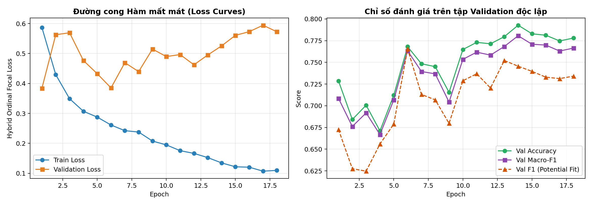 | 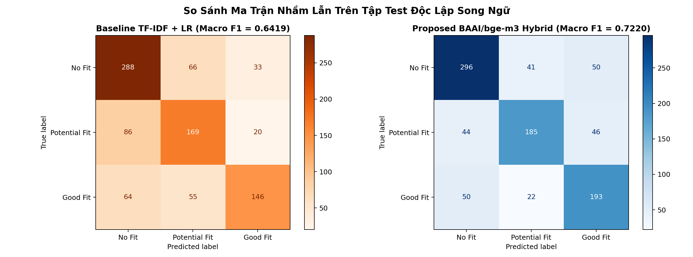 | 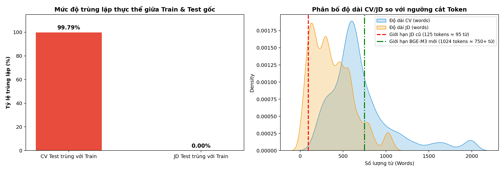 |

</div>

---

## 📜 Quy trình, Trạng thái & Quy tắc nghiệp vụ

### Vòng đời trạng thái hồ sơ ứng tuyển (`web/src/lib/recruitment/status.ts`)

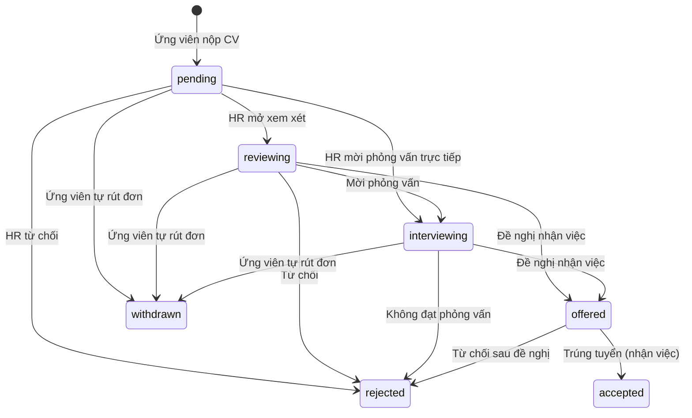

> Lưu ý: Tương thích ngược các dữ liệu cũ có trạng thái `"shortlisted"` qua hàm `normalizeStatus()` (quy về `"interviewing"`).

### Bảng Quy tắc nghiệp vụ hệ thống

| Mã | Quy tắc | Phạm vi áp dụng & Cách thực thi |
|---|---|---|
| **QT-01** | **Kiểm tra hợp lệ tệp tải lên** | CV chỉ nhận `.pdf` / `.docx` `≤ 5.0 MB`, không rỗng; Ảnh đại diện / Logo / Ảnh bìa chỉ nhận `JPG / PNG / WebP` `≤ 10 MB` kèm kiểm tra **magic bytes thực** (chặn SVG/GIF & tệp giả mạo đuôi). |
| **QT-02** | **Chống nộp trùng hồ sơ** | Mỗi ứng viên chỉ có tối đa 1 đơn đang hiệu lực trên 1 tin tuyển dụng (trả `HTTP 409`); chỉ cho phép nộp lại nếu đơn trước đó ở trạng thái `withdrawn`. |
| **QT-03** | **Tự động khóa tin quá hạn** | Hàm `enforceJobDeadlines()` tự động chuyển tin hết hạn `deadline` sang `closed`; API ứng tuyển chặn mọi hồ sơ nộp vào tin `closed` hoặc `draft`. |
| **QT-04** | **Chuẩn điểm AI & Ẩn thông tin nhạy cảm** | Công thức `S = 100 × (P(Good Fit) + 0.5 × P(Potential Fit))` phân ngưỡng `≥ 70 / 50–69 / < 50`. Điểm AI, xác suất và ghi chú nội bộ HR bị loại bỏ hoàn toàn khỏi response phía Ứng viên. |
| **QT-05** | **Phân quyền RBAC & Cô lập tệp riêng tư** | Ứng viên chỉ thao tác trên CV/đơn của chính mình; HR chỉ thao tác trên tin/đơn thuộc công ty mình (`ownsJob`, `findOwnedApplication`). Mọi tệp CV và ảnh lưu ngoài `public/` và kiểm tra quyền khi truy xuất. |
| **QT-06** | **An toàn dữ liệu chụp & Khả năng phục hồi** | Lưu bản chụp `cv_snapshot` ngay lúc nộp đơn (tránh sai lệch khi ứng viên xóa/sửa CV sau này) và gắn `jd_hash` phát hiện điểm lỗi thời. Nếu AI Service gián đoạn, hồ sơ vẫn được lưu ở trạng thái `pending_evaluation` để HR bấm chấm lại sau. |
| **QT-07** | **Xác thực MST doanh nghiệp & OTP Khôi phục mật khẩu** | HR đăng ký bắt buộc tra cứu MST thật từ VietQR; khôi phục mật khẩu qua OTP 6 số có TTL `10 phút`, cooldown `60 giây`, tối đa `5` lần thử sai, lưu hash HMAC (`hashVerificationSecret`). |

---

## 🛡 Quản lý tệp tin, Bảo mật & Tối ưu ảnh 2 tầng

| Loại tệp | Thư mục lưu trữ (ngoài `public/`) | Route truy xuất có bảo vệ | Quy chuẩn xử lý |
|---|---|---|---|
| **CV (`.pdf`, `.docx`)** | `web/storage/cvs/` | `GET /api/files/cv/[id]` | Kiểm tra phiên đăng nhập & quyền sở hữu (`QT-05`) trước khi stream PDF/DOCX (`application/pdf` / `attachment`). Hỗ trợ đọc file mẫu seed trong `public/samples/` nếu có. |
| **Avatar, Logo & Ảnh bìa** | `web/storage/media/<kind>/` | `GET /api/files/media/[kind]/[filename]` | Header chống thực thi XSS `X-Content-Type-Options: nosniff`, `Cache-Control` an toàn, tự động **xóa file vật lý cũ** trên đĩa khi người dùng thay hoặc gỡ ảnh. |

### Pipeline Tối ưu ảnh 10 MB → WebP siêu nhẹ (`image-upload-field.tsx` + `image-optimizer.ts`)
- **Tầng 1 (Client — Browser Canvas)**: Sử dụng `createImageBitmap` giữ đúng chiều xoay EXIF, chạy thuật toán thu nhỏ **đa bước 0.5x (`renderScaledCanvas`)** để chống răng cưa cho logo/chữ độ phân giải 4K+, nén thử nghiệm WebP theo các mức chất lượng `[0.88, 0.80, 0.72, 0.62]` ngay trước khi gửi mạng.
- **Tầng 2 (Server — Sharp `0.35.5` / `libvips`)**: Bảo chứng chất lượng ngay cả khi gọi API trực tiếp không qua trình duyệt: kiểm tra `limitInputPixels: 64_000_000` (chống pixel-bomb), `.rotate()` chuẩn EXIF, xóa metadata GPS/EXIF nhạy cảm, tự crop `1:1` (`512×512`) cho Avatar, giữ nguyên tỉ lệ & kênh trong suốt RGBA cho Logo (`512×512`), và chuẩn hóa Ảnh bìa tối đa `1600×640`. Thực nghiệm kiểm chứng giúp giảm **96% – 99% dung lượng** (ảnh 5.5–8.0 MB còn **2 KB – 273 KB** WebP).

---

## 🧰 Ngăn xếp công nghệ

| Thành phần | Công nghệ & Phiên bản chính | Vai trò trong hệ thống |
|---|---|---|
| **Frontend Framework** | `Next.js 16.4.2` (App Router + Turbopack), `React 19.3`, `TypeScript 5` | Server/Client Components, SSR, tối ưu routing và bundling |
| **UI & Styling** | `Tailwind CSS 4`, `shadcn/ui` (Radix UI), `lucide-react`, `sonner`, Font `Inter` | Hệ thiết kế đồng nhất, Dark/Light tokens chuẩn doanh nghiệp |
| **Quản lý trạng thái & Form** | `@tanstack/react-query 5`, `react-hook-form 7`, `zod 4`, `react-dropzone` | Cache client, validation schema chặt chẽ, kéo thả CV & ảnh |
| **Backend & Xử lý Media** | Next.js Route Handlers, Driver chính thức `mongodb`, Node `crypto` (`scrypt`, `HMAC-SHA256`), `sharp 0.35.5`, `nodemailer` | API RESTful nội bộ, kết nối MongoDB thật kèm Index, xác thực phiên, nén WebP server, gửi email SMTP |
| **AI & Xử lý tài liệu** | `Python 3.9+`, `PyTorch 2.2+`, `Transformers`, `FlagEmbedding (BAAI/bge-m3)`, `PyMuPDF`, `pdfplumber`, `pypdf`, `python-docx`, `OpenCV`, `Tesseract 5 OCR`, `RapidOCR` | Microservice AI (`:8008` / CLI), Layout Engine 2 cột, Hybrid Classifier |
| **Dữ liệu & Dịch vụ ngoài** | **MongoDB (`dungviec_ai_recruitment`)**, Seed snapshot (`database/mongodb_collections.json`), Schema SQL tương đương, VietQR API, `provinces.open-api.vn` | Cơ sở dữ liệu NoSQL thật kèm cơ chế tự seed & tạo index, xác thực MST, chuẩn hóa 34 tỉnh/thành |

---

## 🗂 Cấu trúc thư mục dự án

```text
khoaluantotnghiep/
├── web/                                       # Ứng dụng Next.js (Frontend + Backend API)
│   ├── src/
│   ├── src/
│   │   ├── app/                               # 15 trang App Router & 34 Route Handlers (/api/*)
│   │   │   ├── page.tsx                       #   Trang chủ giới thiệu & tìm nhanh việc làm
│   │   │   ├── viec-lam/  [slug]/             #   Tìm kiếm việc làm & chi tiết tin tuyển dụng
│   │   │   ├── cong-ty/[slug]/                #   Trang thông tin doanh nghiệp công khai
│   │   │   ├── dang-nhap/  dang-ky/           #   Đăng nhập & đăng ký (HR bắt buộc MST)
│   │   │   ├── quen-mat-khau/                 #   Khôi phục mật khẩu bằng OTP 6 số qua Email
│   │   │   ├── tai-khoan-demo/                #   Trang Danh bạ tài khoản kiểm thử (219 TK HR & Ứng viên)
│   │   │   ├── ung-vien/                      #   Tài khoản & quản lý CV, theo dõi đơn ứng tuyển
│   │   │   ├── nha-tuyen-dung/                #   Khu HR (Tổng quan, Tin, Ứng viên, Lịch PV, Công ty)
│   │   │   └── api/                           #   34 endpoints REST API nội bộ
│   │   ├── components/                        # Modules UI: auth, candidate, home, hr, job, layout, shared, ui (shadcn)
│   │   ├── hooks/                             # Custom hooks: use-auth, use-provinces, use-tax-lookup, hr/use-hr-data
│   │   └── lib/
│   │       ├── auth/                          # password-reset.ts (OTP TTL, cooldown, attempts)
│   │       ├── db/                            # mongo-client.ts, store.ts (MongoDB thật), server-auth.ts, ai-client.ts, types.ts
│   │       ├── files/                         # cv-storage.ts, media-specs.ts, media-storage.ts, image-optimizer.ts
│   │       ├── hr/                            # hr-server.ts (RBAC, snapshot, upsertAiEvaluation), job-input.ts
│   │       ├── profile/                       # cv-record.ts, profile-server.ts
│   │       ├── recruitment/                   # status.ts (7 trạng thái & quy tắc chuyển trạng thái dùng chung)
│   │       ├── services/                      # http-client, ttl-cache, tax-lookup, location-service, mail-service
│   │       └── ai-thresholds.ts               # Ngưỡng điểm S (70 / 50) & hàm gắn nhãn dùng chung
│   ├── public/brand/  mascot/  logos/         # Bộ nhận diện thương hiệu Đúng Việc & ảnh mẫu
│   ├── scripts/generate-brand-assets.mjs      # Script sinh bộ SVG/PNG logo, favicon, opengraph
│   ├── storage/                               # Lưu tệp CV (cvs/) & ảnh (media/) riêng tư (tự động tạo khi chạy)
│   └── .env.example                           # Mẫu cấu hình biến môi trường
├── ai-service/                                # Python AI Microservice (:8008 & CLI fallback)
│   ├── main.py                                # HTTP server đa luồng (:8008) cung cấp 5 endpoint AI
│   ├── cli.py                                 # Cầu nối stdin/stdout giúp Web gọi AI ngay cả khi chưa bật :8008
│   ├── config.py                              # Cấu hình model BAAI/bge-m3, giới hạn token, metrics thực nghiệm
│   ├── requirements.txt                       # Thư viện Python cho NLP, OCR, PDF/DOCX và PyTorch
│   ├── services/
│   │   ├── cv_parser.py                       # Kiểm tra QT-01 & điều phối bóc tách CV
│   │   ├── layout_engine.py                   # Thuật toán đọc PDF 1–2 cột, OCR lai Tesseract/RapidOCR, DOCX
│   │   ├── cv_structurer.py & entity_extractor.py # Trích xuất kỹ năng song ngữ & số năm kinh nghiệm
│   │   └── fit_scorer.py                      # BGEM3CVJDScorer nạp bge_m3_hybrid_head.pt & chấm điểm CV–JD
│   ├── data/                                  # skills_taxonomy.json & vn_locations.json
│   └── models/best_cvjd_model/                # bge_m3_hybrid_head.pt (8.0 MB), config.json, benchmark_comparison.csv
├── database/
│   ├── mongodb_collections.json               # Dữ liệu runtime chứa sẵn kho 200+ CV & việc làm demo
│   ├── schema_mongodb_baocao2.js              # Script khởi tạo schema & index chuẩn cho MongoDB
│   └── schema_postgres_baocao2.sql            # Bản thiết kế quan hệ chuẩn tương đương cho PostgreSQL
├── dataset_200_cv_pdfs/                       # Kho 200 CV PDF thật phân theo nhóm ngành phục vụ seed & đánh giá
├── docs/diagrams/                             # Bộ sơ đồ Use Case, Quy trình, ERD, AI Pipeline, Kiến trúc (.drawio & .png)
├── ketqua/extracted/                          # Kết quả xuất từ Colab: trọng số, biểu đồ loss/F1, confusion matrix, 100 mẫu Excel
├── scripts/                                   # Scripts tải/nạp 200 CV mẫu & chụp ảnh màn hình kiểm thử
└── TRAIN_BGE_M3_BILINGUAL_COLAB.ipynb         # Notebook huấn luyện & đánh giá mô hình BAAI/bge-m3 Hybrid
```

---

## 🚀 Hướng dẫn cài đặt & Chạy thử nghiệm

### Yêu cầu môi trường
- **MongoDB Community / Atlas** (`mongodb://127.0.0.1:27017` hoặc URI MongoDB Atlas) — trên macOS có thể chạy qua `brew services start mongodb-community`.
- **Node.js ≥ 20** & `npm`
- **Python 3.9+** (khuyến nghị Python 3.11 hoặc dùng virtualenv `.venv`)
- *(Tùy chọn cho PDF scan)* Cài **Tesseract OCR** kèm gói ngôn ngữ `vie` và `eng` (`brew install tesseract tesseract-lang` trên macOS hoặc `apt install tesseract-ocr tesseract-ocr-vie` trên Ubuntu).
- Kết nối Internet (để tra cứu MST VietQR, API tỉnh/thành và tải `BAAI/bge-m3` lần đầu nếu bật full transformer).

### Bước 1: Clone mã nguồn

```bash
git clone https://github.com/phamkhoa18/dungviec-platform.git
cd dungviec-platform
```

### Bước 2: Cấu hình & Chạy Python AI Service (`ai-service/`) — Khuyến nghị

```bash
cd ai-service
python3 -m venv ../.venv
source ../.venv/bin/activate
pip install -r requirements.txt
python3 main.py                # Lắng nghe mặc định tại http://127.0.0.1:8008
```

Kiểm tra nhanh AI Engine đã nạp checkpoint `bge_m3_hybrid_head.pt`:
```bash
curl http://127.0.0.1:8008/api/v1/health
```
> *Ghi chú: Nếu bạn chỉ chạy web ở chế độ demo nhanh mà chưa khởi động cổng `8008`, backend Next.js sẽ tự động fallback gọi `ai-service/cli.py` qua JSON stdin/stdout.*

### Bước 3: Cấu hình MongoDB, Nạp dữ liệu & Chạy Website Next.js (`web/`)

Mở terminal thứ 2:
```bash
cd web
cp .env.example .env.local     # Điền JWT_SECRET, MONGODB_URI và cấu hình SMTP nếu dùng OTP Gmail
npm install
npm run db:migrate             # Nạp dữ liệu mẫu & tạo Index vào MongoDB "dungviec_ai_recruitment"
npm run dev                    # Truy cập http://localhost:3000 (và /tai-khoan-demo cho Hội đồng)
```

> *Ghi chú: Kể cả khi chưa chạy `npm run db:migrate`, ở lần truy cập đầu tiên `store.ts` sẽ tự động kiểm tra MongoDB, tạo toàn bộ Index chuẩn và import dữ liệu mẫu từ `database/mongodb_collections.json` nếu DB đang trống.*

Kiểm tra tình trạng kết nối Web ↔ AI ↔ MongoDB: `curl http://localhost:3000/api/ai/status`

### Bảng biến môi trường (`web/.env.example` & `ai-service/`)

| Biến môi trường | Mặc định | Mô tả |
|---|---|---|
| `JWT_SECRET` | Khóa dev tích hợp | Chuỗi bí mật ký cookie phiên HMAC-SHA256 (**bắt buộc đổi khi deploy**) |
| `MONGODB_URI` | `mongodb://127.0.0.1:27017` | Chuỗi kết nối MongoDB thật (Local Server hoặc MongoDB Atlas URI) |
| `MONGODB_DB_NAME` | `dungviec_ai_recruitment` | Tên cơ sở dữ liệu MongoDB lưu trữ 11 collections + `_system` |
| `AI_SERVICE_URL` | `http://127.0.0.1:8008` | Địa chỉ HTTP của Python AI Microservice |
| `AI_SERVICE_HOST` / `AI_SERVICE_PORT` | `127.0.0.1` / `8008` | Host & cổng lắng nghe của `ai-service/main.py` |
| `AI_PYTHON_BIN` | Tự dò `.venv` / `python3` | Đường dẫn Python ưu tiên khi gọi fallback `cli.py` |
| `SMTP_HOST` / `SMTP_PORT` / `SMTP_SECURE` | `smtp.gmail.com` / `465` / `true` | Máy chủ SMTP gửi email OTP quên mật khẩu |
| `SMTP_USER` / `SMTP_PASS` / `SMTP_FROM` | — | Tài khoản & App Password gửi email xác minh OTP |

### Lệnh kiểm định chất lượng mã nguồn (`web/`)

```bash
cd web
npm run lint         # Kiểm tra ESLint
npx tsc --noEmit     # Kiểm tra kiểu TypeScript nghiêm ngặt
npm run build        # Đóng gói & kiểm tra Next.js Production Build
```

---

## 🔑 Tài khoản mẫu & Trang Danh bạ Kiểm thử

Mở trực tiếp trang **[`/tai-khoan-demo`](http://localhost:3000/tai-khoan-demo)** (gắn sẵn link ở Footer và trang Đăng nhập) để Giảng viên / Hội đồng xem toàn bộ **17 tài khoản HR** + **202 tài khoản Ứng viên** trực tiếp từ MongoDB kèm tìm kiếm, phân trang và **đăng nhập nhanh 1 chạm**.

Mật khẩu chung cho các tài khoản mẫu trong MongoDB (**216/219** tài khoản): **`123456`**

| Vai trò | Email | Họ tên / Công ty đại diện | Đặc điểm dữ liệu |
|---|---|---|---|
| **Nhà tuyển dụng (`hr`)** | `hr@fptsoftware.com` | Trần Thu Hà — CÔNG TY TNHH PHẦN MỀM FPT | Tài khoản HR chính đầy đủ tin tuyển dụng, hồ sơ ứng tuyển & lịch PV |
| **Nhà tuyển dụng (`hr`)** | `hr@momo.vn` | Lê Quốc Khánh — M_Service (MoMo) | Tài khoản HR công ty công nghệ tài chính |
| **Ứng viên (`candidate`)** | `minhkhoa.ai2026@gmail.com` | Nguyễn Minh Khoa | Đã có CV mẫu, lịch sử ứng tuyển & hồ sơ năng lực |
| **Ứng viên (`candidate`)** | `pham.dang.khoa.cv001@ungvien.vn` | Pham Dang Khoa | CV tiếng Anh (`CV_001_EN_EDUCATION.pdf`) |
| **Ứng viên (`candidate`)** | `tran.quoc.bao.cv003@ungvien.vn` | Trần Quốc Bảo | CV tiếng Anh (`CV_003_EN_Candidate_CV.pdf`) |
| **Ứng viên (`candidate`)** | `hung.le.mkt@gmail.com` | Lê Văn Hùng | CV ngành Marketing tiếng Việt (`CV_004_VI_LE_VAN_HUNG.pdf`) |

> *(Lưu ý: Nếu xóa file `database/mongodb_collections.json` để khởi tạo sạch từ đầu, `store.ts` sẽ tự động sinh dữ liệu seed tối giản gồm `hr@fptsoftware.com`, `hr@momo.vn` và 4 ứng viên `minhanh.dev@gmail.com`, `hoangnam.da@gmail.com`, `quocbao.civil@gmail.com`, `thaovy.fe@gmail.com`.)*

### Kho 200 CV Demo & Nạp nhanh phục vụ nghiệm thu
- Thư mục [`dataset_200_cv_pdfs/`](dataset_200_cv_pdfs) kèm dữ liệu đã phân tích trong DB giúp HR có thể bấm **"Nạp CV từ kho mẫu"** ngay trên trang Quản lý tin tuyển dụng (`POST /api/jobs/[id]/autofill-pool`), hệ thống tự bốc từng lô tối đa 50 CV và gọi AI chấm điểm song song qua `/api/v1/evaluate-fit-batch` để trình diễn bảng xếp hạng tức thì cho hội đồng bảo vệ tiểu luận.

---

## 🔌 Hệ thống API nội bộ & Dịch vụ ngoài

### 1. Python AI Service API (`http://127.0.0.1:8008`) — 5 endpoints

| Method | Đường dẫn | Chức năng |
|---|---|---|
| `GET` | `/api/v1/health` | Trạng thái AI Engine, thiết bị chạy (`CPU`/`MPS`/`CUDA`) & tình trạng nạp `bge_m3_hybrid_head.pt` |
| `GET` | `/api/v1/model-info` | Metadata thực nghiệm từ `config.json` & thông số `MODEL_EXPERIMENT_METADATA` |
| `POST` | `/api/v1/parse-cv` | Giải mã base64 `.pdf`/`.docx`, chạy Layout Engine 2 cột / OCR, trả `raw_text` & danh sách kỹ năng |
| `POST` | `/api/v1/evaluate-fit` | Chấm điểm 1 cặp `cv_text`–`jd_text`, trả về điểm `S`, xác suất 3 lớp, kỹ năng khớp/thiếu & nhận xét |
| `POST` | `/api/v1/evaluate-fit-batch` | Chấm điểm theo lô tối đa 50 CV trên cùng 1 JD (tái sử dụng ngữ cảnh JD) |

### 2. Next.js Route Handlers (`web/src/app/api/*`) — 34 route files

| Nhóm nghiệp vụ | Endpoints | Mô tả chức năng |
|---|---|---|
| **Xác thực & Mật khẩu (7)** | `POST /api/auth/register` · `login` · `logout`<br/>`GET/PUT /api/auth/me`<br/>`POST /api/auth/forgot-password` · `verify-reset-otp` · `reset-password` | Đăng ký (HR kèm tra cứu MST), đăng nhập cookie HMAC, cập nhật hồ sơ cơ bản, quên mật khẩu OTP 6 số qua SMTP |
| **Việc làm (6)** | `GET/POST /api/jobs` · `GET/PUT/PATCH/DELETE /api/jobs/[id]`<br/>`POST /api/jobs/[id]/duplicate` · `rescore-all` · `view` · `GET/POST /api/jobs/[id]/autofill-pool` | CRUD tin tuyển dụng, nhân bản tin, chấm lại toàn bộ ứng viên khi sửa JD, đếm lượt xem, nạp kho 200 CV demo |
| **Đơn ứng tuyển & AI (5)** | `GET/POST /api/applications` · `GET/PATCH/POST /api/applications/[id]`<br/>`POST /api/applications/bulk` · `GET /api/applications/export`<br/>`GET/POST/DELETE /api/applications/[id]/notes` | Nộp hồ sơ + gọi AI chấm điểm, lọc/xếp hạng theo quyền, chuyển trạng thái pipeline, xuất CSV, ghi chú nội bộ HR |
| **CV & Hồ sơ ứng viên (5)** | `GET/POST/DELETE /api/cv-profiles` · `PATCH/DELETE /api/cv-profiles/[id]`<br/>`POST /api/cv-profiles/[id]/reparse` · `GET /api/files/cv/[id]`<br/>`GET/PUT /api/candidate-profile` | Tải/quản lý CV PDF/DOCX, phân tích lại `raw_text`, stream CV riêng tư theo quyền, lưu hồ sơ năng lực |
| **Đa phương tiện (2)** | `POST/DELETE /api/media/upload`<br/>`GET /api/files/media/[kind]/[filename]` | Upload avatar/logo/ảnh bìa đến 10 MB tối ưu WebP bằng Sharp, phục vụ tệp tĩnh an toàn kèm `nosniff` |
| **Phỏng vấn (3)** | `GET/POST /api/interviews` · `PATCH /api/interviews/[id]` · `GET /api/interviews/[id]/ics` | Đặt lịch, xác nhận/đổi lịch, ghi kết quả đánh giá, xuất file lịch `.ics` |
| **Quản trị, Tra cứu & AI (6)** | `GET /api/hr/analytics` · `GET/PUT /api/companies` · `GET/PATCH /api/notifications`<br/>`GET /api/lookup/tax/[mst]` · `GET /api/locations/provinces` · `GET /api/ai/status` | Thống kê KPI HR, cập nhật công ty, thông báo, tra cứu MST/tỉnh thành, kiểm tra sức khỏe AI |

### 3. Dịch vụ bên ngoài (`web/src/lib/services/`)
- Sử dụng `HttpClient` (timeout 8 giây + tự động retry) và `TtlCache` bộ nhớ đệm:
  - **VietQR Business API (`https://api.vietqr.io/v2/business/`)**: Cache **7 ngày**; nếu dịch vụ không phản hồi khi đăng ký mới, trả lỗi tạm ngưng để đảm bảo không cho phép đăng ký công ty chưa xác thực MST.
  - **Vietnam Provinces API (`provinces.open-api.vn` v2)**: Cache **24 giờ**, dự phòng tự động sang **Esgoo API** và danh sách tĩnh **34 tỉnh/thành** trong [`provinces-fallback.ts`](web/src/lib/services/provinces-fallback.ts).

---

## 🗄 Cơ sở dữ liệu & Sơ đồ thiết kế

### Thiết kế dữ liệu (6 Collection cốt lõi + 5 Collection nghiệp vụ mở rộng trên MongoDB)

Toàn bộ dữ liệu runtime được lưu trữ và truy vấn trực tiếp trên **MongoDB (`dungviec_ai_recruitment`)** với đối tượng `ObjectId` chuẩn cùng bộ Index định nghĩa tại [`database/schema_mongodb_baocao2.js`](database/schema_mongodb_baocao2.js) (kèm bản SQL tương đương tại [`database/schema_postgres_baocao2.sql`](database/schema_postgres_baocao2.sql) và file snapshot khởi tạo ban đầu [`database/mongodb_collections.json`](database/mongodb_collections.json)): **219** người dùng, **17** doanh nghiệp, **23** tin tuyển dụng, **202** hồ sơ CV và **201** đơn ứng tuyển kèm kết quả AI:

| Collection | Nhóm | Trường trọng tâm |
|---|---|---|
| `users` | Cốt lõi | `email`, `password_hash` (`scrypt`), `role` (`candidate`/`hr`), `full_name`, `avatar_url`, `is_active` |
| `companies` | Cốt lõi | `hr_user_id`, `company_name`, `slug`, `tax_code`, `address`, `verified`, `logo_url`, `cover_url`, `benefits` |
| `jobs` | Cốt lõi | `company_id`, `title`, `slug`, `jd_text`, `jd_hash`, `required_skills`, `salary_*`, `location`, `deadline`, `status` |
| `cv_profiles` | Cốt lõi | `user_id`, `file_path`, `raw_text`, `extracted_skills`, `extraction_method`, `ocr_applied`, `two_column_detected`, `is_default` |
| `applications` | Cốt lõi | `job_id`, `candidate_id`, `cv_profile_id`, `cv_snapshot`, `status`, `status_history`, `cover_letter`, `source` |
| `ai_evaluations` | Cốt lõi | `application_id`, `match_score`, `predicted_label`, `prob_good/potential/no_fit`, `matched_skills`, `missing_skills`, `jd_hash`, `history` |
| `candidate_profiles` | Mở rộng | `user_id`, `headline`, `summary`, `skills`, `expected_salary`, `years_of_experience`, `open_to_work` |
| `interviews` | Mở rộng | `application_id`, `scheduled_at`, `mode`, `meeting_link`/`location`, `status`, `candidate_response`, `evaluation` |
| `application_notes` | Mở rộng | Ghi chú đánh giá nội bộ của HR theo từng `application_id` |
| `notifications` | Mở rộng | Thông báo theo `user_id` khi có đơn mới, đổi trạng thái hoặc lịch phỏng vấn |
| `password_resets` | Mở rộng | Lưu `otp_hash`, `attempts`, `expires_at`, `reset_token_hash`, `used_at` cho luồng quên mật khẩu |

### Bộ sơ đồ thiết kế hệ thống (`docs/diagrams/`)

<table>
<tr>
<td align="center"><b>1. Sơ đồ Use Case</b><br/></td>
<td align="center"><b>2. Quy trình nghiệp vụ tuyển dụng</b><br/>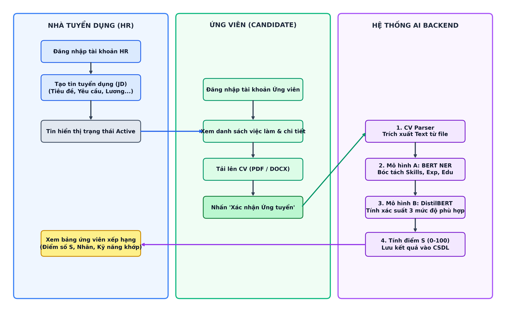</td>
</tr>
<tr>
<td align="center"><b>3. Sơ đồ thực thể kết hợp (ERD)</b><br/>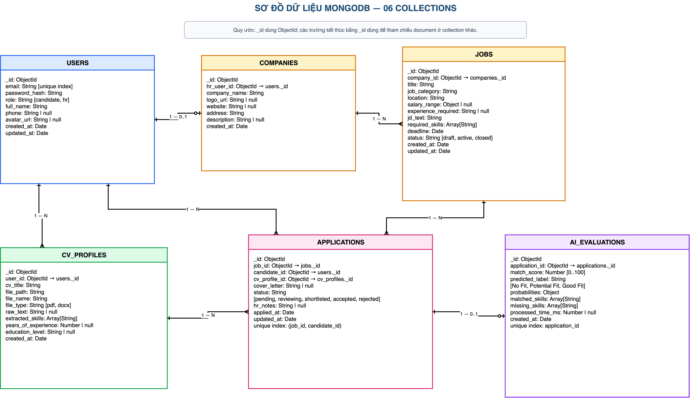</td>
<td align="center"><b>4. Pipeline xử lý CV & AI</b><br/>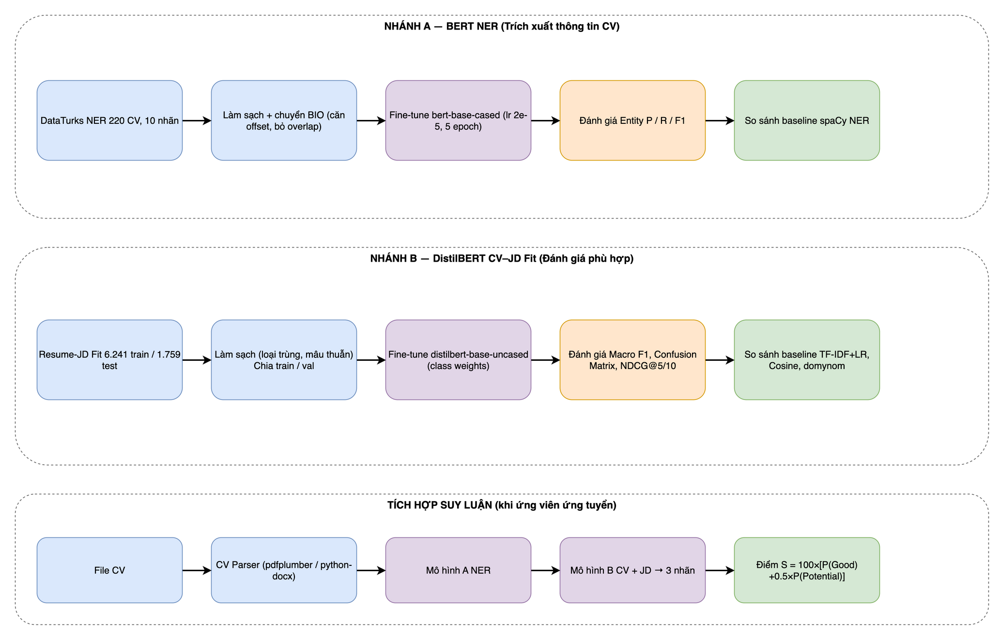</td>
</tr>
<tr>
<td align="center"><b>5. Kiến trúc hệ thống tổng thể</b><br/>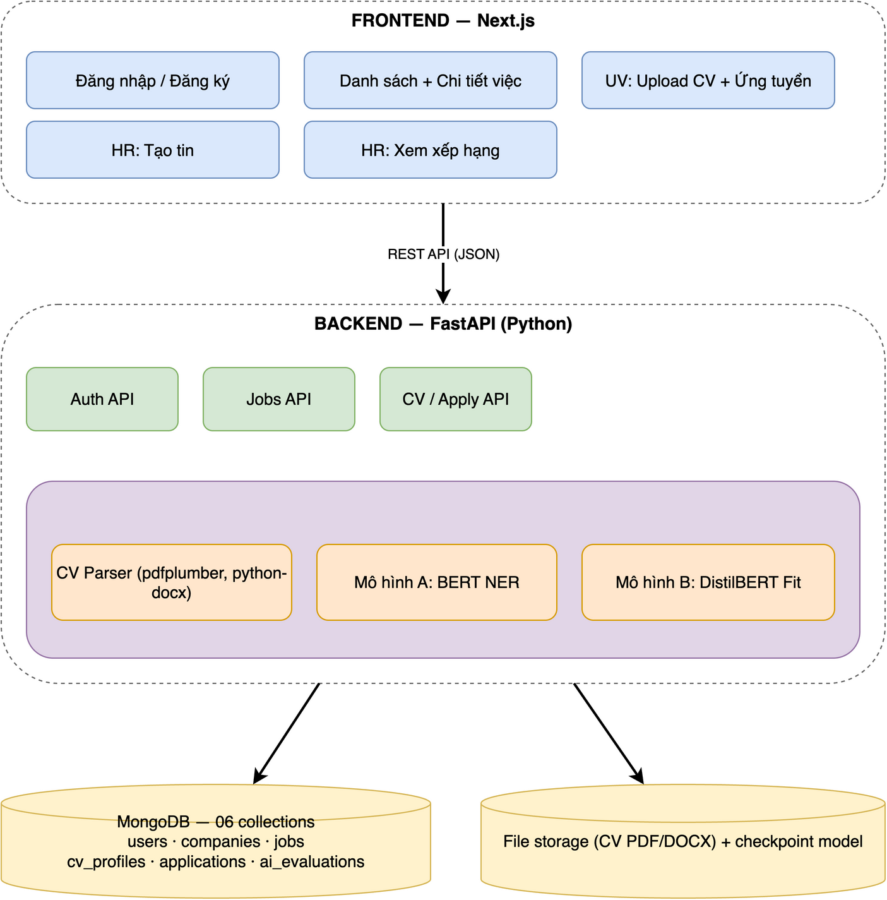</td>
<td align="center"><b>6. Biểu đồ chuyển trạng thái hồ sơ</b><br/>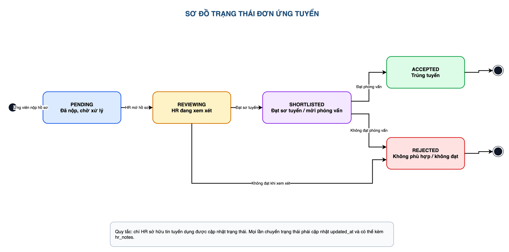</td>
</tr>
</table>

> Toàn bộ file nguồn sơ đồ định dạng `.drawio` để chỉnh sửa trực tiếp nằm tại [`docs/diagrams/`](docs/diagrams) và file tổng hợp [`HE_THONG_TUYEN_DUNG_AI_ALL_DIAGRAMS.drawio`](HE_THONG_TUYEN_DUNG_AI_ALL_DIAGRAMS.drawio).

---

## ⚠️ Hạn chế hiện tại & Hướng phát triển

1. **Mô hình đồng bộ Collection giữa Request và MongoDB**: Hệ thống hiện đã kết nối trực tiếp MongoDB thật (`mongo-client.ts` + `store.ts` với cơ chế diff theo document và `bulkWrite` tuần tự), đáp ứng tốt tải tiểu luận và trình diễn nhiều luồng nghiệp vụ; ở quy mô hàng nghìn truy cập ghi đồng thời mỗi giây, có thể tách dần từng endpoint sang truy vấn aggregation/update trực tiếp từng collection hoặc MongoDB Replica Set Transaction.
2. **Tài nguyên suy luận đầy đủ của `BAAI/bge-m3`**: Nạp trọn vẹn backbone đa ngôn ngữ `BAAI/bge-m3` yêu cầu ~2.3 GB weights + GPU/RAM lớn; ở môi trường nhẹ, AI Service vẫn sử dụng checkpoint `bge_m3_hybrid_head.pt` kết hợp không gian con & cấu trúc từ vựng song ngữ. Trong thực tế sản xuất, nên đóng gói `ai-service` thành container riêng có GPU/ONNX quantization kèm hàng đợi (Redis/Celery) để xử lý OCR và chấm điểm hàng loạt bất đồng bộ.
3. **Độ phủ từ điển chuyên ngành**: Bộ taxonomy trong `ai-service/data/skills_taxonomy.json` và `fit_scorer.py` tối ưu tốt nhất cho CNTT, Dữ liệu, Kinh doanh, Marketing, Kế toán, Logistics và Xây dựng; với một số ngành đặc thù mới, độ chính xác có thể cải thiện thêm bằng cách thu thập và gán nhãn dữ liệu CV–JD tiếng Việt chuyên biệt cho ngành đó.
4. **Bảo mật & Triển khai thực tế**: Chức năng gửi email OTP yêu cầu cấu hình SMTP thật trong `.env.local`, và hệ thống có khuyến nghị nâng cấp phiên bản Next.js `16.4.2` lên bản vá mới hơn khi đưa lên môi trường Internet công khai.

---

<div align="center">

**Phạm Đăng Khoa (`24810114`)** · Giảng viên hướng dẫn: **ThS. Đoàn Thanh Phong**

*Hệ thống Đúng Việc — Tiểu luận Tốt nghiệp · Cập nhật đồng bộ đầy đủ với mã nguồn hiện tại.*

</div>
