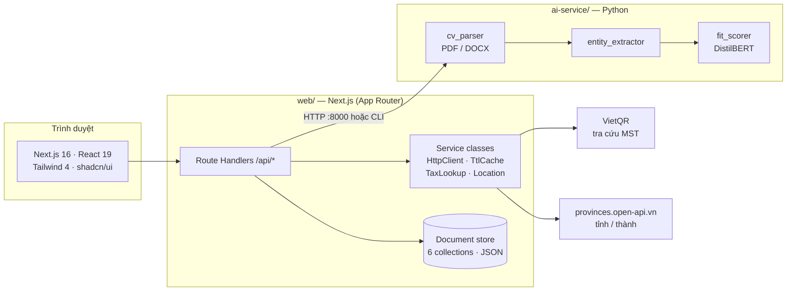
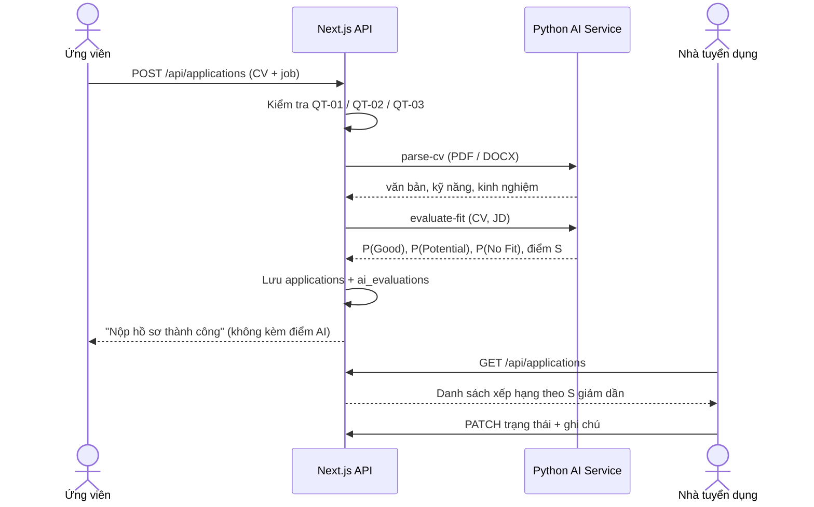
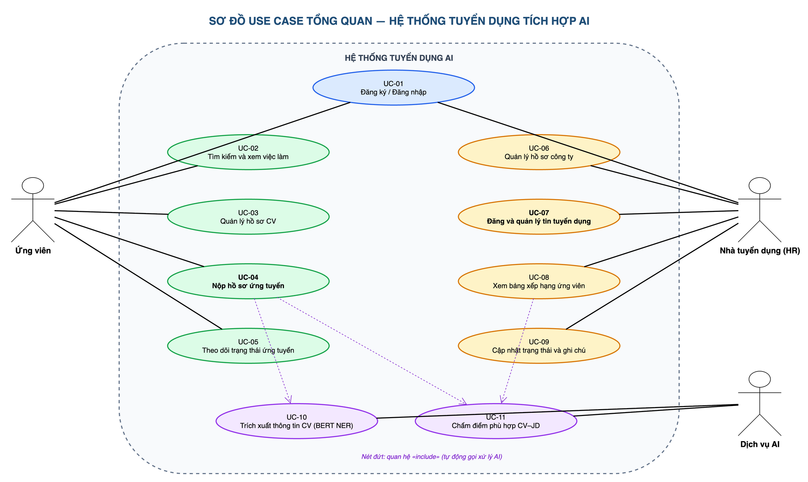
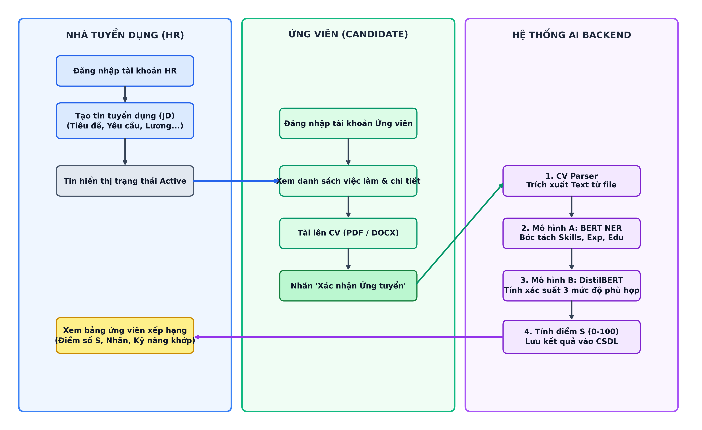
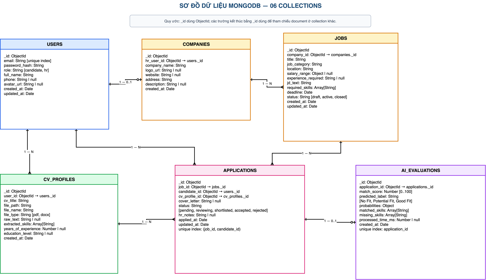
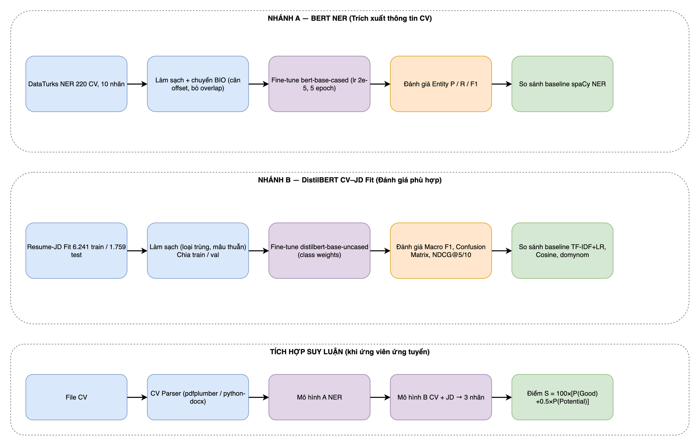
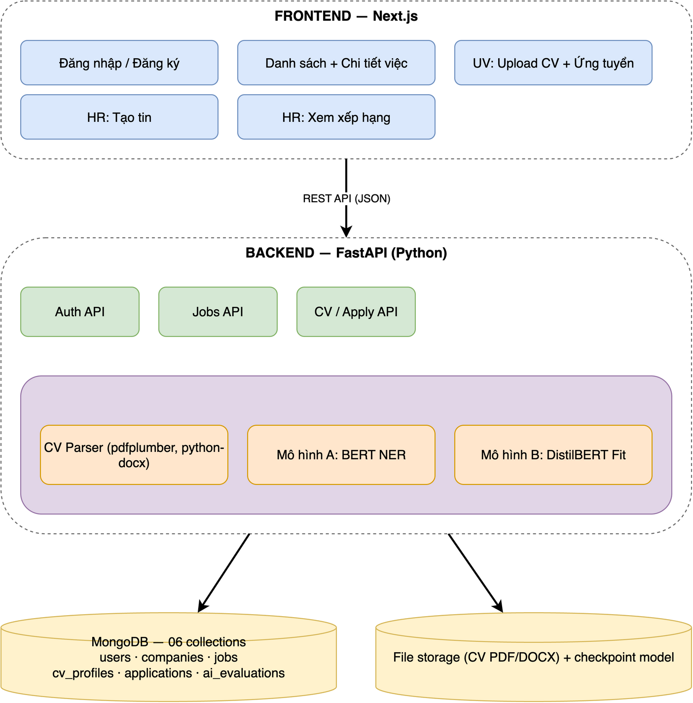
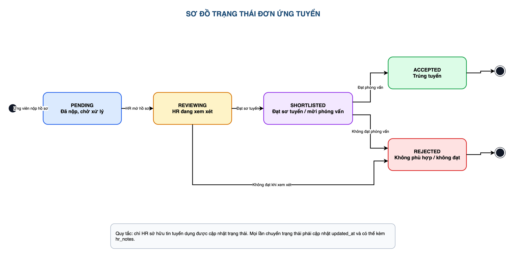

<div align="center">


# Đúng Việc — Website tuyển dụng ứng dụng AI

**Phân tích CV và đánh giá mức độ phù hợp với vị trí tuyển dụng**

[](https://nextjs.org)
[](https://react.dev)
[](https://www.typescriptlang.org)
[](https://tailwindcss.com)
[](https://www.python.org)
[](https://pytorch.org)
[](#-thông-tin-đề-tài)

*Nhà tuyển dụng đăng tin → ứng viên nộp CV → AI chấm điểm CV–JD → HR xem danh sách đã xếp hạng và ra quyết định.*

</div>

---

## 📑 Mục lục

- [Thông tin đề tài](#-thông-tin-đề-tài)
- [Tính năng](#-tính-năng)
- [Kiến trúc hệ thống](#-kiến-trúc-hệ-thống)
- [Mô-đun AI](#-mô-đun-ai)
- [Quy tắc nghiệp vụ](#-quy-tắc-nghiệp-vụ)
- [Công nghệ](#-công-nghệ)
- [Cấu trúc thư mục](#-cấu-trúc-thư-mục)
- [Cài đặt & chạy thử](#-cài-đặt--chạy-thử)
- [Tài khoản mẫu](#-tài-khoản-mẫu)
- [API nội bộ](#-api-nội-bộ)
- [Dịch vụ dữ liệu bên ngoài](#-dịch-vụ-dữ-liệu-bên-ngoài)
- [Cơ sở dữ liệu](#-cơ-sở-dữ-liệu)
- [Sơ đồ thiết kế](#-sơ-đồ-thiết-kế)
- [Hạn chế & hướng phát triển](#-hạn-chế--hướng-phát-triển)

---

## 🎓 Thông tin đề tài

| | |
|---|---|
| **Đề tài** | Xây dựng website hỗ trợ tuyển dụng ứng dụng AI trong phân tích CV và đánh giá mức độ phù hợp với vị trí tuyển dụng |
| **Sinh viên** | Phạm Đăng Khoa — MSSV 24810114 |
| **GVHD** | ThS. Đoàn Thanh Phong |
| **Phạm vi** | 4 use case · 2 vai trò (Ứng viên, Nhà tuyển dụng) · 6 bảng dữ liệu |

Phạm vi được giữ gọn theo đúng báo cáo số 2 — chỉ làm những gì đề tài yêu cầu:

| Mã | Use case | Tác nhân |
|---|---|---|
| **UC-01** | Đăng và quản lý tin tuyển dụng | Nhà tuyển dụng |
| **UC-02** | Tìm việc và ứng tuyển bằng CV | Ứng viên |
| **UC-03** | AI chấm điểm mức độ phù hợp CV – JD | Hệ thống |
| **UC-04** | Sàng lọc ứng viên theo điểm AI | Nhà tuyển dụng |

---

## ✨ Tính năng

### 👤 Ứng viên
- Tìm việc theo từ khoá, tỉnh/thành (34 tỉnh thành mới) và nhóm ngành.
- Nộp CV `.pdf` / `.docx` (≤ 5 MB) hoặc chọn lại CV đã lưu; có thư giới thiệu ngắn.
- Theo dõi trạng thái hồ sơ: *Đã nộp → Đang xem xét → Mời phỏng vấn → Trúng tuyển / Chưa phù hợp*.
- Ứng viên **không thấy điểm AI** và ghi chú nội bộ của HR (xem [QT-04](#-quy-tắc-nghiệp-vụ)).

### 🏢 Nhà tuyển dụng
- Đăng ký **bắt buộc bằng mã số thuế**: tên công ty và địa chỉ lấy tự động từ cơ quan thuế, không nhập tay.
- Khu quản trị với thanh điều hướng ngang gồm 4 mục:

| Mục | Chức năng |
|---|---|
| **Tổng quan** | 4 chỉ số chính, phân bố mức phù hợp, top 5 ứng viên nổi bật |
| **Tin tuyển dụng** | Tạo / sửa tin, lọc theo trạng thái, đóng / mở lại tin |
| **Ứng viên** | Danh sách xếp hạng theo điểm AI, xem CV PDF, điểm AI kèm kỹ năng khớp / thiếu, đổi trạng thái và ghi chú |
| **Công ty** | Thông tin pháp lý chỉ đọc (đã xác thực MST), phần giới thiệu công ty chỉnh sửa được |

### 🤖 AI
- Bóc tách văn bản và thực thể (kỹ năng, số năm kinh nghiệm, học vấn) từ CV thật.
- Chấm điểm CV – JD bằng DistilBERT Cross-Encoder, 3 mức: **Good Fit**, **Potential Fit**, **No Fit**.
- Ghi lại xác suất từng lớp, kỹ năng khớp / thiếu; cảnh báo khi CV là ảnh quét (cần OCR).

---

## 🏗 Kiến trúc hệ thống



- `web/` và `ai-service/` tách riêng. Web gọi AI qua HTTP `:8000`; nếu cổng chưa bật sẽ tự gọi `ai-service/cli.py` (JSON qua stdin/stdout), nên khi chạy thử không bắt buộc bật dịch vụ AI riêng.
- Dữ liệu lưu dạng **document store** trong một file JSON (`database/mongodb_collections.json`), mô phỏng 6 collection của MongoDB theo báo cáo. File được sinh tự động từ dữ liệu mẫu ở lần chạy đầu.

### Luồng ứng tuyển và chấm điểm



---

## 🧠 Mô-đun AI

**Mô hình:** `distilbert-base-uncased` fine-tune làm Cross-Encoder phân loại 3 lớp trên bộ dữ liệu
[`cnamuangtoun/resume-job-description-fit`](https://huggingface.co/datasets/cnamuangtoun/resume-job-description-fit)
(5.298 train · 936 val · 1.759 test).

**Smart Dual Truncation:** `[CLS] CV (≤384 token) [SEP] JD (≤125 token) [SEP]` ≤ 512 token.

**Điểm phù hợp liên tục:**

```
S = 100 × [ P(Good Fit) + 0.5 × P(Potential Fit) ]
```

| Điểm S | Nhãn | Hiển thị cho HR |
|---|---|---|
| ≥ 70 | Good Fit | Rất phù hợp |
| 50 – 70 | Potential Fit | Tiềm năng |
| < 50 | No Fit | Chưa phù hợp |

Ngưỡng nằm ở [`web/src/lib/ai-thresholds.ts`](web/src/lib/ai-thresholds.ts) và khớp với [`ai-service/services/fit_scorer.py`](ai-service/services/fit_scorer.py).

### Kết quả thực nghiệm

| Chỉ số | Validation (epoch 5) | Test (1.759 mẫu) — DistilBERT | Test — TF-IDF + LR (baseline) |
|---|---|---|---|
| Accuracy | 0,660 | 0,449 | 0,456 |
| Macro-F1 | 0,661 | 0,378 | 0,427 |

Chỉ số xếp hạng: **NDCG@5 = 0,584**, **NDCG@10 = 0,726**.

> [!IMPORTANT]
> Kết quả trên tập test **chưa vượt baseline TF-IDF**. Bộ dữ liệu công khai là CV – JD tiếng Anh, nhãn nhiễu và 3 lớp khó phân biệt. Vì vậy điểm AI chỉ là **tham khảo để HR ưu tiên xem hồ sơ**, mọi quyết định cuối cùng do con người đưa ra (QT-04). Chi tiết phương pháp ở báo cáo số 3.

Ma trận nhầm lẫn:

<div align="center">

</div>

> [!NOTE]
> File trọng số `model.safetensors` (~268 MB) **không nằm trong repo** do vượt giới hạn của GitHub. Khi thiếu file này, `ai-service` tự chạy chế độ suy luận trên văn bản CV/JD để demo vẫn hoạt động. Xem [`ai-service/models/README.md`](ai-service/models/README.md).

### Endpoint của AI Service

| Method | Đường dẫn | Mô tả |
|---|---|---|
| GET | `/api/v1/health` | Trạng thái dịch vụ, mô hình đã nạp hay chưa |
| GET | `/api/v1/model-info` | Thông số thực nghiệm DistilBERT |
| POST | `/api/v1/parse-cv` | Đọc CV `.pdf` / `.docx`, trích kỹ năng, kinh nghiệm, học vấn |
| POST | `/api/v1/evaluate-fit` | Chấm điểm CV – JD, trả xác suất 3 lớp và điểm S |

---

## 📜 Quy tắc nghiệp vụ

| Mã | Quy tắc | Nơi thực thi |
|---|---|---|
| **QT-01** | CV chỉ nhận `.pdf` / `.docx`, tối đa 5 MB | Client + `api/applications` + `ai-service` |
| **QT-02** | Mỗi ứng viên chỉ ứng tuyển 1 lần cho 1 tin (HTTP 409 nếu trùng) | `api/applications` |
| **QT-03** | Tin đã đóng hoặc hết hạn thì không nhận hồ sơ mới | `api/applications` |
| **QT-04** | Điểm AI chỉ để HR tham khảo; ứng viên không xem được điểm và ghi chú nội bộ | `api/applications` (lọc theo vai trò) |
| **QT-05** | Ứng viên chỉ thấy đơn của mình; HR chỉ thấy đơn thuộc công ty của mình | `api/applications` |

---

## 🧰 Công nghệ

| Lớp | Công nghệ |
|---|---|
| Giao diện | Next.js 16 (App Router, Cache Components), React 19, TypeScript, Tailwind CSS 4, shadcn/ui (Radix), lucide-react, sonner |
| Dữ liệu client | TanStack Query 5, react-hook-form + zod, react-dropzone |
| Backend | Next.js Route Handlers, phiên đăng nhập bằng cookie ký (HMAC), băm mật khẩu `scrypt` |
| AI | Python 3.11, PyTorch, 🤗 Transformers (DistilBERT), pdfplumber, pypdf, python-docx, scikit-learn |
| Dịch vụ ngoài | VietQR Business API, provinces.open-api.vn (có dữ liệu dự phòng offline) |

**Nhận diện thương hiệu:** logo *tờ CV + kính lúp có dấu tick + tia sáng AI*, bảng màu xanh `#306BD9` / navy `#0F1F4D`. Bộ biểu tượng, favicon, ảnh chia sẻ OG sinh bằng [`web/scripts/generate-brand-assets.mjs`](web/scripts/generate-brand-assets.mjs).

---

## 🗂 Cấu trúc thư mục

```text
.
├── web/                         # Ứng dụng Next.js
│   ├── src/app/                 # Trang & API (App Router)
│   │   ├── page.tsx             #   Trang chủ
│   │   ├── viec-lam/            #   Danh sách & chi tiết việc làm
│   │   ├── dang-nhap/ dang-ky/  #   Xác thực
│   │   ├── ung-vien/            #   Khu vực ứng viên
│   │   ├── nha-tuyen-dung/      #   Khu vực HR (tổng quan, tin, ứng viên, công ty)
│   │   └── api/                 #   Route Handlers
│   ├── src/components/          # auth · hr · job · candidate · shared · ui
│   ├── src/hooks/               # use-auth, use-provinces, use-tax-lookup, hr/use-hr-data
│   ├── src/lib/
│   │   ├── services/            # HttpClient, TtlCache, TaxLookup, LocationService
│   │   ├── db/                  # store (document DB), ai-client, types
│   │   └── ai-thresholds.ts     # Ngưỡng 70 / 50 dùng chung
│   └── scripts/                 # Tạo logo / favicon / OG image
├── ai-service/                  # Python AI microservice
│   ├── main.py  cli.py          # HTTP server (:8000) và cầu nối CLI
│   ├── services/                # cv_parser · entity_extractor · fit_scorer
│   └── models/                  # Checkpoint DistilBERT (trọng số không đưa lên git)
├── database/                    # Schema MongoDB / PostgreSQL (dữ liệu chạy thật tự sinh)
├── docs/                        # Báo cáo, sơ đồ draw.io + PNG
├── filebaocao/ tailieuchuan/    # Các báo cáo tuần 1–3 của tiểu luận
├── kqtrain/                     # Kết quả huấn luyện (confusion matrix, notebook)
└── TRAIN_CV_JD_FIT_MODEL.ipynb  # Notebook huấn luyện mô hình
```

---

## 🚀 Cài đặt & chạy thử

**Yêu cầu:** Node.js ≥ 20, Python 3.11 (chỉ cần cho phần AI), kết nối Internet (tra cứu MST và tỉnh/thành; tỉnh/thành có dữ liệu dự phòng).

### 1. Clone

```bash
git clone https://github.com/phamkhoa18/dungviec-platform.git
cd dungviec-platform
```

### 2. Chạy website

```bash
cd web
cp .env.example .env.local     # chỉnh JWT_SECRET nếu muốn
npm install
npm run dev
```

Mở <http://localhost:3000>. Lần chạy đầu tiên, hệ thống tự tạo `database/mongodb_collections.json` từ dữ liệu mẫu.

### 3. Chạy AI service (khuyến nghị)

```bash
cd ai-service
python3.11 -m venv .venv && source .venv/bin/activate
pip install -r requirements.txt
python main.py                  # http://127.0.0.1:8000
```

Kiểm tra: `curl http://127.0.0.1:8000/api/v1/health`.
Nếu chưa bật, web sẽ tự gọi `ai-service/cli.py` bằng `python3` có sẵn trên máy (cần đã cài `requirements.txt`).

### 4. Biến môi trường

| Biến | Mặc định | Ý nghĩa |
|---|---|---|
| `JWT_SECRET` | khoá dev tích hợp sẵn | Khoá ký phiên đăng nhập — **đặt giá trị riêng khi triển khai thật** |
| `AI_SERVICE_URL` | `http://127.0.0.1:8000` | Địa chỉ AI service |
| `AI_SERVICE_HOST` / `AI_SERVICE_PORT` | `127.0.0.1` / `8000` | Địa chỉ lắng nghe của AI service |

### 5. Kiểm tra mã nguồn

```bash
cd web
npm run lint
npx tsc --noEmit
```

---

## 🔑 Tài khoản mẫu

Mật khẩu chung của dữ liệu mẫu: **`123456`**

| Vai trò | Email | Ghi chú |
|---|---|---|
| Nhà tuyển dụng | `hr@fptsoftware.com` | FPT Software, có sẵn tin và hồ sơ ứng tuyển |
| Nhà tuyển dụng | `hr@momo.vn` | MoMo |
| Ứng viên | `minhanh.dev@gmail.com` | CV Python Backend |
| Ứng viên | `thaovy.fe@gmail.com` | CV ReactJS Frontend |
| Ứng viên | `hoangnam.da@gmail.com` | CV Data Analyst |
| Ứng viên | `quocbao.civil@gmail.com` | CV Kỹ sư xây dựng |

Đăng ký HR mới cần **mã số thuế còn hoạt động và chưa được dùng** (10 số, hoặc 13 số dạng `XXXXXXXXXX-NNN`).

---

## 🔌 API nội bộ

| Nhóm | Endpoint | Mô tả |
|---|---|---|
| Xác thực | `POST /api/auth/register` · `login` · `logout` · `GET/PUT /api/auth/me` | Đăng ký (HR kèm MST), đăng nhập, phiên hiện tại |
| Việc làm | `GET/POST /api/jobs` · `GET/PUT/PATCH/DELETE /api/jobs/[id]` | Danh sách, tạo, sửa, đóng / mở lại, xoá tin |
| Ứng tuyển | `GET/POST /api/applications` | Danh sách xếp hạng (theo vai trò) và nộp hồ sơ |
| | `PATCH /api/applications/[id]` | HR đổi trạng thái, ghi chú |
| | `POST /api/applications/[id]` | Chấm lại điểm AI |
| CV | `GET/POST/DELETE /api/cv-profiles` | CV đã lưu của ứng viên |
| Công ty | `GET/PUT /api/companies` | Thông tin công ty (tên, MST, địa chỉ chỉ đọc khi đã xác thực) |
| Tra cứu | `GET /api/lookup/tax/[mst]` | Tra cứu mã số thuế |
| | `GET /api/locations/provinces` | Danh sách tỉnh/thành |
| Hệ thống | `GET /api/ai/status` | Trạng thái AI service và thống kê collection |

---

## 🌐 Dịch vụ dữ liệu bên ngoài

Truy cập qua các lớp service trong [`web/src/lib/services/`](web/src/lib/services) (`HttpClient` có timeout 8 giây và tự thử lại, `TtlCache` lưu đệm):

| Dữ liệu | Nguồn | Cache | Dự phòng |
|---|---|---|---|
| Mã số thuế → tên, địa chỉ, trạng thái hoạt động | [VietQR Business API](https://api.vietqr.io/v2/business/) | 7 ngày | Báo lỗi `UNAVAILABLE`, không cho đăng ký |
| 34 tỉnh/thành Việt Nam | [provinces.open-api.vn](https://provinces.open-api.vn) (v2) | 24 giờ | Esgoo, rồi danh sách nhúng sẵn `provinces-fallback.ts` |

Khi đăng ký HR, server tự tra MST ở phía máy chủ rồi mới lưu `company_name`, `address`, `tax_code`, nên không thể giả mạo từ trình duyệt. MST trùng trả về `409 DUPLICATE_TAX_CODE`.

---

## 🗄 Cơ sở dữ liệu

6 collection theo báo cáo số 2 (script: [`database/schema_mongodb_baocao2.js`](database/schema_mongodb_baocao2.js), bản SQL tương đương: [`schema_postgres_baocao2.sql`](database/schema_postgres_baocao2.sql)):

| Collection | Nội dung chính |
|---|---|
| `users` | Tài khoản, vai trò `candidate` / `hr`, mật khẩu băm |
| `companies` | Công ty của HR: tên, MST, địa chỉ, cờ `verified`, ngành, quy mô |
| `jobs` | Tin tuyển dụng, JD, kỹ năng yêu cầu, hạn nộp, trạng thái |
| `cv_profiles` | CV đã bóc tách: văn bản, kỹ năng, kinh nghiệm, học vấn |
| `applications` | Đơn ứng tuyển, trạng thái, ghi chú HR (duy nhất theo job + ứng viên) |
| `ai_evaluations` | Điểm S, nhãn, 3 xác suất, kỹ năng khớp / thiếu, phiên bản mô hình |

---

## 📐 Sơ đồ thiết kế

<table>
<tr>
<td align="center"><b>Use case</b><br/></td>
<td align="center"><b>Quy trình nghiệp vụ</b><br/></td>
</tr>
<tr>
<td align="center"><b>ERD</b><br/></td>
<td align="center"><b>Pipeline AI</b><br/></td>
</tr>
<tr>
<td align="center"><b>Kiến trúc</b><br/></td>
<td align="center"><b>Trạng thái hồ sơ</b><br/></td>
</tr>
</table>

File nguồn `.drawio` nằm cùng thư mục [`docs/diagrams/`](docs/diagrams). Báo cáo đầy đủ: [`tailieuchuan/`](tailieuchuan).

---

## ⚠️ Hạn chế & hướng phát triển

- **Dữ liệu lưu trong file JSON** để dễ chạy thử và nộp bài; chưa dùng cơ sở dữ liệu thật. Schema MongoDB / PostgreSQL đã có sẵn để chuyển đổi.
- **Chất lượng mô hình** còn hạn chế (xem bảng kết quả): dữ liệu huấn luyện là tiếng Anh, chưa có tập CV – JD tiếng Việt có nhãn.
- **CV dạng ảnh quét** chưa được OCR, hệ thống chỉ cảnh báo.
- Hướng phát triển: tập dữ liệu tiếng Việt, mô hình đa ngôn ngữ, OCR, chuyển sang MongoDB, hộp thư thông báo cho ứng viên.

---

<div align="center">

Thực hiện bởi **Phạm Đăng Khoa** · GVHD **ThS. Đoàn Thanh Phong**

*Dự án phục vụ mục đích học tập — Tiểu luận tốt nghiệp.*

</div>
