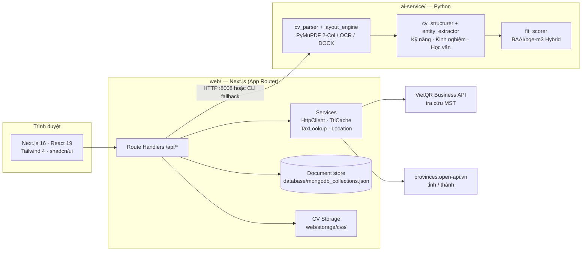
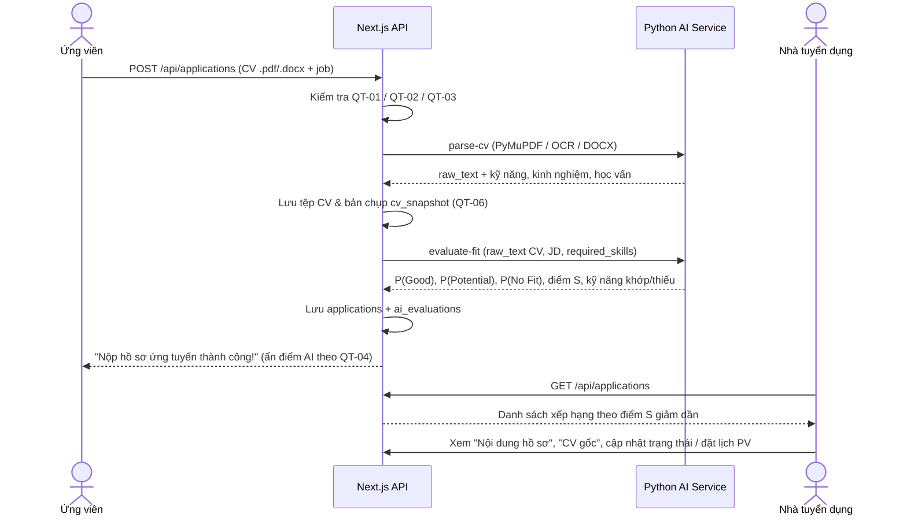
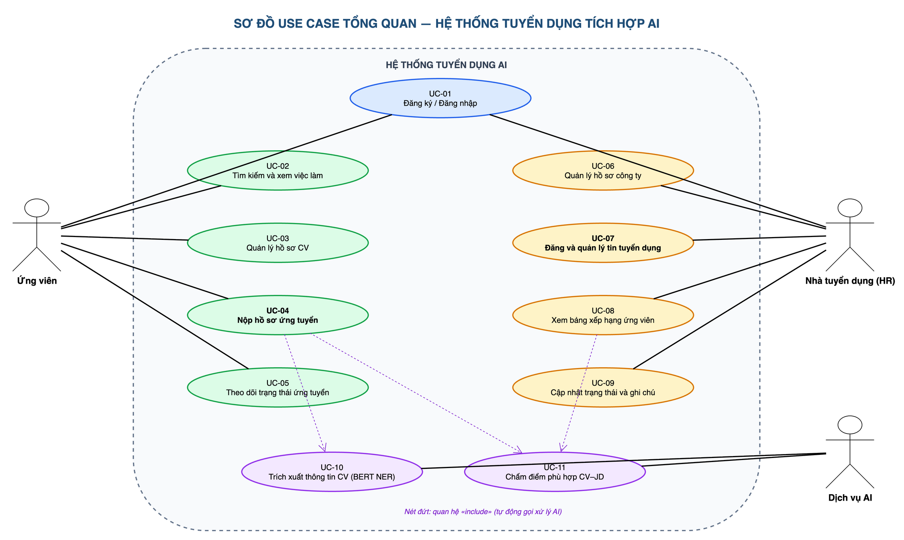

<div align="center">


# Đúng Việc — Website tuyển dụng ứng dụng AI

**Phân tích CV và đánh giá mức độ phù hợp với vị trí tuyển dụng**

[](https://nextjs.org)
[](https://react.dev)
[](https://www.typescriptlang.org)
[](https://tailwindcss.com)
[](https://www.python.org)
[](https://pytorch.org)
[](#-thông-tin-đề-tài)

*Nhà tuyển dụng đăng tin → ứng viên nộp CV → AI đọc toàn bộ nội dung CV & chấm điểm CV–JD → HR xem danh sách đã xếp hạng và ra quyết định.*

</div>

---

## 📑 Mục lục

- [Thông tin đề tài](#-thông-tin-đề-tài)
- [Tính năng](#-tính-năng)
- [Kiến trúc hệ thống](#-kiến-trúc-hệ-thống)
- [Mô-đun AI](#-mô-đun-ai)
- [Quy tắc nghiệp vụ](#-quy-tắc-nghiệp-vụ)
- [Công nghệ](#-công-nghệ)
- [Cấu trúc thư mục](#-cấu-trúc-thư-mục)
- [Cài đặt & chạy thử](#-cài-đặt--chạy-thử)
- [Tài khoản mẫu](#-tài-khoản-mẫu)
- [API nội bộ](#-api-nội-bộ)
- [Dịch vụ dữ liệu bên ngoài](#-dịch-vụ-dữ-liệu-bên-ngoài)
- [Cơ sở dữ liệu](#-cơ-sở-dữ-liệu)
- [Sơ đồ thiết kế](#-sơ-đồ-thiết-kế)
- [Hạn chế & hướng phát triển](#-hạn-chế--hướng-phát-triển)

---

## 🎓 Thông tin đề tài

| | |
|---|---|
| **Đề tài** | Xây dựng website hỗ trợ tuyển dụng ứng dụng AI trong phân tích CV và đánh giá mức độ phù hợp với vị trí tuyển dụng |
| **Sinh viên** | Phạm Đăng Khoa — MSSV `24810114` |
| **GVHD** | ThS. Đoàn Thanh Phong |
| **Phạm vi** | 4 use case chính · 2 vai trò (`candidate`, `hr`) · 6 bảng dữ liệu chuẩn + các bảng mở rộng hỗ trợ quy trình |

| Mã | Use case | Tác nhân |
|---|---|---|
| **UC-01** | Đăng và quản lý tin tuyển dụng | Nhà tuyển dụng |
| **UC-02** | Tìm việc, quản lý CV và ứng tuyển | Ứng viên |
| **UC-03** | AI phân tích CV và chấm điểm mức độ phù hợp CV – JD | Hệ thống |
| **UC-04** | Sàng lọc, so sánh ứng viên theo điểm AI và phỏng vấn | Nhà tuyển dụng |

---

## ✨ Tính năng

### 👤 Ứng viên
- Tìm việc theo từ khóa, tỉnh/thành (34 tỉnh/thành), nhóm ngành, hình thức làm việc và mức lương.
- Tải lên CV `.pdf` / `.docx` (≤ 5 MB) hoặc chọn CV đã lưu; hỗ trợ thư giới thiệu ngắn và quản lý hồ sơ năng lực.
- Xem trực tiếp **bản PDF gốc** và **Nội dung hồ sơ** (văn bản đã đọc từ CV) ngay trong modal xem CV; hỗ trợ rà soát thông tin gợi ý điền vào hồ sơ cá nhân.
- Theo dõi tiến trình hồ sơ (*Mới nộp → Đang xem xét → Phỏng vấn → Đề nghị nhận việc → Trúng tuyển / Từ chối / Đã rút*), xác nhận hoặc xin đổi lịch phỏng vấn, nhận thông báo.
- Ứng viên **không thấy điểm AI** và các ghi chú/đánh giá nội bộ của HR (quy tắc [QT-04](#-quy-tắc-nghiệp-vụ)).

### 🏢 Nhà tuyển dụng
- Đăng ký **bắt buộc xác thực bằng mã số thuế (MST)**: tên công ty và địa chỉ được tra cứu tự động từ cơ quan thuế qua server, không nhập tay giả mạo.
- Khu quản trị với thanh điều hướng gồm **5 mục**:

| Mục | Chức năng |
|---|---|
| **Tổng quan** | Các chỉ số KPI tuyển dụng, phễu chuyển đổi, biểu đồ phân bố mức phù hợp AI, top ứng viên và lịch phỏng vấn sắp tới |
| **Tin tuyển dụng** | Tạo / sửa / nhân bản tin, lọc theo trạng thái, đóng / mở lại tin, chấm lại điểm hàng loạt khi cập nhật mô tả |
| **Ứng viên** | Danh sách xếp hạng theo điểm AI (List & Kanban), chi tiết 5 tab (*Đánh giá AI*, *Nội dung hồ sơ*, *CV gốc*, *Phỏng vấn*, *Ghi chú & Lịch sử*), so sánh song song ứng viên, thao tác hàng loạt và xuất CSV |
| **Lịch phỏng vấn** | Đặt lịch trực tuyến/trực tiếp, xuất tệp `.ics`, ghi nhận kết quả đánh giá sau phỏng vấn |
| **Công ty** | Thông tin pháp lý chỉ đọc (đã xác thực MST), chỉnh sửa giới thiệu, ngành nghề, quy mô và phúc lợi |

### 🤖 AI (1 mô hình tự huấn luyện duy nhất)
- **Đọc & chuẩn hóa CV (`ai-service/`)**: Hỗ trợ PDF 1–2 cột (PyMuPDF kết hợp thuật toán dò khe trắng và băng ngang), OCR lai cho PDF ảnh quét (Tesseract 5 LSTM `vie+eng` + OpenCV + RapidOCR/PP-OCRv4), và Word `.docx`.
- **Chấm điểm không mất dữ liệu**: Mô hình AI đọc **toàn bộ nội dung văn bản gốc (`raw_text`)** của CV thay vì bản tóm tắt rút gọn, đảm bảo giữ nguyên 100% thông tin kinh nghiệm, dự án và kỹ năng.
- **Mô hình duy nhất**: **`BAAI/bge-m3` (`BGEM3HybridFitClassifier`)** song ngữ Việt–Anh (4 chế độ `VI-VI`, `EN-EN`, `EN-VI`, `VI-EN`), trả về điểm `S` (0–100), phân loại **Good Fit / Potential Fit / No Fit**, xác suất 3 lớp, kỹ năng khớp/thiếu (hỗ trợ nhãn ghép & từ đồng nghĩa song ngữ) và nhận xét tự động bằng tiếng Việt.

---

## 🏗 Kiến trúc hệ thống



- `web/` và `ai-service/` tách riêng. Website ưu tiên gọi HTTP tới `http://127.0.0.1:8008`; nếu dịch vụ HTTP chưa được bật, backend tự động gọi `ai-service/cli.py` qua JSON stdin/stdout để vẫn thực thi đúng pipeline Python thật.
- Tệp CV tải lên được lưu ngoài `public/` tại `web/storage/cvs/` và chỉ cho phép truy cập qua `/api/files/cv/[id]` sau khi kiểm tra quyền sở hữu/tuyển dụng.
- Dữ liệu lưu trong document store `database/mongodb_collections.json` (tự sinh từ dữ liệu mẫu ở lần chạy đầu tiên; có sẵn script schema cho MongoDB và PostgreSQL).

### Luồng ứng tuyển và chấm điểm



---

## 🧠 Mô-đun AI

- **Kiến trúc:** **`BAAI/bge-m3`** + tầng phân loại lai **`BGEM3HybridFitClassifier`** ([`bge_m3_hybrid_head.pt`](ai-service/models/best_cvjd_model/bge_m3_hybrid_head.pt), ~8.4 MB), huấn luyện bằng PyTorch trong [`TRAIN_BGE_M3_BILINGUAL_COLAB.ipynb`](TRAIN_BGE_M3_BILINGUAL_COLAB.ipynb).
- **Dữ liệu huấn luyện:** [`cnamuangtoun/resume-job-description-fit`](https://huggingface.co/datasets/cnamuangtoun/resume-job-description-fit) (tách Bipartite Disjoint Split 0% trùng lặp CV/JD giữa Train/Val/Test) kết hợp ngữ liệu song ngữ Việt–Anh (`VI-VI`, `EN-EN`, `EN-VI`, `VI-EN`).
- **Ngữ cảnh dài:** CV tối đa `1.024` token + JD tối đa `1.024` token = `2.048` token (hỗ trợ kiến trúc mở rộng tới `8.192` token).
- **Công thức điểm phù hợp liên tục (`QT-04`):**

```text
S = 100 × [ P(Good Fit) + 0.5 × P(Potential Fit) ]
```

| Điểm `S` | Nhãn | Hiển thị cho HR |
|---|---|---|
| ≥ 70 | Good Fit | Rất phù hợp |
| 50 – 69 | Potential Fit | Tiềm năng |
| < 50 | No Fit | Chưa phù hợp |

Ngưỡng đồng bộ tại [`web/src/lib/ai-thresholds.ts`](web/src/lib/ai-thresholds.ts) và [`ai-service/services/fit_scorer.py`](ai-service/services/fit_scorer.py).

### Kết quả thực nghiệm (theo [`ai-service/config.py`](ai-service/config.py))

| Chỉ số | Validation (Epoch 14) | Test độc lập — `BAAI/bge-m3 Hybrid` | Test — TF-IDF + Logistic Regression (Baseline) |
|---|---|---|---|
| Accuracy | 79,11% | **72,71%** | 65,05% |
| Macro-F1 | 0,7804 | **0,7220** | 0,6419 |
| Weighted-F1 | — | **0,7271** | — |
| Test 100 mẫu phân tầng | — | **77,00%** | — |

Chỉ số xếp hạng: **NDCG@5 = 0,9192**, **NDCG@10 = 0,9302**, **Recall@5 = 0,8905**.

> [!NOTE]
> Trọng số tầng phân loại `bge_m3_hybrid_head.pt` được lưu tại [`ai-service/models/best_cvjd_model/`](ai-service/models/best_cvjd_model). Chi tiết xem [`ai-service/models/README.md`](ai-service/models/README.md).

### Endpoint của Python AI Service (`:8008`)

| Method | Đường dẫn | Mô tả |
|---|---|---|
| `GET` | `/api/v1/health` | Kiểm tra trạng thái AI engine và checkpoint |
| `GET` | `/api/v1/model-info` | Thông số thực nghiệm và cấu hình runtime `BAAI/bge-m3` |
| `POST` | `/api/v1/parse-cv` | Đọc `.pdf` / `.docx` (kèm OCR khi cần), trả về `raw_text` và metadata kỹ năng/kinh nghiệm |
| `POST` | `/api/v1/evaluate-fit` | Chấm điểm CV–JD từ `raw_text`, trả về điểm `S`, 3 xác suất, kỹ năng khớp/thiếu và nhận xét |

---

## 📜 Quy tắc nghiệp vụ

| Mã | Quy tắc | Nơi thực thi |
|---|---|---|
| **QT-01** | CV chỉ nhận định dạng `.pdf` / `.docx`, tối đa 5.0 MB, không rỗng | Client + `api/applications` + `api/cv-profiles` + `ai-service` |
| **QT-02** | Mỗi ứng viên chỉ nộp 1 đơn đang hiệu lực cho mỗi tin (HTTP 409 nếu trùng; cho nộp lại nếu đã rút) | `api/applications` |
| **QT-03** | Tin đã đóng hoặc quá hạn `deadline` tự chuyển `closed` và không nhận hồ sơ | `enforceJobDeadlines` + `api/applications` |
| **QT-04** | Điểm `S = 100 × (P(Good) + 0.5 × P(Potential))` chỉ HR xem được; ứng viên bị ẩn điểm AI và ghi chú nội bộ | `api/applications` + `api/applications/[id]` |
| **QT-05** | Ứng viên chỉ xem/sửa dữ liệu của mình; HR chỉ thao tác tin/đơn thuộc công ty của mình | `requireHr` + `ownsJob` + `api/files/cv/[id]` |
| **QT-06** | Lỗi kết nối AI khi nộp đơn vẫn lưu hồ sơ ở trạng thái `pending_evaluation` để HR chấm lại sau | `api/applications` + `hr-server` |

---

## 🧰 Công nghệ

| Lớp | Công nghệ |
|---|---|
| Giao diện | Next.js 16 (App Router), React 19, TypeScript 5, Tailwind CSS 4, shadcn/ui (Radix), lucide-react, sonner |
| Dữ liệu client | TanStack Query 5, react-hook-form + zod, react-dropzone |
| Backend | Next.js Route Handlers, cookie phiên ký HMAC-SHA256, băm mật khẩu `scrypt` |
| AI & Xử lý tài liệu | Python 3.9+/3.11, FastAPI/Uvicorn, PyTorch, 🤗 Transformers (`BAAI/bge-m3`), PyMuPDF (`fitz`), Tesseract 5 OCR (`vie+eng`), RapidOCR (`onnxruntime`), OpenCV, python-docx, pypdf |
| Dịch vụ ngoài | VietQR Business API (MST), `provinces.open-api.vn` (có fallback `esgoo` + offline) |

**Nhận diện thương hiệu:** logo *tờ CV + kính lúp có dấu tick + tia sáng AI*, bảng màu xanh `#306BD9` / navy `#0F1F4D`. Asset sinh bằng [`web/scripts/generate-brand-assets.mjs`](web/scripts/generate-brand-assets.mjs).

---

## 🗂 Cấu trúc thư mục

```text
.
├── web/                              # Ứng dụng Next.js (Frontend + Backend API)
│   ├── src/app/                      # Pages & Route Handlers (App Router)
│   │   ├── page.tsx                  #   Trang chủ
│   │   ├── viec-lam/                 #   Tìm việc & chi tiết tin tuyển dụng
│   │   ├── cong-ty/[slug]/           #   Trang chi tiết doanh nghiệp
│   │   ├── dang-nhap/  dang-ky/      #   Đăng nhập & đăng ký (HR kèm xác thực MST)
│   │   ├── ung-vien/                 #   Trung tâm tài khoản & quản lý CV ứng viên
│   │   ├── nha-tuyen-dung/           #   Khu HR (Tổng quan, Tin, Ứng viên, Lịch PV, Công ty)
│   │   └── api/                      #   29 file Route Handler (/api/*)
│   ├── src/components/               # auth · candidate · home · hr · job · layout · shared · ui
│   ├── src/hooks/                    # use-auth, use-provinces, use-tax-lookup, hr/use-hr-data
│   ├── src/lib/
│   │   ├── db/                       # store.ts, server-auth.ts, ai-client.ts, types.ts
│   │   ├── hr/                       # hr-server.ts, job-input.ts
│   │   ├── profile/                  # cv-record.ts, profile-server.ts, merge.ts
│   │   ├── recruitment/              # status.ts (pipeline & trạng thái dùng chung)
│   │   ├── services/                 # http-client, ttl-cache, tax-lookup, location-service
│   │   └── ai-thresholds.ts          # Ngưỡng 70 / 50 dùng chung
│   ├── storage/cvs/                  # Thư mục lưu tệp CV tải lên (riêng tư, gitignored)
│   └── .env.example                  # Mẫu biến môi trường
├── ai-service/                       # Python AI Microservice (:8008 & CLI)
│   ├── main.py                       # HTTP server (FastAPI / ThreadingHTTPServer)
│   ├── cli.py                        # Cầu nối stdin/stdout khi server HTTP chưa bật
│   ├── config.py                     # Cấu hình model, token limit, metrics
│   ├── requirements.txt              # Danh sách thư viện Python
│   ├── services/
│   │   ├── cv_parser.py              # Kiểm tra QT-01 & điều phối trích xuất CV
│   │   ├── layout_engine.py          # Đọc PDF 1–2 cột, OCR lai Tesseract/RapidOCR, DOCX
│   │   ├── cv_structurer.py          # Chuẩn hóa kỹ năng, thời gian kinh nghiệm, học vấn
│   │   ├── entity_extractor.py       # API trích xuất thực thể tương thích
│   │   └── fit_scorer.py             # Chấm điểm CV–JD song ngữ (BAAI/bge-m3 Hybrid)
│   ├── data/                         # Taxonomy kỹ năng song ngữ & từ điển chuẩn hóa
│   └── models/best_cvjd_model/       # Checkpoint bge_m3_hybrid_head.pt (~8.4 MB)
├── database/                         # Schema MongoDB / PostgreSQL & runtime DB JSON
├── dataset_200_cv_pdfs/              # Tập 200 CV PDF mẫu phục vụ kiểm thử & seed
├── docs/                             # Tài liệu thiết kế & sơ đồ .drawio / .png
├── scripts/                          # Script kiểm thử E2E & tạo dữ liệu mẫu
└── TRAIN_BGE_M3_BILINGUAL_COLAB.ipynb # Notebook huấn luyện BAAI/bge-m3 Hybrid trên Colab
```

---

## 🚀 Cài đặt & chạy thử

**Yêu cầu:** Node.js ≥ 20, Python 3.9+ (khuyến nghị 3.11 cho AI service), Tesseract (`vie+eng`) nếu cần OCR PDF scan, kết nối Internet (tra cứu MST và tỉnh/thành).

### 1. Clone dự án

```bash
git clone https://github.com/phamkhoa18/dungviec-platform.git
cd dungviec-platform
```

### 2. Chạy Website (`web/`)

```bash
cd web
cp .env.example .env.local     # chỉnh JWT_SECRET nếu cần
npm install
npm run dev
```

Mở <http://localhost:3000>. Ở lần chạy đầu tiên, hệ thống tự khởi tạo `database/mongodb_collections.json` từ dữ liệu mẫu.

### 3. Chạy AI Service (`ai-service/`, khuyến nghị)

```bash
cd ai-service
pip install -r requirements.txt
python3 main.py                # chạy tại http://127.0.0.1:8008
```

Kiểm tra: `curl http://127.0.0.1:8008/api/v1/health` hoặc `curl http://localhost:3000/api/ai/status`.
Nếu cổng `8008` chưa bật, website tự động fallback sang `ai-service/cli.py`.

### 4. Biến môi trường

| Biến | Mặc định | Ý nghĩa |
|---|---|---|
| `JWT_SECRET` | khóa dev tích hợp sẵn | Khóa ký phiên HMAC — **đặt giá trị bí mật riêng khi triển khai** |
| `AI_SERVICE_URL` | `http://127.0.0.1:8008` | Địa chỉ Python AI Service |
| `AI_SERVICE_HOST` / `AI_SERVICE_PORT` | `127.0.0.1` / `8008` | Host và cổng lắng nghe của AI Service |
| `AI_PYTHON_BIN` | tự dò `.venv` / `python3` | Đường dẫn Python ưu tiên khi web gọi `cli.py` |

### 5. Kiểm tra mã nguồn

```bash
cd web
npm run lint
npx tsc --noEmit
```

---

## 🔑 Tài khoản mẫu

Mật khẩu chung cho các tài khoản mẫu: **`123456`**

| Vai trò | Email | Ghi chú |
|---|---|---|
| Nhà tuyển dụng | `hr@fptsoftware.com` | FPT Software — có sẵn tin tuyển dụng và hồ sơ ứng tuyển |
| Nhà tuyển dụng | `hr@momo.vn` | M_Service (MoMo) |
| Ứng viên | `minhanh.dev@gmail.com` | CV Python Backend Developer |
| Ứng viên | `thaovy.fe@gmail.com` | CV ReactJS Frontend Developer |
| Ứng viên | `hoangnam.da@gmail.com` | CV Data Analyst |
| Ứng viên | `quocbao.civil@gmail.com` | CV Kỹ sư xây dựng |

Đăng ký tài khoản HR mới yêu cầu **Mã số thuế đang hoạt động và chưa được đăng ký** (10 số hoặc 13 số dạng `XXXXXXXXXX-NNN`).

---

## 🔌 API nội bộ

| Nhóm | Endpoint | Mô tả |
|---|---|---|
| Xác thực | `POST /api/auth/register` · `login` · `logout` · `GET/PUT /api/auth/me` | Đăng ký (HR kèm MST), đăng nhập, quản lý phiên và tài khoản |
| Việc làm | `GET/POST /api/jobs` · `GET/PUT/PATCH/DELETE /api/jobs/[id]` | Danh sách, chi tiết, tạo/sửa/đóng/lưu trữ tin |
| | `POST /api/jobs/[id]/duplicate` · `rescore-all` · `view` | Nhân bản tin, chấm lại điểm hàng loạt, đếm lượt xem |
| Ứng tuyển | `GET/POST /api/applications` | Danh sách xếp hạng theo điểm AI (lọc theo vai trò) và nộp hồ sơ |
| | `GET/PATCH/POST /api/applications/[id]` | Chi tiết hồ sơ, đổi trạng thái pipeline, chấm lại điểm AI |
| | `POST /api/applications/bulk` · `GET /api/applications/export` | Cập nhật trạng thái hàng loạt & xuất file CSV |
| | `GET/POST/DELETE /api/applications/[id]/notes` | Ghi chú nội bộ của HR theo từng đơn |
| CV & Hồ sơ | `GET/POST/DELETE /api/cv-profiles` · `PATCH /api/cv-profiles/[id]` | Quản lý CV đã tải lên, đặt CV chính, xóa/lưu trữ an toàn |
| | `POST /api/cv-profiles/[id]/reparse` · `GET /api/files/cv/[id]` | Phân tích lại CV và tải/xem PDF gốc có kiểm tra quyền |
| | `GET/PUT /api/candidate-profile` · `POST .../apply-cv` | Hồ sơ năng lực ứng viên & áp dụng thông tin gợi ý từ CV |
| Phỏng vấn | `GET/POST /api/interviews` · `PATCH /api/interviews/[id]` | Đặt lịch phỏng vấn, ghi phiếu đánh giá & phản hồi ứng viên |
| | `GET /api/interviews/[id]/ics` | Xuất tệp lịch hẹn chuẩn `.ics` |
| HR & Công ty | `GET /api/hr/analytics` · `GET/PUT /api/companies` | Số liệu dashboard HR & cập nhật thông tin công ty |
| Thông báo | `GET/PATCH /api/notifications` | Đọc và đánh dấu đã đọc thông báo |
| Tra cứu & AI | `GET /api/lookup/tax/[mst]` · `GET /api/locations/provinces` | Tra cứu MST doanh nghiệp và danh sách tỉnh/thành |
| | `GET /api/ai/status` | Kiểm tra trạng thái AI Service và thống kê dữ liệu |

---

## 🌐 Dịch vụ dữ liệu bên ngoài

Truy cập qua tầng service trong [`web/src/lib/services/`](web/src/lib/services) (`HttpClient` timeout 8 giây + tự thử lại, `TtlCache` lưu đệm):

| Dữ liệu | Nguồn | Cache | Dự phòng |
|---|---|---|---|
| Mã số thuế → tên, địa chỉ, trạng thái | [VietQR Business API](https://api.vietqr.io/v2/business/) | 7 ngày | Trả lỗi `UNAVAILABLE`, chặn đăng ký để đảm bảo xác thực |
| 34 tỉnh/thành Việt Nam | [provinces.open-api.vn](https://provinces.open-api.vn) (v2) | 24 giờ | Esgoo API, sau đó fallback tĩnh [`provinces-fallback.ts`](web/src/lib/services/provinces-fallback.ts) |

Khi đăng ký HR, backend tự tra cứu MST ở phía máy chủ trước khi ghi `company_name`, `address`, `tax_code`; MST đã tồn tại trả về HTTP `409 DUPLICATE_TAX_CODE`.

---

## 🗄 Cơ sở dữ liệu

Thiết kế chuẩn 6 collection theo Báo cáo số 2 (script: [`database/schema_mongodb_baocao2.js`](database/schema_mongodb_baocao2.js), bản SQL tương đương: [`database/schema_postgres_baocao2.sql`](database/schema_postgres_baocao2.sql)), lưu runtime tại `database/mongodb_collections.json`:

| Collection | Vai trò | Nội dung chính |
|---|---|---|
| `users` | Cốt lõi | Tài khoản `candidate` / `hr`, mật khẩu băm `scrypt` |
| `companies` | Cốt lõi | Công ty của HR: tên, MST, địa chỉ, cờ xác thực, mô tả |
| `jobs` | Cốt lõi | Tin tuyển dụng, `jd_text`, `jd_hash`, `required_skills`, hạn nộp |
| `cv_profiles` | Cốt lõi | CV tải lên: `raw_text`, kỹ năng, kinh nghiệm, học vấn, metadata OCR/layout |
| `applications` | Cốt lõi | Đơn ứng tuyển, trạng thái pipeline, lịch sử chuyển trạng thái, `cv_snapshot` |
| `ai_evaluations` | Cốt lõi | Điểm `S`, nhãn phân loại, 3 xác suất, kỹ năng khớp/thiếu, nhận xét AI, lịch sử chấm |
| `candidate_profiles`, `interviews`, `application_notes`, `notifications` | Hỗ trợ quy trình | Hồ sơ năng lực chi tiết, lịch phỏng vấn, ghi chú nội bộ HR, thông báo thời gian thực |

---

## 📐 Sơ đồ thiết kế

<table>
<tr>
<td align="center"><b>Use case</b><br/></td>
<td align="center"><b>Quy trình nghiệp vụ</b><br/></td>
</tr>
<tr>
<td align="center"><b>ERD</b><br/></td>
<td align="center"><b>Pipeline AI</b><br/></td>
</tr>
<tr>
<td align="center"><b>Kiến trúc</b><br/></td>
<td align="center"><b>Trạng thái hồ sơ</b><br/></td>
</tr>
</table>

File nguồn `.drawio` nằm trong [`docs/diagrams/`](docs/diagrams).

---

## ⚠️ Hạn chế & hướng phát triển

- **Lưu trữ dữ liệu bằng file JSON (`database/mongodb_collections.json`)**: Phù hợp để cài đặt và chạy demo nhanh cho tiểu luận; khi triển khai thực tế cần kết nối trực tiếp tới MongoDB / PostgreSQL theo schema đã chuẩn bị sẵn.
- **Môi trường Python chạy full backbone `BAAI/bge-m3`**: Mô hình nền `BAAI/bge-m3` cần ~2.3 GB weights + thư viện `transformers` / `FlagEmbedding`; trên máy chưa cài `transformers`, AI Service vẫn nạp `bge_m3_hybrid_head.pt` và chạy cơ chế lai cấu trúc–ngữ nghĩa nhẹ, nhưng triển khai production nên chạy dịch vụ AI cố định trong virtualenv/Docker đầy đủ phụ thuộc.
- **Độ phủ ngành nghề phi kỹ thuật**: Bộ từ điển kỹ năng chuẩn hóa hiện tối ưu mạnh cho nhóm Công nghệ thông tin, Dữ liệu, Kinh doanh, Marketing, Kế toán, Logistics và Xây dựng; với các ngành lao động phổ thông không có kỹ năng chuẩn, hệ thống chấm dựa trên tương đồng văn bản và kinh nghiệm thực tế.
- **Hướng phát triển**: Chuyển tầng lưu trữ sang MongoDB Atlas/Docker, bổ sung hàng đợi xử lý bất đồng bộ cho OCR & chấm điểm hàng loạt, mở rộng bộ dữ liệu CV–JD tiếng Việt đa ngành có gán nhãn chuyên gia.

---

<div align="center">

Thực hiện bởi **Phạm Đăng Khoa** · GVHD **ThS. Đoàn Thanh Phong**

*Dự án phục vụ mục đích học tập — Tiểu luận tốt nghiệp.*

</div>
