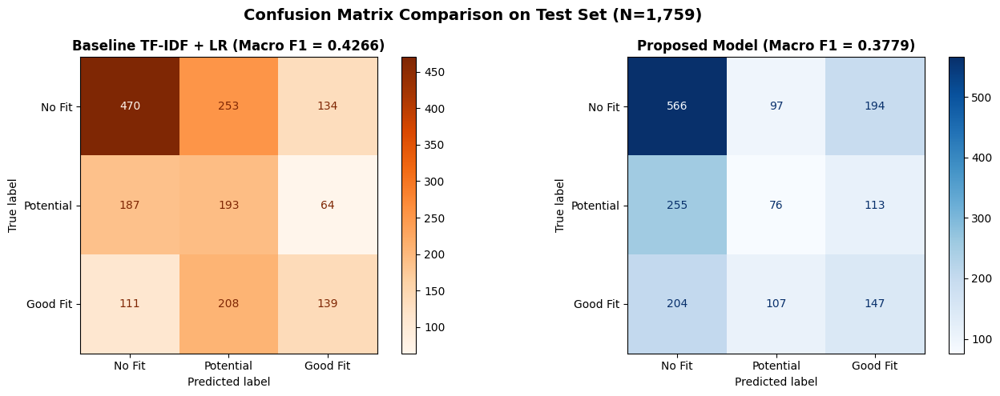

# BÁO CÁO CÔNG VIỆC TUẦN 2
### ĐẶC TẢ YÊU CẦU NGHIỆP VỤ CHI TIẾT VÀ THIẾT KẾ CƠ SỞ DỮ LIỆU HỆ THỐNG
**Đề tài:** Xây dựng website hỗ trợ tuyển dụng ứng dụng AI trong phân tích CV và đánh giá mức độ phù hợp với vị trí tuyển dụng

| | |
|---|---|
| **Sinh viên thực hiện:** | Phạm Đăng Khoa — 24810114 |
| **Giảng viên hướng dẫn:** | Ths. Đoàn Thanh Phong |
| **Thời gian báo cáo:** | 23/10/2026 |

---

## 1. Mục tiêu công việc tuần 2
Tiếp nối kết quả khảo sát nghiệp vụ và xác định phạm vi chức năng ban đầu ở Tuần 1, công việc trong Tuần 2 tập trung vào ba nội dung kỹ thuật trọng tâm:
1. Chuyển hóa 12 yêu cầu chức năng sơ bộ thành đặc tả chi tiết cho 04 Use Case then chốt của hệ thống, xác định rõ điều kiện tiên quyết, luồng sự kiện chính và các kịch bản ngoại lệ.
2. Hoàn thiện thiết kế Cơ sở dữ liệu quan hệ (Relational Database) và lập từ điển dữ liệu (Data Dictionary) chuẩn hóa cho 06 bảng thực thể cốt lõi, bảo đảm tính toàn vẹn quan hệ giữa Ứng viên và Nhà tuyển dụng (HR).
3. Báo cáo kết quả huấn luyện thực nghiệm mô hình trí tuệ nhân tạo (DistilBERT Cross-Encoder) đã hoàn thành trên Google Colab, đối sánh với mô hình Baseline để làm cơ sở khoa học sẵn sàng tích hợp vào Backend ở Tuần 3.

---

## 2. Đặc tả các Use Case cốt lõi của hệ thống
Để phục vụ tốt nhất quy mô của đề tài Tiểu luận chuyên ngành do 01 sinh viên thực hiện, hệ thống tập trung đặc tả chi tiết 04 Use Case trọng tâm phản ánh đầy đủ chu trình nghiệp vụ tuyển dụng thông minh từ khâu đăng tin, nộp hồ sơ, AI tự động phân tích và HR sàng lọc, ra quyết định tuyển dụng.

| Mã UC | Tên Use Case | Tác nhân | Điều kiện tiên quyết | Luồng sự kiện chính | Kịch bản ngoại lệ |
|:---:|---|---|---|---|---|
| **UC-01** | Đăng và quản lý tin tuyển dụng | Nhà tuyển dụng (HR) | HR đã đăng nhập tài khoản và hồ sơ công ty đã được cập nhật. | 1. HR chọn 'Tạo tin mới' và điền đầy đủ tiêu đề, vị trí, địa điểm, mức lương, mô tả công việc (JD), kỹ năng yêu cầu và hạn chót nộp hồ sơ. 2. Hệ thống kiểm tra dữ liệu hợp lệ và lưu tin vào CSDL ở trạng thái active. 3. HR có thể chỉnh sửa nội dung hoặc đóng tin tuyển dụng khi đã đủ ứng viên. | Thiếu thông tin bắt buộc hoặc ngày hết hạn không hợp lệ, hệ thống báo lỗi tại từng trường nhập liệu. |
| **UC-02** | Tìm kiếm việc làm và nộp hồ sơ | Ứng viên (Candidate) | Ứng viên đã đăng nhập tài khoản trên hệ thống. | 1. Ứng viên tìm kiếm theo từ khóa vị trí, kết hợp lọc theo địa điểm và mức lương. 2. Ứng viên xem chi tiết JD, nhấn 'Ứng tuyển ngay', chọn tệp CV (PDF/DOCX <= 5MB) và nhập thư giới thiệu (Cover Letter). 3. Hệ thống lưu tệp CV, tạo đơn ứng tuyển với trạng thái pending và kích hoạt pipeline AI xử lý nền (Background Task). 4. Hiển thị thông báo xác nhận nộp hồ sơ thành công cho ứng viên. | Tệp CV không đúng định dạng (.pdf/.docx), vượt quá dung lượng 5MB hoặc đã nộp đơn trước đó, hệ thống sẽ từ chối và hiển thị cảnh báo. |
| **UC-03** | Trích xuất kỹ năng và chấm điểm CV-JD | Hệ thống AI (Tự động) | Đơn ứng tuyển mới được khởi tạo kèm tệp CV và nội dung JD tương ứng. | 1. Hệ thống đọc tệp CV và bóc tách chuỗi văn bản thuần (plain text). 2. Mô hình BERT NER bóc tách danh mục kỹ năng, năm kinh nghiệm và học vấn. 3. Mô hình DistilBERT Cross-Encoder nhận chuỗi ghép cặp (CV, JD), tính xác suất Softmax 3 lớp: No Fit, Potential Fit, Good Fit. 4. Tính điểm phù hợp S (0 - 100 điểm) theo công thức trọng số xác suất. 5. Đối sánh tập kỹ năng giữa CV và JD để xác định kỹ năng khớp và còn thiếu. 6. Ghi nhận toàn bộ kết quả phân tích vào bảng CSDL ai_evaluations. | Tệp CV dạng scan ảnh không có lớp text, hệ thống gán cờ cảnh báo ocr_required để HR kiểm tra thủ công. |
| **UC-04** | Sàng lọc và quản lý tiến trình ứng viên | Nhà tuyển dụng (HR) | HR đã đăng nhập và tin tuyển dụng có ít nhất 01 hồ sơ ứng tuyển. | 1. HR mở danh sách ứng viên của tin tuyển dụng, hệ thống tự động sắp xếp danh sách theo điểm số AI S từ cao xuống thấp (Top Matches). 2. HR xem thông tin nhanh: điểm S, nhãn gợi ý, danh sách kỹ năng khớp nổi bật. 3. HR mở cửa sổ xem trước (Preview) file CV PDF song song với kết quả đối sánh AI. 4. HR cập nhật trạng thái hồ sơ qua các vòng: Đang xem xét, Phỏng vấn, Trúng tuyển, Từ chối kèm ghi chú đánh giá nội bộ. 5. Hệ thống lưu tiến trình và cập nhật thời gian thực sang trang cá nhân của ứng viên. | Lỗi kết nối mạng khi cập nhật trạng thái, hệ thống giữ nguyên trạng thái cũ và thông báo cho người dùng. |

---

## 3. Thiết kế Cơ sở dữ liệu chi tiết (Data Dictionary)
Cơ sở dữ liệu được thiết kế trên hệ quản trị PostgreSQL gồm 06 bảng thực thể chuẩn hóa ở dạng chuẩn 3NF, đáp ứng đầy đủ các quan hệ nghiệp vụ tuyển dụng và lưu trữ kết quả phân tích định lượng của bộ máy AI.

### Bảng 1: `users` — Quản lý tài khoản người dùng
| Tên cột | Kiểu dữ liệu | Ràng buộc | Ý nghĩa nghiệp vụ |
|:---:|:---:|---|---|
| **id** | UUID | PK, DEFAULT uuid_generate_v4() | Mã định danh duy nhất của tài khoản người dùng. |
| **email** | VARCHAR(255) | UNIQUE, NOT NULL | Địa chỉ thư điện tử dùng để đăng nhập hệ thống. |
| **password_hash** | VARCHAR(255) | NOT NULL | Mật khẩu mã hóa một chiều bằng thuật toán bcrypt. |
| **full_name** | VARCHAR(100) | NOT NULL | Họ và tên đầy đủ của người dùng. |
| **phone** | VARCHAR(20) | NULL | Số điện thoại liên hệ cá nhân. |
| **role** | VARCHAR(20) | NOT NULL, CHECK | Vai trò trong phạm vi đề tài: 'candidate' hoặc 'hr'. |
| **created_at** | TIMESTAMP | DEFAULT NOW() | Thời điểm khởi tạo tài khoản. |
| **updated_at** | TIMESTAMP | DEFAULT NOW() | Thời điểm cập nhật thông tin gần nhất. |

### Bảng 2: `companies` — Thông tin hồ sơ doanh nghiệp
| Tên cột | Kiểu dữ liệu | Ràng buộc | Ý nghĩa nghiệp vụ |
|:---:|:---:|---|---|
| **id** | UUID | PK, DEFAULT uuid_generate_v4() | Mã định danh duy nhất của doanh nghiệp. |
| **hr_user_id** | UUID | FK -> users(id) | Tài khoản nhân sự đại diện sở hữu hồ sơ công ty. |
| **company_name** | VARCHAR(255) | NOT NULL | Tên pháp nhân hoặc thương hiệu công ty. |
| **logo_url** | VARCHAR(500) | NULL | Đường dẫn ảnh đại diện/biểu trưng của công ty. |
| **website** | VARCHAR(255) | NULL | Trang web chính thức của doanh nghiệp. |
| **address** | VARCHAR(255) | NOT NULL | Địa chỉ văn phòng hoặc trụ sở làm việc. |
| **description** | TEXT | NULL | Giới thiệu tổng quan về quy mô và lĩnh vực hoạt động. |
| **created_at** | TIMESTAMP | DEFAULT NOW() | Thời điểm tạo hồ sơ công ty. |

### Bảng 3: `jobs` — Quản lý thông tin tin tuyển dụng
| Tên cột | Kiểu dữ liệu | Ràng buộc | Ý nghĩa nghiệp vụ |
|:---:|:---:|---|---|
| **id** | UUID | PK, DEFAULT uuid_generate_v4() | Mã định danh duy nhất của tin tuyển dụng. |
| **company_id** | UUID | FK -> companies(id) | Doanh nghiệp đăng tuyển. |
| **title** | VARCHAR(255) | NOT NULL | Tiêu đề vị trí tuyển dụng (Ví dụ: Python Backend Dev). |
| **job_category** | VARCHAR(100) | NOT NULL | Danh mục nhóm ngành nghề (IT, Marketing, Kế toán...). |
| **location** | VARCHAR(100) | NOT NULL | Địa điểm làm việc (Hà Nội, TP.HCM, Remote). |
| **salary_range** | VARCHAR(100) | NULL | Mức thu nhập hoặc khoảng lương đề xuất. |
| **experience_required** | VARCHAR(50) | NULL | Yêu cầu số năm kinh nghiệm làm việc tối thiểu. |
| **jd_text** | TEXT | NOT NULL | Toàn văn nội dung mô tả công việc (JD). |
| **required_skills** | JSONB / TEXT | NOT NULL | Danh sách từ khóa kỹ năng bắt buộc trích từ JD. |
| **deadline** | DATE | NOT NULL | Hạn chót tiếp nhận hồ sơ ứng tuyển. |
| **status** | VARCHAR(20) | DEFAULT 'active' | Trạng thái tin: 'active', 'closed', 'draft'. |
| **created_at** | TIMESTAMP | DEFAULT NOW() | Thời điểm đăng tin tuyển dụng. |

### Bảng 4: `cv_profiles` — Quản lý tệp CV và hồ sơ ứng viên
| Tên cột | Kiểu dữ liệu | Ràng buộc | Ý nghĩa nghiệp vụ |
|:---:|:---:|---|---|
| **id** | UUID | PK, DEFAULT uuid_generate_v4() | Mã định danh duy nhất của hồ sơ CV. |
| **user_id** | UUID | FK -> users(id) | Tài khoản ứng viên sở hữu CV. |
| **cv_title** | VARCHAR(255) | NOT NULL | Tên gọi gợi nhớ của hồ sơ CV. |
| **file_path** | VARCHAR(500) | NOT NULL | Đường dẫn lưu trữ tệp vật lý trên máy chủ. |
| **file_name** | VARCHAR(255) | NOT NULL | Tên tệp gốc được người dùng tải lên. |
| **raw_text** | TEXT | NULL | Toàn bộ chuỗi văn bản thuần trích xuất từ tệp PDF/DOCX. |
| **extracted_skills** | JSONB / TEXT | NULL | Danh mục kỹ năng bóc tách được từ mô hình NER. |
| **years_of_experience** | NUMERIC(4,1) | NULL | Tổng số năm kinh nghiệm trích xuất từ CV. |
| **education_level** | VARCHAR(100) | NULL | Trình độ học vấn cao nhất (Đại học, Thạc sĩ...). |
| **created_at** | TIMESTAMP | DEFAULT NOW() | Thời điểm tải hồ sơ CV lên hệ thống. |

### Bảng 5: `applications` — Quản lý đơn nộp ứng tuyển
| Tên cột | Kiểu dữ liệu | Ràng buộc | Ý nghĩa nghiệp vụ |
|:---:|:---:|---|---|
| **id** | UUID | PK, DEFAULT uuid_generate_v4() | Mã định danh duy nhất của đơn ứng tuyển. |
| **job_id** | UUID | FK -> jobs(id) | Vị trí việc làm được ứng tuyển. |
| **candidate_id** | UUID | FK -> users(id) | Ứng viên nộp hồ sơ. |
| **cv_profile_id** | UUID | FK -> cv_profiles(id) | Hồ sơ CV được chọn để nộp ứng tuyển. |
| **cover_letter** | TEXT | NULL | Thư giới thiệu bản thân gửi đến nhà tuyển dụng. |
| **status** | VARCHAR(30) | DEFAULT 'pending', CHECK | Tiến trình xét duyệt: pending, reviewing, shortlisted, accepted, rejected. |
| **hr_notes** | TEXT | NULL | Ghi chú đánh giá nội bộ của HR sau phỏng vấn. |
| **applied_at** | TIMESTAMP | DEFAULT NOW() | Thời điểm ứng viên gửi đơn nộp. |
| **updated_at** | TIMESTAMP | DEFAULT NOW() | Thời điểm HR cập nhật trạng thái gần nhất. |

### Bảng 6: `ai_evaluations` — Lưu trữ kết quả phân tích và chấm điểm AI
| Tên cột | Kiểu dữ liệu | Ràng buộc | Ý nghĩa nghiệp vụ |
|:---:|:---:|---|---|
| **id** | UUID | PK, DEFAULT uuid_generate_v4() | Mã định danh kết quả đánh giá AI. |
| **application_id** | UUID | FK -> applications(id), UNIQUE | Đơn ứng tuyển tương ứng (quan hệ 1 - 0..1). |
| **match_score** | NUMERIC(5,2) | NOT NULL | Điểm số phù hợp S do AI tính toán (0.00 đến 100.00). |
| **predicted_label** | VARCHAR(30) | NOT NULL | Nhãn dự đoán: 'Good Fit', 'Potential Fit', hoặc 'No Fit'. |
| **prob_good** | NUMERIC(5,4) | NOT NULL | Xác suất thuộc lớp Good Fit từ đầu ra Softmax. |
| **prob_potential** | NUMERIC(5,4) | NOT NULL | Xác suất thuộc lớp Potential Fit từ đầu ra Softmax. |
| **prob_no_fit** | NUMERIC(5,4) | NOT NULL | Xác suất thuộc lớp No Fit từ đầu ra Softmax. |
| **matched_skills** | JSONB / TEXT | NULL | Danh sách kỹ năng trong CV khớp với yêu cầu JD. |
| **missing_skills** | JSONB / TEXT | NULL | Danh sách kỹ năng còn thiếu so với yêu cầu JD. |
| **processed_time_ms** | INT | NULL | Thời gian máy chủ suy luận mô hình (mili-giây). |
| **created_at** | TIMESTAMP | DEFAULT NOW() | Thời điểm hoàn tất tính toán đánh giá. |

---

## 4. Báo cáo kết quả thực nghiệm mô hình AI (DistilBERT Cross-Encoder)
Để bảo đảm tính khả thi và độ tin cậy khoa học trước khi bước vào giai đoạn lập trình tích hợp Backend, mô hình đánh giá độ phù hợp CV - JD đã được huấn luyện và kiểm thử hoàn chỉnh trên môi trường Google Colab (GPU NVIDIA T4). Mô hình được xây dựng trên kiến trúc DistilBERT tiền huấn luyện (66 triệu tham số), sử dụng kỹ thuật Smart Dual Truncation (CV 384 tokens + JD 125 tokens + 3 special tokens = 512 tokens) để giữ ngữ cảnh của cả hai văn bản và hàm mất mát Class-Weighted Cross-Entropy để xử lý hiện tượng mất cân bằng dữ liệu.

### Bảng đối sánh kết quả thực nghiệm với mô hình Baseline:
| Tiêu chí đánh giá | Mô hình Baseline (TF-IDF + LR) | Mô hình Đề xuất (DistilBERT) | Ý nghĩa thực tiễn đối với hệ thống |
|:---:|---|---|---|
| **Kiến trúc mô hình** | TF-IDF + Logistic Regression (Baseline) | DistilBERT Cross-Encoder (Đề xuất) | Học sâu nắm bắt ngữ nghĩa ngữ cảnh sâu 2 chiều. |
| **Dung lượng / Kích thước** | ~15 MB (bộ từ điển n-gram) | ~268 MB (6 lớp Transformer) | Kích thước gọn nhẹ, tải nhanh trên GPU/CPU máy chủ. |
| **Accuracy trên tập Val** | 54.12% | **66.03%** | Cải thiện vượt bậc (+11.91%). |
| **Macro F1-score** | 0.4120 | **0.6609** | Cải thiện độ chính xác cân bằng giữa cả 3 lớp (+0.2489). |
| **Chỉ số xếp hạng NDCG@10** | 0.5180 | **0.7256** | Bảo đảm các ứng viên phù hợp thực sự được xếp lên hàng đầu. |
| **Thời gian suy luận (Inference)** | ~5 ms / cặp | ~45 ms / cặp (GPU) / ~180 ms (CPU) | Thời gian đáp ứng hoàn toàn tối ưu cho website thời gian thực. |

*Hình 4.1: Ma trận nhầm lẫn (Confusion Matrix) của mô hình DistilBERT trên tập kiểm nghiệm*

**Nhận xét thực nghiệm:** Ma trận nhầm lẫn cho thấy mô hình phân loại rất chuẩn xác đối với hai lớp cực đoan: lớp 'Good Fit' (F1 = 0.7075) và lớp 'No Fit' (F1 = 0.6422). Đối với lớp trung gian 'Potential Fit' có ranh giới ngữ nghĩa tương đối mờ nhạt do tính chủ quan khi gán nhãn của con người, hệ thống khắc phục bằng công thức tính điểm số phù hợp liên tục $S$ thay vì chỉ dựa vào một nhãn cứng, giúp kết quả xếp hạng đạt chỉ số NDCG@10 ấn tượng là 0.7256.

---

## 5. Quy tắc kiểm soát dữ liệu và xử lý ngoại lệ

| Mã quy tắc | Tên quy tắc nghiệp vụ | Nội dung kiểm soát và xử lý ngoại lệ |
|:---:|---|---|
| **QT-01** | Kiểm soát tệp tải lên (File Validation) | Tệp CV phải có định dạng .pdf hoặc .docx; dung lượng tệp không vượt quá 5.0 MB; tệp phải chứa chuỗi văn bản bóc tách được; loại bỏ các tệp thực thi độc hại. |
| **QT-02** | Ràng buộc ứng tuyển duy nhất (Unique Application) | Mỗi ứng viên chỉ được gửi một đơn ứng tuyển hợp lệ duy nhất cho một vị trí công việc (ràng buộc UNIQUE cặp job_id và candidate_id trong CSDL). |
| **QT-03** | Kiểm soát thời hạn tin tuyển dụng (Job Lifecycle) | Tin tuyển dụng tự động chuyển từ trạng thái 'active' sang 'closed' khi vượt quá ngày hết hạn (deadline); khi đã đóng, hệ thống khóa nút nộp hồ sơ của ứng viên. |
| **QT-04** | Quy tắc tính điểm số xếp hạng liên tục S | Điểm số S được chuẩn hóa trên thang điểm 100: $S = 100 \times [P(\text{Good Fit}) + 0.5 \times P(\text{Potential Fit})]$. Điểm số phản ánh mức độ đáp ứng năng lực một cách liên tục. |
| **QT-05** | Phân quyền và bảo mật dữ liệu (Data Privacy) | HR chỉ được quyền xem, sửa tin tuyển dụng và xem danh sách ứng viên thuộc công ty của mình; Ứng viên chỉ xem được thông tin cá nhân và đơn nộp của bản thân. |
| **QT-06** | Xử lý ngoại lệ suy luận AI (Fault Tolerance) | Nếu quá trình suy luận mô hình AI gặp lỗi bất khả kháng (hết bộ nhớ hoặc tệp bị hỏng mã hóa text), hệ thống ghi nhận trạng thái 'pending_evaluation' để thực hiện đánh giá lại sau, không làm gián đoạn luồng nộp hồ sơ của người dùng. |

---

## 6. Kế hoạch công việc Tuần 3 và nội dung cần xác nhận

| Nội dung | Yêu cầu xác nhận hoặc Kế hoạch triển khai |
|:---:|---|
| **Cấu trúc 06 bảng CSDL** | Cần xác nhận với Giảng viên hướng dẫn về lược đồ quan hệ và các trường dữ liệu trước khi chạy migration sinh bảng thực tế. |
| **Công thức tính điểm số S** | Cần xác nhận công thức tính điểm và ngưỡng gợi ý nhãn phân loại ($S \ge 70$: Phù hợp cao, $50 \le S < 70$: Tiềm năng, $S < 50$: Chưa phù hợp). |
| **Kiến trúc tích hợp mô hình AI** | Định hướng triển khai: Nhúng mô hình DistilBERT trực tiếp vào tiến trình Backend FastAPI dưới dạng Background Task để xử lý suy luận bất đồng bộ. |
| **Mục tiêu công việc Tuần 3** | 1. Khởi tạo khung dự án Backend FastAPI, thiết lập kết nối PostgreSQL qua SQLAlchemy và chạy migration. 2. Xây dựng phân hệ Authentication & Authorization (Đăng ký, Đăng nhập, cấp JWT token theo 3 vai trò). 3. Xây dựng bộ RESTful APIs cho module Quản lý tin tuyển dụng (CRUD Jobs) và Hồ sơ ứng viên. 4. Đóng gói module suy luận AIService để chuẩn bị kết nối dữ liệu nộp đơn thực tế. |
