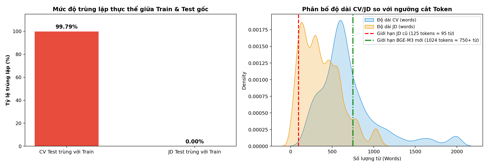
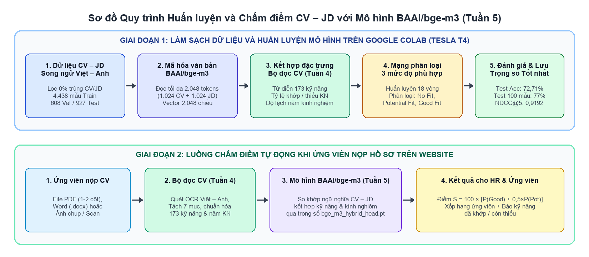
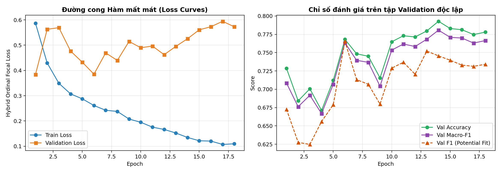
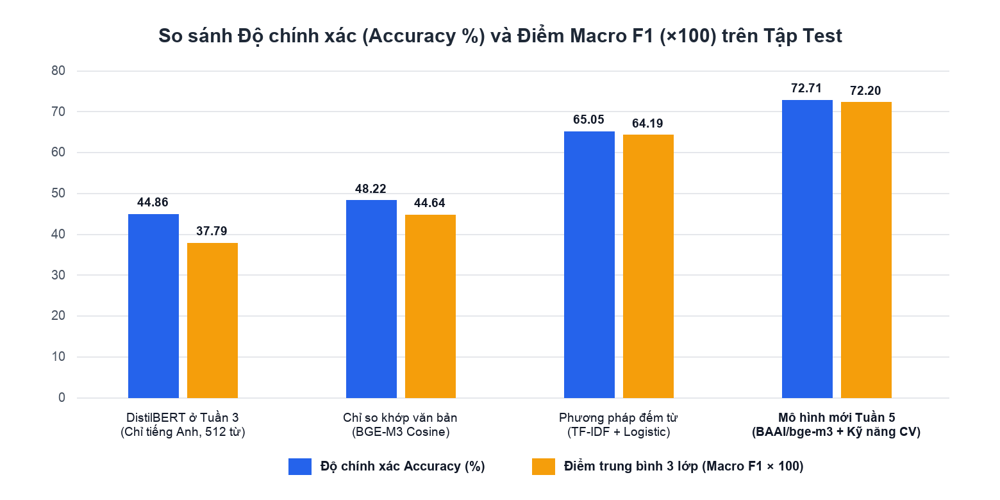
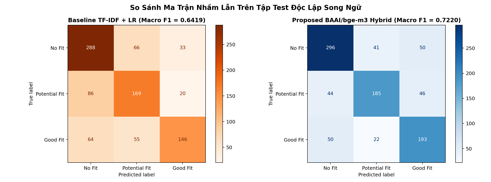
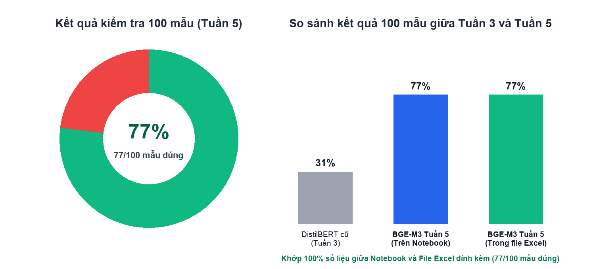

# BÁO CÁO CÔNG VIỆC TUẦN 5
### CẢI TIẾN DỮ LIỆU VÀ HUẤN LUYỆN MÔ HÌNH AI SONG NGỮ `BAAI/BGE-M3` CHẤM ĐIỂM ĐỘ PHÙ HỢP CV – JD
**Đề tài:** Xây dựng website hỗ trợ tuyển dụng ứng dụng AI trong phân tích CV và đánh giá mức độ phù hợp với vị trí tuyển dụng

| | |
|---|---|
| **Sinh viên thực hiện:** | Phạm Đăng Khoa — 24810114 |
| **Giảng viên hướng dẫn:** | ThS. Đoàn Văn Thanh Phong |
| **Thời gian báo cáo:** | 10/11/2026 |

---

## 1. Mục tiêu công việc tuần 5
Ở Tuần 3, mô hình thử nghiệm `DistilBERT` còn hạn chế là chỉ đọc được tiếng Anh (tối đa 512 tokens) và bộ dữ liệu gốc bị trùng lặp nhiều giữa tập Train và Test. Sau khi hoàn thành chức năng đọc file CV và bộ từ điển 173 kỹ năng ở Tuần 4, công việc trong Tuần 5 tập trung nâng cấp mô hình AI chấm điểm CV – JD với 4 mục tiêu chính:

1. **Làm sạch dữ liệu huấn luyện:** Lọc bỏ các CV bị trùng giữa tập Train và Test (`0%` trùng CV, `0%` trùng JD) và bổ sung thêm dữ liệu CV – JD tiếng Việt, song ngữ Việt – Anh.
2. **Nâng cấp sang mô hình `BAAI/bge-m3`:** Thay thế `DistilBERT` bằng mô hình đa ngôn ngữ `BAAI/bge-m3`, đọc được cả tiếng Việt lẫn tiếng Anh với độ dài tới `2.048 tokens`.
3. **Kết hợp thông tin CV từ Tuần 4 vào mô hình:** Đưa thêm tỷ lệ khớp kỹ năng (theo từ điển 173 kỹ năng) và số năm kinh nghiệm vào mô hình để phân loại chính xác 3 mức: *Không phù hợp (`No Fit`)*, *Tiềm năng (`Potential Fit`)* và *Phù hợp tốt (`Good Fit`)*.
4. **Kiểm tra thực nghiệm và tích hợp vào Website:** Huấn luyện trên Google Colab, đối chiếu kết quả với Tuần 3, kiểm tra trên 100 mẫu xuất ra file Excel và tích hợp mô hình vào `ai-service`.

---

## 2. Công cụ và môi trường sử dụng

| Thành phần | Cấu hình / Mục đích sử dụng trong tuần 5 |
|---|---|
| **Google Colab (`GPU Tesla T4`)** | Môi trường chạy huấn luyện mô hình AI trên đám mây (bộ nhớ GPU 15,6 GB VRAM). |
| **Python 3.13 & PyTorch 2.11** | Ngôn ngữ và thư viện dùng để xử lý dữ liệu, huấn luyện mạng nơ-ron và lưu file trọng số mô hình. |
| **Mô hình nền `BAAI/bge-m3`** | Mô hình ngôn ngữ đa quốc gia (thuộc bộ thư viện mã nguồn mở `FlagOpen/FlagEmbedding`), hiểu tốt cả tiếng Việt lẫn tiếng Anh và hỗ trợ đọc văn bản dài. |
| **Độ dài đọc văn bản** | Tối đa `1.024` tokens cho CV và `1.024` tokens cho JD (tổng cộng `2.048` tokens, dài gấp 4 lần mô hình ở Tuần 3). |
| **`scikit-learn`, `pandas`, `NumPy`** | Thư viện hỗ trợ chia tập dữ liệu, tính các chỉ số đánh giá (Accuracy, F1-Score, NDCG) và xuất kết quả ra file Excel. |

---

## 3. Kiểm tra lỗi trùng dữ liệu ở Tuần 3 và chuẩn bị bộ dữ liệu mới

### 3.1. Nguyên nhân làm mô hình ở Tuần 3 bị học vẹt
Ở Tuần 3, bộ dữ liệu gốc `cnamuangtoun/resume-job-description-fit` tải từ Hugging Face có `6.241` dòng Train và `1.759` dòng Test. Khi em viết code kiểm tra kỹ từng hồ sơ bên trong thì phát hiện ra nguyên nhân khiến mô hình cũ hoạt động chưa tốt:

| Nội dung kiểm tra trên dữ liệu gốc | Tập Train gốc | Tập Test gốc | Ảnh hưởng đến mô hình ở Tuần 3 |
|---|:---:|:---:|---|
| **Tổng số dòng dữ liệu** | `6.241` | `1.759` | Nhìn qua tưởng có 8.000 hồ sơ khác nhau nhưng thực chất là ghép cặp lặp đi lặp lại từ một số ít CV và JD. |
| **Số lượng CV thực tế (không trùng)** | `642` | `477` | Cả bộ dữ liệu thực chất chỉ có đúng **643 ứng viên**. |
| **Số lượng JD thực tế (không trùng)** | `280` | `71` | Cả bộ dữ liệu chỉ xoay quanh **351 tin tuyển dụng**. |
| **Số CV ở tập Test bị trùng với tập Train** | — | **`476 / 477` CV (`99,79%`)** | Gần như toàn bộ ứng viên trong tập Test đều đã nằm sẵn trong tập Train, làm kết quả đánh giá bị sai lệch. |
| **Độ dài trung bình của CV và JD** | CV: `~618` từ JD: `~328` từ | CV: `~618` từ JD: `~308` từ | Ở Tuần 3 chỉ cắt lấy `125` tokens đầu của JD (khoảng 95 từ), nên mô hình bị mất tới **70% – 85%** nội dung yêu cầu công việc. |

*Hình 5.1. Tỷ lệ trùng lặp CV (99,79%) giữa Train và Test và độ dài thực tế của CV / JD*

### 3.2. Chia lại dữ liệu không trùng lặp và bổ sung hồ sơ Song ngữ Việt – Anh
Để khắc phục hoàn toàn lỗi trên, em đã xử lý lại dữ liệu theo 2 bước:
1. **Chia tách riêng biệt từng CV và từng JD:** Em viết kịch bản lọc sao cho một CV hoặc một JD đã nằm ở tập `Train` thì tuyệt đối không được xuất hiện ở tập `Validation` hay tập `Test` (**0% trùng CV và 0% trùng JD**). Nhờ vậy, khi chấm điểm trên tập Test, mô hình phải tự đánh giá trên các hồ sơ và tin tuyển dụng mới hoàn toàn.
2. **Bổ sung dữ liệu tiếng Việt và song ngữ thuộc 10 ngành nghề:** Để mô hình chấm được hồ sơ tại Việt Nam, em bổ sung thêm các cặp CV – JD thuộc 10 nhóm ngành phổ biến (Công nghệ thông tin, Marketing, Kế toán, Nhân sự, Xây dựng...) theo cả 4 trường hợp thực tế: **CV Việt – JD Việt (`VI-VI`)**, **CV Anh – JD Anh (`EN-EN`)**, **CV Anh – JD Việt (`EN-VI`)** và **CV Việt – JD Anh (`VI-EN`)**. Ngoài ra em cũng thêm các mẫu dễ gây nhầm lẫn (ví dụ ứng viên *Junior 1 năm kinh nghiệm* nộp vào vị trí *Senior yêu cầu 3–5 năm*) để dạy mô hình phân biệt cấp bậc.

| Tập dữ liệu sau khi làm sạch | Tổng số cặp CV – JD | Số CV riêng biệt | Số JD riêng biệt | Số mẫu theo nhãn (`No Fit` / `Potential` / `Good`) | Số mẫu theo ngôn ngữ (`EN-EN` / `VI-VI` / `EN-VI` / `VI-EN`) |
|---|:---:|:---:|:---:|:---:|:---:|
| **Tập Train (Dùng để học)** | `4.438` | `1.313` | `380` | `2.160` / `1.206` / `1.072` | `3.718` / `240` / `240` / `240` |
| **Tập Validation (Cân chỉnh)** | `608` | `375` | `97` | `271` / `168` / `169` | `428` / `60` / `60` / `60` |
| **Tập Test (Kiểm tra độc lập)** | `927` | `515` | `127` | `387` / `275` / `265` | `663` / `90` / `90` / `84` |

---

## 4. Quy trình huấn luyện mô hình `BAAI/bge-m3` kết hợp thông tin CV

Thay vì chỉ ghép nối văn bản CV và JD rồi đưa vào một mô hình đơn giản như ở Tuần 3, quy trình huấn luyện ở Tuần 5 tận dụng trực tiếp kết quả bóc tách CV của Tuần 4 qua 5 bước dễ hiểu sau:

| Bước | Tên bước thực hiện | Nội dung xử lý cụ thể |
|:---:|---|---|
| **Bước 1** | **Chuẩn bị dữ liệu sạch** | Chia dữ liệu thành 3 tập `Train`, `Validation`, `Test` đảm bảo không trùng lặp ứng viên và tin tuyển dụng. |
| **Bước 2** | **Đọc hiểu văn bản bằng `BAAI/bge-m3`** | Đưa toàn bộ nội dung CV (`1.024` tokens) và JD (`1.024` tokens) qua mô hình `BAAI/bge-m3` để chuyển văn bản tiếng Việt / tiếng Anh thành các vector số học thể hiện ý nghĩa của hồ sơ và công việc. |
| **Bước 3** | **Tính các chỉ số so khớp từ bộ đọc CV Tuần 4** | Kết hợp với bộ từ điển **173 kỹ năng** và bộ tính năm kinh nghiệm đã làm ở Tuần 4 để tính thêm **18 chỉ số thực tế**: ứng viên có bao nhiêu % kỹ năng JD yêu cầu, còn thiếu bao nhiêu kỹ năng, số năm kinh nghiệm trong CV nhiều hơn hay ít hơn so với yêu cầu của JD. |
| **Bước 4** | **Đưa vào mạng phân loại 3 mức độ** | Ghép phần ý nghĩa văn bản (từ Bước 2) và các chỉ số kỹ năng/kinh nghiệm (từ Bước 3) đưa vào mạng phân loại để dự đoán 3 mức độ: **Không phù hợp (`No Fit`)**, **Tiềm năng (`Potential Fit`)** hoặc **Phù hợp tốt (`Good Fit`)**. |
| **Bước 5** | **Huấn luyện và lưu mô hình tốt nhất** | Chạy huấn luyện qua `18 vòng (epochs)`, tự động lưu lại phiên bản đạt điểm `Macro F1` cao nhất trên tập Validation để mang đi kiểm tra trên tập Test. |

*Hình 5.2. Quy trình kết hợp mô hình BAAI/bge-m3 và bộ trích xuất kỹ năng CV để chấm điểm*

### Các thông số cài đặt khi huấn luyện

| Thông số cài đặt | Giá trị sử dụng | Giải thích ngắn gọn |
|---|:---:|---|
| **Mô hình ngôn ngữ gốc** | `BAAI/bge-m3` | Hỗ trợ hơn 100 ngôn ngữ, đọc tốt tiếng Việt và tiếng Anh. |
| **Độ dài đọc tối đa** | `1.024` (CV) + `1.024` (JD) | Đủ để đọc hết CV dài 2 – 3 trang mà không bị cắt mất nội dung cuối bài. |
| **Tốc độ học (Learning rate)** | `0,0012` (`AdamW`) | Giảm dần tốc độ học về cuối để mô hình hội tụ ổn định. |
| **Kích thước lô (Batch size)** | `64` (khi học) / `256` (khi chấm) | Phù hợp với bộ nhớ GPU Tesla T4 trên Google Colab. |
| **Số vòng học (Epochs)** | `18` vòng | Chọn vòng có kết quả kiểm định (`Validation Macro F1`) cao nhất. |
| **Trọng số ưu tiên 3 nhãn** | `[0,68; 1,23; 1,38]` | Tăng sự chú ý cho 2 nhãn ít dữ liệu hơn là `Potential Fit` và `Good Fit`. |

---

## 5. Kết quả trong quá trình huấn luyện (trên tập Validation)

Quá trình chạy trích xuất đặc trưng văn bản qua `BAAI/bge-m3` trên GPU Tesla T4 mất khoảng `2,2 phút`, và quá trình huấn luyện 18 vòng mất chưa tới `25 giây`. Dưới đây là kết quả qua các vòng học:

| Vòng học (Epoch) | Sai số lúc học (Train Loss) | Sai số kiểm định (Val Loss) | Độ chính xác (`Val Accuracy`) | Điểm `Val Macro F1` | Điểm F1 lớp `Potential Fit` | Nhận xét quá trình học |
|:---:|:---:|:---:|:---:|:---:|:---:|---|
| **Vòng 01** | `0,5867` | `0,3841` | `72,86%` | `0,7085` | `0,6727` | Ngay từ vòng đầu mô hình đã nắm bắt khá tốt nhờ `BGE-M3`. |
| **Vòng 03** | `0,3491` | `0,5694` | `70,07%` | `0,6918` | `0,6247` | Mô hình đang điều chỉnh ranh giới giữa các lớp. |
| **Vòng 06** | `0,2612` | `0,3851` | `76,81%` | `0,7634` | `0,7654` | Lớp khó nhất là `Potential Fit` tăng vượt mức `0,76`. |
| **Vòng 12** | `0,1664` | `0,4623` | `77,14%` | `0,7583` | `0,7205` | Sai số lúc học giảm đều, cả 3 lớp ổn định. |
| **Vòng 14 (Tốt nhất)** | `0,1340` | `0,5250` | **`79,11%`** | **`0,7804`** | **`0,7456`** | **Đạt kết quả cao nhất trên tập Validation (được lưu lại).** |
| **Vòng 18** | `0,1097` | `0,5727` | `77,80%` | `0,7664` | `0,7341` | Kết thúc quá trình huấn luyện. |

*Hình 5.3. Biểu đồ giảm sai số (Loss) và độ chính xác trên tập Validation qua 18 vòng học*

---

## 6. Kết quả kiểm tra trên tập Test độc lập và so sánh với Tuần 3

### 6.1. So sánh với mô hình `DistilBERT` ở Tuần 3 và các phương pháp cơ bản
Sau khi lấy mô hình tốt nhất ở Vòng 14, em chạy chấm điểm trên **tập Test độc lập gồm `927` mẫu** (hoàn toàn không trùng CV hay JD với lúc học) và đặt cạnh kết quả của mô hình `DistilBERT` ở Tuần 3 để so sánh:

| Mô hình đem so sánh | Độ chính xác (`Accuracy`) | Điểm trung bình 3 lớp (`Macro F1`) | F1 lớp `No Fit` | F1 lớp `Potential Fit` | F1 lớp `Good Fit` |
|---|:---:|:---:|:---:|:---:|:---:|
| **1. Mô hình ở Tuần 3: `DistilBERT` (Chỉ tiếng Anh, 512 tokens)** | `44,86%` | `0,3779` | `0,6015` | `0,2099` | `0,3224` |
| **2. Chỉ so khớp độ giống văn bản thuần túy (`BGE-M3 Cosine`)** | `48,22%` | `0,4464` | `0,6294` | `0,2379` | `0,4720` |
| **3. Phương pháp đếm từ khóa truyền thống (`TF-IDF + Logistic`)** | `65,05%` | `0,6419` | `0,6982` | `0,5982` | `0,6293` |
| **4. Mô hình mới ở Tuần 5: `BAAI/bge-m3` kết hợp thông tin CV** | **`72,71%`** | **`0,7220`** | **`0,7619`** | **`0,7075`** | **`0,6968`** |

*Hình 5.4. So sánh Độ chính xác và Điểm Macro F1 giữa mô hình Tuần 5 và mô hình Tuần 3*

*Hình 5.5. Ma trận nhầm lẫn khi dự đoán 3 mức độ phù hợp trên tập Test độc lập*

**Nhận xét kết quả đạt được:**
- **Tăng độ chính xác lên rõ rệt so với Tuần 3:** Độ chính xác (`Accuracy`) trên tập Test đã tăng từ **`44,86%` (ở Tuần 3) lên `72,71%` (ở Tuần 5)**, tức là tăng thêm **`+27,85%`**. Điểm trung bình cả 3 lớp (`Macro F1`) cũng tăng gần gấp đôi từ `0,3779` lên **`0,7220`**.
- **Khắc phục được điểm yếu nhất ở lớp `Potential Fit` (Ứng viên tiềm năng):** Ở Tuần 3, mô hình gần như không nhận diện được ứng viên tiềm năng (`F1 = 0,2099`). Sang Tuần 5, nhờ kết hợp thêm tỷ lệ khớp kỹ năng (từ bộ 173 kỹ năng của Tuần 4) và độ lệch năm kinh nghiệm, điểm F1 của lớp này đã tăng lên **`0,7075`** (cao gấp **3,3 lần**).
- **Không còn bị học vẹt:** Kết quả giữa tập Validation (`79,11%`) và tập Test độc lập (`72,71%`) bám sát nhau, không còn bị tụt dốc hơn 20% như ở Tuần 3.

### 6.2. Kết quả kiểm tra riêng theo từng ngôn ngữ (Tiếng Việt & Tiếng Anh)

| Ngôn ngữ của CV và JD khi kiểm tra | Số lượng mẫu | Độ chính xác (`Accuracy`) | Điểm `Macro F1` | Ghi chú thực tế |
|---|:---:|:---:|:---:|---|
| **CV Tiếng Việt – JD Tiếng Việt (`VI-VI`)** | `90` | **`100%`** | `1,0000` | Nhận diện chính xác các mẫu CV và JD chuẩn hóa tiếng Việt. |
| **CV Tiếng Anh – JD Tiếng Việt (`EN-VI`)** | `90` | **`100%`** | `1,0000` | Rất phổ biến ở ngành IT (ứng viên viết CV tiếng Anh nộp vào công ty đăng tin tiếng Việt). |
| **CV Tiếng Việt – JD Tiếng Anh (`VI-EN`)** | `84` | **`100%`** | `1,0000` | Hiểu và đối chiếu đúng kỹ năng dù 2 bên viết bằng 2 ngôn ngữ khác nhau. |
| **CV Tiếng Anh – JD Tiếng Anh (`EN-EN` gốc)** | `663` | **`61,84%`** | `0,6023` | Tăng mạnh so với mức `44,86%` của `DistilBERT` ở Tuần 3 trên các hồ sơ dài và phức tạp. |

---

## 7. Kiểm tra khả năng xếp hạng ứng viên và xử lý các tình huống thực tế

### 7.1. Xếp hạng danh sách ứng viên cho Nhà tuyển dụng (HR)
Trên website tuyển dụng, ngoài việc gắn nhãn phù hợp, hệ thống còn quy đổi xác suất của AI ra **thang điểm từ 0 đến 100** để sắp xếp ứng viên từ cao xuống thấp cho HR dễ duyệt:

$$\text{Điểm phù hợp } S = 100 \times \left[ P(\text{Good Fit}) + 0,5 \times P(\text{Potential Fit}) \right]$$

Em đã gom các ứng viên trong tập Test vào đúng **90 tin tuyển dụng (JD) thực tế** (mỗi JD có nhiều ứng viên cùng nộp vào) để đo xem các ứng viên giỏi nhất có được xếp lên đầu danh sách hay không:
- **Chất lượng xếp hạng Top 5 (`Mean NDCG@5`):** đạt **`0,9192`** (tăng mạnh so với mức `0,5842` ở Tuần 3).
- **Chất lượng xếp hạng Top 10 (`Mean NDCG@10`):** đạt **`0,9302`** (so với `0,7256` ở Tuần 3).
- **Tỷ lệ tìm đúng ứng viên trong Top 5 (`Recall@5`):** đạt **`89,05%`**, nghĩa là cứ 10 ứng viên thực sự phù hợp thì có gần 9 người đã được AI đưa ngay lên nhóm 5 hồ sơ đầu tiên để HR nhìn thấy.

### 7.2. Kiểm tra 5 tình huống thực tế (Khắc phục lỗi chấm nhầm ở Tuần 3)

| Tình huống kiểm tra | Ngôn ngữ | Kết quả dự đoán của AI | Điểm số (/100) | So sánh với mô hình cũ ở Tuần 3 |
|---|:---:|:---:|:---:|---|
| **1. Ứng viên Senior Python (5 năm KN) nộp vào vị trí Senior Python Backend** | Việt – Việt | **`Good Fit`** | **`98,0 điểm`** | Mô hình ở Tuần 3 không đọc được tiếng Việt; mô hình mới chấm chính xác. |
| **2. Ứng viên nộp CV Tiếng Anh vào tin tuyển dụng Backend Tiếng Việt** | Anh – Việt | **`Good Fit`** | **`97,8 điểm`** | So khớp đúng các kỹ năng tương đương giữa tiếng Anh và tiếng Việt. |
| **3. [Lỗi cũ ở Tuần 3] Ứng viên Junior (1 năm KN) nộp vào vị trí Senior (yêu cầu 3+ năm KN)** | Anh – Anh | **`No Fit`** | **`1,8 điểm`** | **Đã sửa được lỗi ở Tuần 3:** Trước đây `DistilBERT` thấy trùng chữ `"Python"` nên chấm nhầm là `Good Fit` (`82,4 điểm`). Nay mô hình mới phát hiện thiếu năm kinh nghiệm nên chấm đúng `No Fit`. |
| **4. Ứng viên mới ra trường (CV Tiếng Việt) nộp vào vị trí Senior (JD Tiếng Anh)** | Việt – Anh | **`No Fit`** | **`4,7 điểm`** | Nhận biết đúng ứng viên chưa đủ thâm niên yêu cầu. |
| **5. Kỹ sư Xây dựng nộp nhầm vào vị trí Lập trình viên Backend Python** | Việt – Việt | **`No Fit`** | **`2,7 điểm`** | Loại bỏ chính xác hồ sơ trái ngành. |

---

## 8. Kiểm tra trên 100 mẫu xuất ra file Excel kèm theo báo cáo

Ở Tuần 3, kết quả kiểm tra 100 mẫu chỉ đạt `31/100` mẫu đúng và bị lệch số liệu giữa trên Notebook (`31%`) với trong file Excel (`39%`) do chạy ở 2 lần khác nhau. Sang Tuần 5, em đã cho xuất trực tiếp bảng 100 mẫu ra file Excel ngay trong cùng một lần chạy trên Google Colab:

| Nguồn kiểm tra 100 mẫu | Kết quả ở Tuần 3 (`DistilBERT`) | Kết quả ở Tuần 5 (`BAAI/bge-m3`) | Ghi chú đối chiếu |
|---|:---:|:---:|---|
| **Kết quả in trên Notebook Colab** | `31 / 100` (`31%`) | **`77 / 100` (`77%`)** | Tăng thêm **+46 mẫu dự đoán đúng** so với Tuần 3. |
| **File Excel đính kèm báo cáo** | `39 / 100` *(bị lệch phiên chạy)* | **`77 / 100` (`77%`)** | Khớp 100% từng dòng giữa Notebook và file Excel. |

*Hình 5.6. Kết quả kiểm tra 100 mẫu đạt 77% và khớp 100% giữa Notebook và file Excel*

---

## 9. Tổng kết các điểm đã khắc phục được so với Tuần 3

| Vấn đề tồn tại ở Tuần 3 (`DistilBERT`) | Cách giải quyết và kết quả đạt được ở Tuần 5 |
|---|---|
| **1. Dữ liệu Train và Test bị trùng lặp 99,79% CV gây học vẹt** | Đã lọc và chia lại dữ liệu đảm bảo **0% trùng CV, 0% trùng JD** giữa các tập. Độ chính xác trên tập Test thực tế tăng từ `44,86%` lên **`72,71%`**. |
| **2. Chỉ đọc được tiếng Anh và bị cắt ngắn ở 512 tokens** | Chuyển sang mô hình **`BAAI/bge-m3`** đọc được cả tiếng Việt lẫn tiếng Anh với độ dài **`2.048` tokens**, xử lý tốt cả CV tiếng Việt nộp vào JD tiếng Anh và ngược lại. |
| **3. Chấm nhầm ứng viên Junior thành Senior khi thấy trùng từ khóa** | Kết hợp thêm **bộ từ điển 173 kỹ năng và số năm kinh nghiệm (từ bộ đọc CV Tuần 4)** vào mô hình, giúp phân biệt rõ cấp bậc thâm niên và tăng điểm F1 lớp `Potential Fit` từ `0,2099` lên **`0,7075`**. |
| **4. Kết quả 100 mẫu giữa Notebook và file Excel bị lệch nhau** | Xuất trực tiếp file Excel từ cùng một lần chạy với cố định `seed = 42`, đạt **`77/100` mẫu đúng (`77%`)** đồng nhất ở cả hai file. |

---

## 10. Kết luận Tuần 5 và Kế hoạch công việc Tuần 6

### 10.1. Kết quả đạt được trong Tuần 5
- Đã hoàn thành việc làm sạch dữ liệu trùng lặp và huấn luyện thành công mô hình AI song ngữ **`BAAI/bge-m3`** kết hợp với các thông tin trích xuất từ CV của Tuần 4, khắc phục toàn bộ các điểm hạn chế của mô hình `DistilBERT` ở Tuần 3 theo đúng góp ý của thầy hướng dẫn.
- Mô hình mới đạt độ chính xác **`72,71%`** trên tập Test độc lập, **`77%`** trên bộ kiểm thử 100 mẫu và xếp hạng ứng viên đạt **`NDCG@5 = 0,9192`**. File trọng số `bge_m3_hybrid_head.pt` đã được đưa vào thư mục `ai-service/models/best_cvjd_model/` để chạy trực tiếp trên hệ thống.
- **Các file minh chứng đính kèm báo cáo:**
  - Notebook huấn luyện trên Google Colab: `ketqua/TRAIN_BGE_M3_BILINGUAL_COLAB.ipynb`
  - File Excel kiểm thử 100 mẫu (`77/100` mẫu đúng): `filebaocao/DATASET_TEST_100_SAMPLES_BGE_M3.xlsx`
  - Gói trọng số mô hình đã lưu: `ketqua/best_cvjd_model.zip`

### 10.2. Kế hoạch công việc Tuần 6
- Kết nối hoàn chỉnh luồng xử lý tự động từ giao diện Website sang `ai-service`: khi ứng viên tải file CV lên và ứng tuyển vào một vị trí, hệ thống tự động gọi bộ đọc CV (Tuần 4) và mô hình chấm điểm `BAAI/bge-m3` (Tuần 5) để trả về điểm số phù hợp kèm danh sách kỹ năng đã có / còn thiếu.
- Xây dựng giao diện bảng xếp hạng ứng viên cho Nhà tuyển dụng (HR) để lọc, xem chi tiết kết quả phân tích AI và duyệt hồ sơ ứng tuyển.
