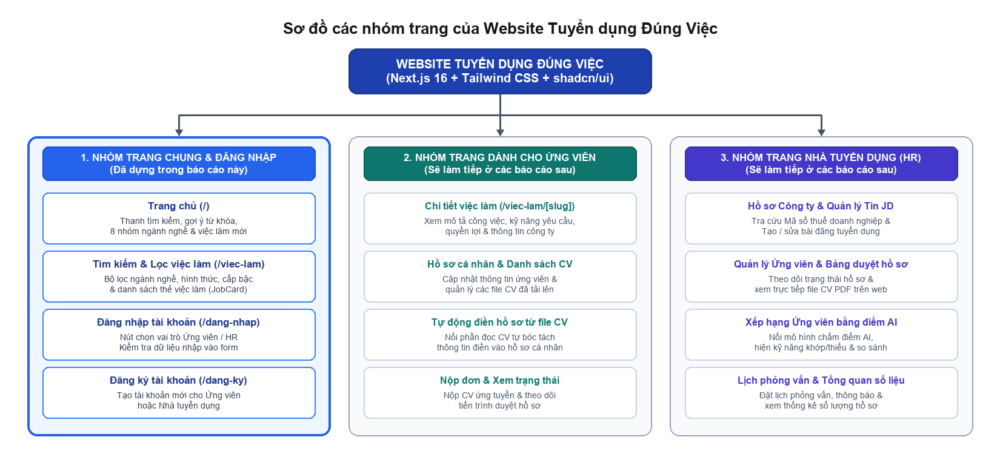
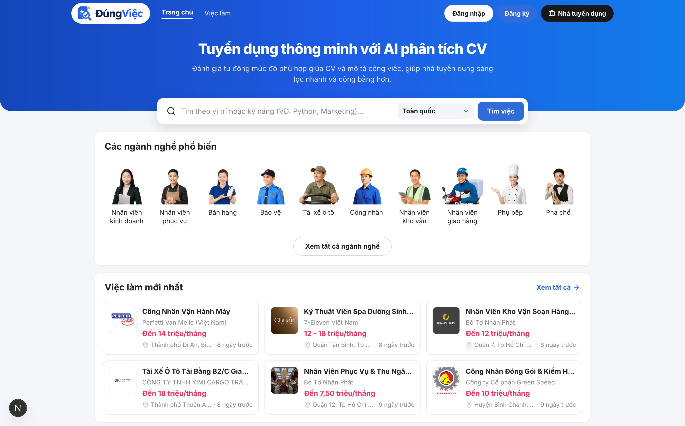
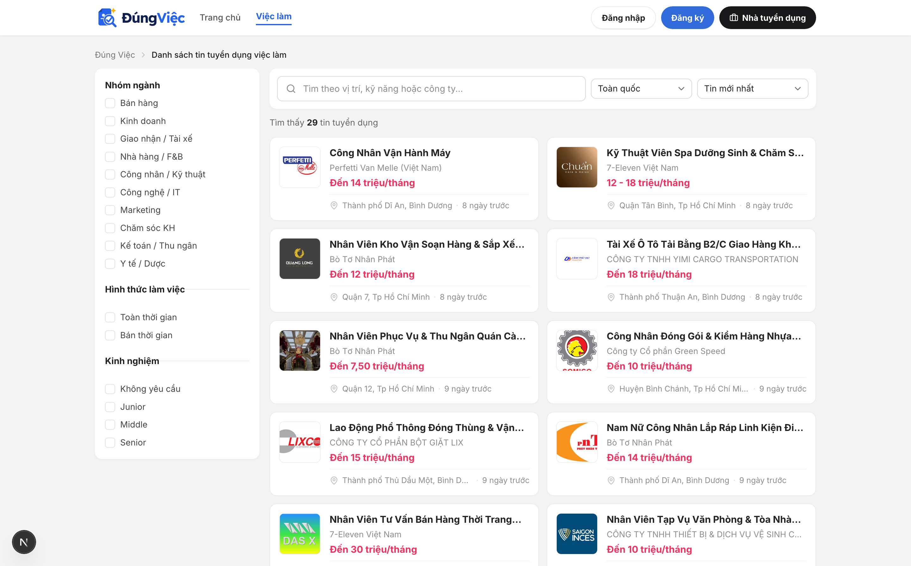
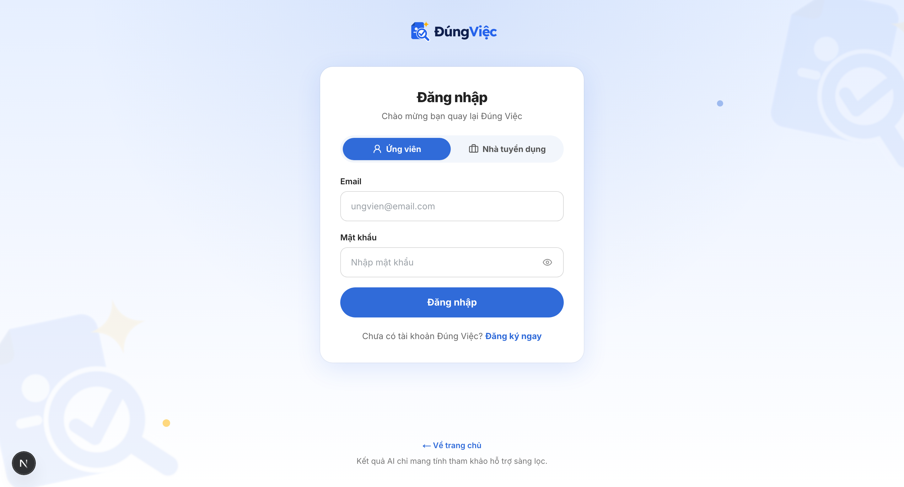
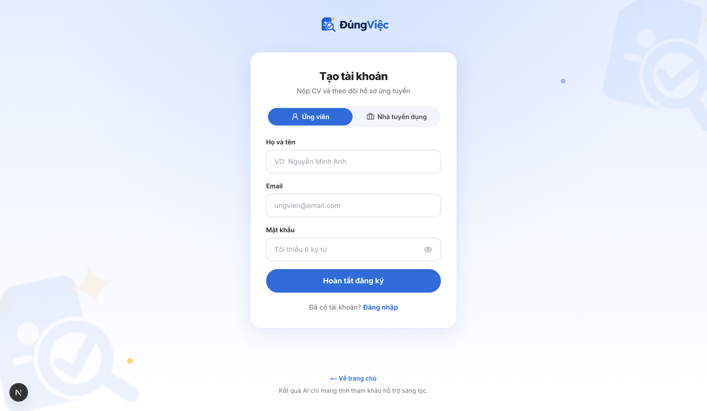

# BÁO CÁO CÔNG VIỆC TUẦN 6
## THIẾT KẾ GIAO DIỆN (UI/UX) VÀ DỰNG CÁC MÀN HÌNH CƠ BẢN CỦA WEBSITE TUYỂN DỤNG

- **Đề tài:** Xây dựng website hỗ trợ tuyển dụng ứng dụng AI trong phân tích CV và đánh giá mức độ phù hợp với vị trí tuyển dụng
- **Sinh viên thực hiện:** Phạm Đăng Khoa - 24810114
- **Giảng viên hướng dẫn:** ThS. Đoàn Văn Thanh Phong
- **Thời gian báo cáo:** 11/11/2026

---

## 1. Mục tiêu công việc tuần 6

Ở tuần 4 và tuần 5 em đã làm xong phần đọc file CV và huấn luyện mô hình chấm điểm `BAAI/bge-m3` ở phía Backend. Sang tuần 6 này, em bắt đầu chuyển sang làm phần giao diện Website (*Đúng Việc*). Vì phần giao diện của cả hệ thống khá nhiều màn hình nên tuần này em chưa nối AI vội mà tập trung thiết kế bố cục UI/UX và dựng trước các trang cơ bản với 3 việc chính:

1. Vẽ sơ đồ tổng thể các trang của website để xác định rõ các nhóm màn hình cần làm.
2. Chọn bảng màu, phông chữ tiếng Việt và tạo sẵn các thành phần dùng chung (thanh menu, nút bấm, ô nhập liệu, thẻ công việc) bằng `Tailwind CSS` và `shadcn/ui`.
3. Dựng trước 4 màn hình cơ bản dành cho người dùng khi truy cập vào web: **Trang chủ (`/`)**, **Trang tìm kiếm việc làm (`/viec-lam`)**, **Trang Đăng nhập (`/dang-nhap`)** và **Trang Đăng ký (`/dang-ky`)**.

---

## 2. Công cụ làm giao diện và quy định màu sắc, phông chữ

### 2.1. Các thư viện Frontend em sử dụng

| Thành phần | Công nghệ sử dụng | Mục đích sử dụng trong đồ án |
|---|---|---|
| **Framework chính** | `Next.js 16` & `React 19` | Chia thư mục các trang rõ ràng theo đường dẫn (`src/app/`), tốc độ chuyển trang nhanh. |
| **Ngôn ngữ** | `TypeScript` | Kiểm tra kiểu dữ liệu của các biến truyền vào giao diện để ít bị lỗi vặt khi chạy. |
| **Thư viện CSS & UI** | `Tailwind CSS` & `shadcn/ui` | Hỗ trợ căn chỉnh bố cục nhanh và có sẵn các mẫu nút bấm, hộp chọn, bảng biểu đồng bộ. |
| **Phông chữ & Icon** | `Lexend`, `Inter` & `Lucide Icons` | Hiển thị tiếng Việt rõ dấu, không bị lỗi font trên trình duyệt. |

### 2.2. Bảng màu và phông chữ thống nhất trên web

Để các trang có cùng một tông màu nhìn giống các web tuyển dụng thực tế, em cấu hình cố định mã màu và font chữ trong file `globals.css` như sau:

| Thành phần hiển thị | Mã màu / Phông chữ | Cách dùng trên trang web |
|---|---|---|
| **Màu chính (Xanh dương)** | `#306BD9` / `#2563EB` | Dùng cho logo *Đúng Việc*, nút bấm chính (*Tìm kiếm, Đăng nhập, Đăng ký*) và viền ô đang chọn. |
| **Màu nền trang** | `#F4F6FA` & `#FFFFFF` | Nền web dùng màu xám nhạt `#F4F6FA` để các thẻ việc làm màu trắng `#FFFFFF` nổi lên dễ nhìn hơn. |
| **Màu chữ** | `#18181B` & `#6B7280` | Tên công việc dùng chữ đen đậm `#18181B`, các thông tin phụ như tên công ty, địa điểm dùng màu xám `#6B7280`. |
| **Màu nhấn thông tin** | `#059669` (Xanh lá) & `#EF4444` (Đỏ) | Màu xanh lá dùng để viết mức lương trên thẻ việc làm; màu đỏ dùng để báo lỗi khi nhập thiếu thông tin. |
| **Phông chữ** | `Lexend` & `Inter` | Tiêu đề lớn dùng font `Lexend` in đậm; phần chữ nội dung và ô nhập liệu dùng font `Inter`. |

---

## 3. Sơ đồ các trang của Website và cách bố trí giao diện (UX)

Em chia toàn bộ website thành 3 nhóm trang chính: **(1) Nhóm trang chung và đăng nhập**, **(2) Nhóm trang dành cho Ứng viên**, và **(3) Nhóm trang dành cho Nhà tuyển dụng (HR)**. Trong tuần 6 này em hoàn thiện trước Nhóm 1, còn các màn hình chi tiết của Ứng viên, Nhà tuyển dụng và phần nối AI em sẽ làm tiếp trong các báo cáo tiếp theo.

Khi thiết kế các trang ở tuần 6, em bố trí theo hướng đơn giản để người dùng dễ thao tác:
- Ngay khi mở Trang chủ (`/`) là thấy thanh tìm kiếm theo tên việc làm và tỉnh thành ở giữa màn hình, kèm theo các từ khóa gợi ý bên dưới để bấm chọn nhanh.
- Ở trang tìm việc (`/viec-lam`), em đặt bộ lọc (ngành nghề, hình thức làm việc, cấp bậc) cố định ở cột bên trái, còn danh sách việc làm nằm ở cột bên phải để khi tích lọc là thấy danh sách bên phải cập nhật ngay.
- Ở trang Đăng nhập (`/dang-nhap`) và Đăng ký (`/dang-ky`), em làm nút chuyển qua lại giữa 2 vai trò *Ứng viên* và *Nhà tuyển dụng* ngay trên cùng một form thay vì phải tách ra 2 trang đăng nhập riêng.

*Hình 6.1. Sơ đồ các nhóm trang của Website Đúng Việc và phần giao diện thực hiện trong Tuần 6.*

---

## 4. Kết quả các màn hình giao diện đã dựng trong Tuần 6

Dưới đây là 4 màn hình cơ bản em đã code xong và chạy thực tế trên trình duyệt trong tuần này:

### 4.1. Màn hình Trang chủ (`/`)

Màn hình Trang chủ (`/`) gồm các phần chính:
- **Thanh menu trên cùng (`Header`):** Có logo *Đúng Việc*, các mục *Tìm việc làm, Việc làm IT, Việc làm Marketing, Công ty* và các nút *Đăng nhập, Đăng ký, Nhà tuyển dụng*.
- **Khung tìm kiếm ở đầu trang:** Cho phép gõ từ khóa công việc, chọn tỉnh/thành phố và có các nút từ khóa gợi ý bên dưới (*ReactJS, Node.js, Python AI, Marketing...*).
- **Mục danh mục ngành nghề:** Chia thành 8 ô ngành nghề phổ biến kèm số lượng công việc đang tuyển.
- **Mục việc làm mới nhất:** Hiển thị danh sách các thẻ việc làm (`JobCard`) chia làm 3 cột, mỗi thẻ hiện tên công việc, tên công ty, mức lương màu xanh lá, địa điểm và các thẻ kỹ năng cần có.

*Hình 6.2. Giao diện màn hình Trang chủ (`/`).*

### 4.2. Màn hình Tìm kiếm và Lọc việc làm (`/viec-lam`)

Khi bấm vào mục *Tìm việc làm*, web chuyển sang màn hình danh sách việc làm (`/viec-lam`) gồm:
- **Thanh tìm kiếm phía trên:** Gõ từ khóa công việc/kỹ năng và lọc theo tỉnh thành.
- **Cột bộ lọc bên trái:** Cho phép tích lọc theo **Danh mục ngành nghề**, **Hình thức làm việc** (*Toàn thời gian, Bán thời gian, Làm từ xa, Thực tập*) và **Cấp bậc kinh nghiệm** (*Thực tập sinh, Mới tốt nghiệp, Junior, Middle, Senior, Trưởng nhóm*).
- **Danh sách việc làm bên phải:** Báo tổng số việc làm tìm được (ví dụ: *Tìm thấy 29 việc làm phù hợp*), nút chọn sắp xếp và lưới các thẻ công việc.

*Hình 6.3. Giao diện màn hình Tìm kiếm và Lọc danh sách việc làm (`/viec-lam`).*

### 4.3. Màn hình Đăng nhập (`/dang-nhap`) và Đăng ký (`/dang-ky`)

Hai màn hình Đăng nhập và Đăng ký được chia làm 2 cột (cột trái là khung giới thiệu màu xanh `#306BD9`, cột phải là form nhập thông tin):
- **Màn hình Đăng nhập (`/dang-nhap`):** Có nút chọn vai trò **Ứng viên** hoặc **Nhà tuyển dụng**, ô nhập *Email*, *Mật khẩu* (có nút ẩn/hiện mật khẩu) và báo lỗi nếu bỏ trống hoặc nhập sai định dạng.
- **Màn hình Đăng ký (`/dang-ky`):** Cho phép chọn tạo tài khoản cho *Ứng viên* hoặc *Nhà tuyển dụng*, nhập *Họ và tên*, *Email*, *Mật khẩu*, *Xác nhận mật khẩu* trước khi gửi đăng ký.

*Hình 6.4. Giao diện màn hình Đăng nhập tài khoản (`/dang-nhap`).*

*Hình 6.5. Giao diện màn hình Đăng ký tài khoản mới (`/dang-ky`).*

Trong các báo cáo tiếp theo, em sẽ làm tiếp các màn hình còn lại của phía Ứng viên và Nhà tuyển dụng, sau đó ghép nối dần phần đọc CV và chấm điểm AI đã làm ở các tuần trước vào giao diện web.
